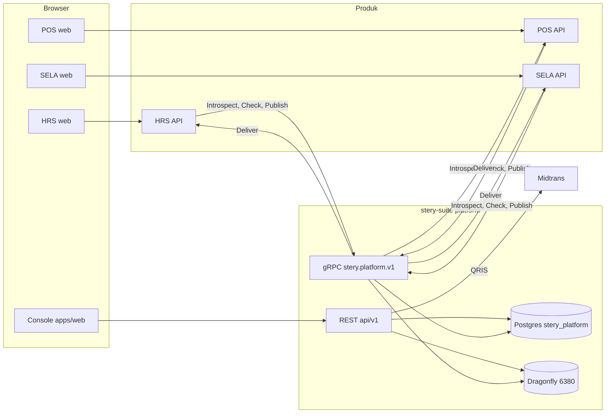
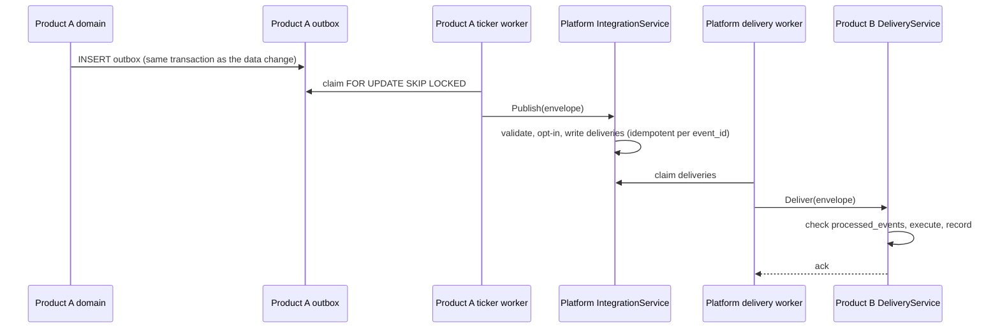
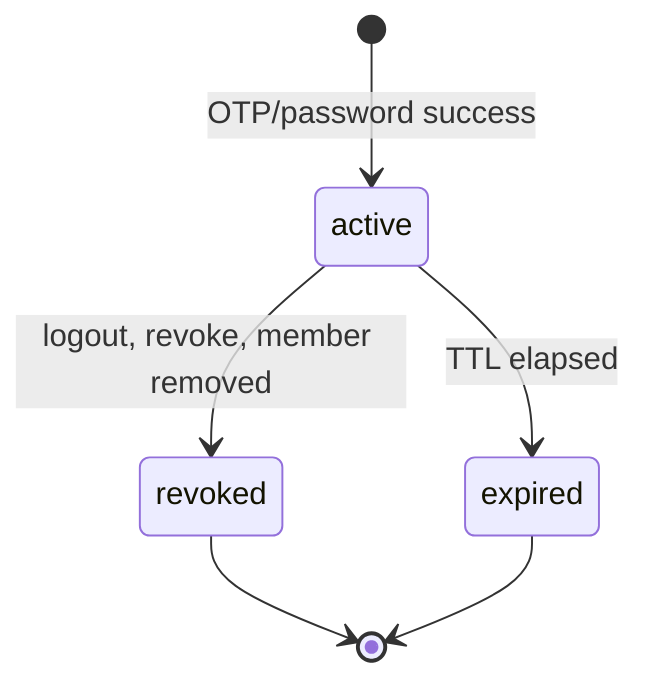
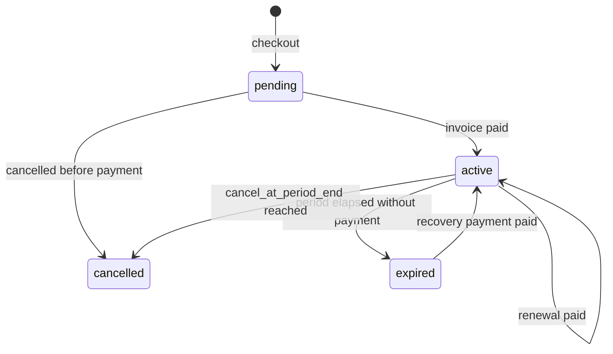
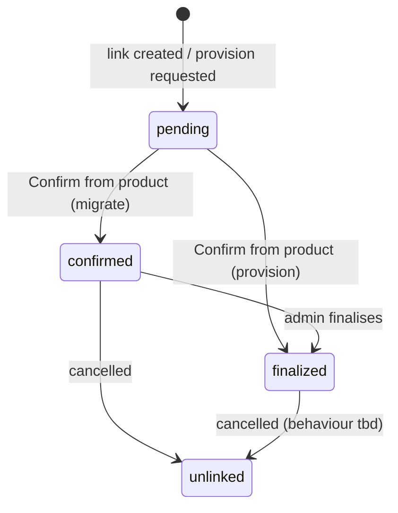
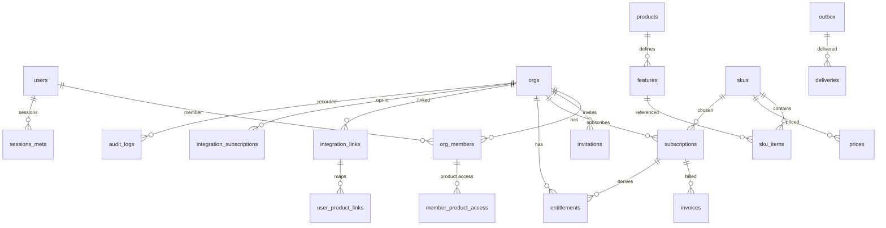
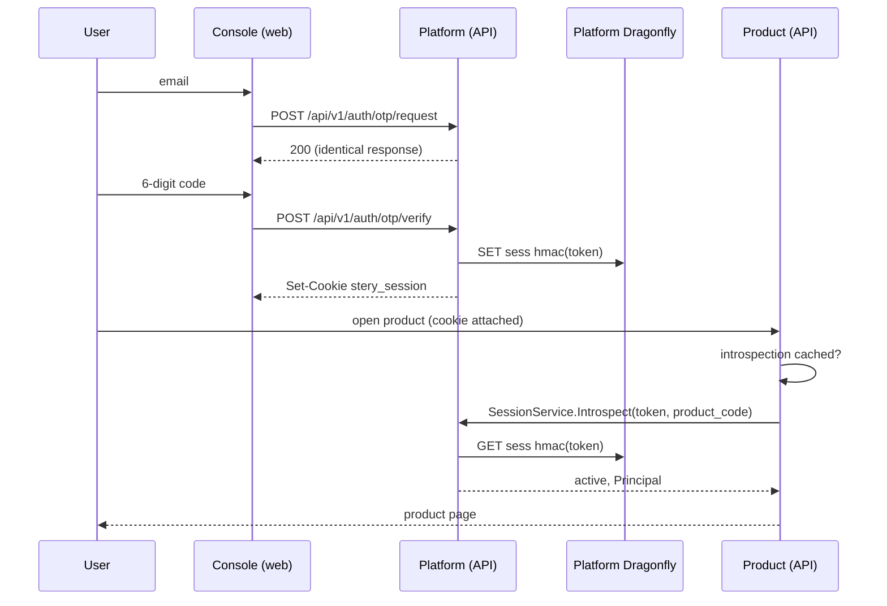
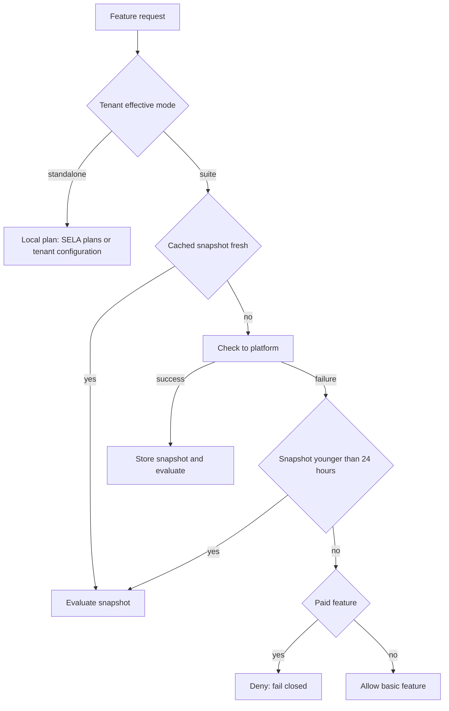
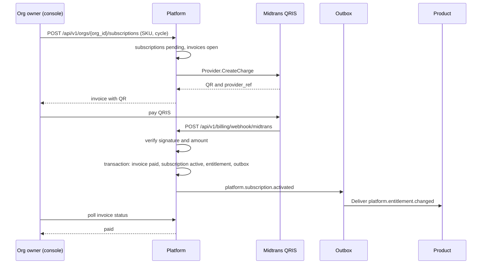

# FSD Stery Suite

*Functional Specification Document (FSD): `stery-suite` platform, product operating mode, and integration contract for HRIS-Stery, POS-Stery, and SELA*

|                         |                                                                                                                                        |
|-------------------------|----------------------------------------------------------------------------------------------------------------------------------------|
| **Document Name**       | FSD - Stery Suite (platform, ports, product contract, and alignment strategy)                                                          |
| **Version**             | 1.0 (Draft)                                                                                                                            |
| **Date**                | 6 November 2026                                                                                                                        |
| **Prepared by**         | Product & Engineering Team                                                                                                             |
| **Status**              | Draft for review                                                                                                                       |
| **Related Documents**   | 00_Analisis_Dampak_Risiko, BRD_Stery_Suite, PRD_Stery_Suite, BRD_HRIS, PRD_HRIS, FSD_HRIS, BRD_POS, FSD_POS, `POS-Stery/PRD.md`, BRD/PRD/FSD Sela (v2.5 / v2.5 / v2.55) |
| **Changes from previous** | Changes from previous: First issue                                                                                                   |

## 1. Introduction

### 1.1 Purpose

This document is the functional and technical specification of the `stery-suite` platform and of the contract that HRIS-Stery (`HRS`), POS-Stery (`POS`), and SELA (`SEL`) must satisfy so they can be sold as one package or individually. It derives directly from BRD_Stery_Suite (requirements `BR-SUI-01` through `BR-SUI-18`, decision log `D-SUI-01` through `D-SUI-12`) and PRD_Stery_Suite (`US-SUI-01` through `US-SUI-17`, `NFR-SUI-01` through `NFR-SUI-16`); those IDs are only referenced here, not redefined.

### 1.2 Scope and boundaries

- **In scope:** the platform (IAM, ENT, BIL, NTF, AUD, ADM, INT, DEP), six Go ports with two adapters, the gRPC contracts `stery.platform.v1` and `stery.product.v1`, the platform data model, the suite deployment profile, the Product Contract, and the S1-S4 alignment strategy.
- **Out of scope:** code changes in any repo (this phase is documents only), HRS and POS domain functions (found in FSD_HRIS and FSD_POS), changes to SELA packages and prices, OpenTelemetry/Prometheus observability in the baseline (open decision D-SUI-11).
- **Platform status today:** `stery-suite` contains only `docs/` (git repo created, no commit and no code). All FRs in section 4 therefore have status `Belum`, except a few that are partly satisfied by SELA assets that will be reused (see 1.3).

### 1.3 Document conventions

| Convention | Meaning |
| --- | --- |
| Status | `Selesai`, `Sebagian`, `Belum`, `Pending Verification`, `Ditunda`. In this document `Sebagian` is used only when a reusable implementation already exists in a product repo (e.g. SELA); the platform side stays `Belum`. |
| `Evidence` | Repo path relative to the `moon-eye` root (prefixes `SELA/`, `POS-Stery/`, `HRIS-Stery/`, `stery-suite/`). This column contains only paths that exist today; target paths appear only in the 2.7 delta table and the 2.6 repo structure. |
| Priority | M = Must, S = Should, C = Could. |
| `tbd` | A business or technical value that is not yet decided and not found in a repo; always accompanied by an open question. No price, SLA, quota, or target is derived or guessed. The only price figures are the existing SELA package prices (Rp0, Rp39.000, Rp129.000, Rp350.000). |
| `[INFERENCE]` | A design proposal or estimate by the author not yet backed by code evidence or an owner decision. |
| ID | `FR-SUI-<MM>.<n>` and `FR-SUI-SEC.<n>` are defined only in section 4. `<MM>` = module number: 01 IAM, 02 ENT, 03 BIL, 04 NTF, 05 AUD, 06 ADM, 07 INT, 08 DEP. SELA FRs are written with their own name, e.g. `SELA FR-05.1`. |
| Truth | Code is the truth. Status documents or notes that contradict the code are recorded in 11.3, not repeated as fact. |

### 1.4 Terms

| Term | Definition |
| --- | --- |
| Organisation (org) | The customer entity on the platform; owner of the subscription, members, and entitlements. |
| Tenant | The data isolation unit inside a product (HRS/POS: tenant; SELA: host). In suite mode, a product tenant is linked to one org. |
| Mode | `STERY_MODE=standalone` (default) or `suite`. The effective mode per tenant is described in 4.08 (FR-SUI-08.2). |
| Port | A Go interface that a product uses for identity, tenant, entitlement, notification, audit, and events. Each port has a `standalone` adapter and a `suite` adapter. |
| Entitlement snapshot | A per-org entitlement document signed by the platform and cached by the product. |
| Envelope | The cross-product event format (6.4). |
| Product Contract | The list of requirements for a product to join the suite (4.08, FR-SUI-08.3 through FR-SUI-08.8). |

## 2. Architecture and Stack

Architecture principle (D-SUI-01): composition, not consolidation. The three products remain separate deployment units with separate databases; the platform is the fourth deployment unit. The stack of the whole suite is the SELA stack (owner decision); HRIS and POS are aligned to that stack (2.7).

### 2.1 Stack (STACK-SPEC, source SELA)

The following table is normative for the platform and is the conformance checklist (FR-SUI-08.7) for every product. The source column points to evidence that the standard exists in SELA. Versions are read from `SELA/apps/api/go.mod` (go 1.25.1, pgx v5.11.0, goose v3.26.0, go-redis v9.22.0, grpc v1.84.0) and `SELA/apps/web/package.json` (Svelte ^5.56.1, Vite ^8.0.16, TypeScript ^6.0.3, Vitest ^4.1.11, SvelteKit ^2.63.0).

| # | Layer | Standard | Source in SELA |
| --- | --- | --- | --- |
| 1 | Repo layout | Per product: `apps/api`, `apps/web`, `deploy/`, `scripts/`, `docs/`, `Makefile`, `CLAUDE.md`, `AGENTS.md` | `SELA/CLAUDE.md` (Layout section), `SELA/docs/FSD_Sela.md` (2.6), `SELA/AGENTS.md`, `SELA/Makefile` |
| 2 | Language | Go >= 1.25.1; one module per product `github.com/<owner>/<product>` (owner handle `Briyantama` as in SELA, not verified for new repos, OQ-7) | `SELA/apps/api/go.mod` |
| 3 | Decomposition | Module = Go package `services/<nama>` in one process; core `Service` + Postgres repository + HTTP adapter + optional gRPC adapter; boundaries via Go interfaces and proto contracts so they can be split later | `SELA/apps/api/services`, `SELA/docs/FSD_Sela.md` (2.6) |
| 4 | Transport | REST `/api/v1` on `net/http` ServeMux, envelope `{success,data,error}` via `kit/httpx`; gRPC (`api/proto/v1`, buf, committed `gen/go`, `scripts/proto-gen.sh --check`) for machine/internal clients with a deny-by-default interceptor; no gateway tier; Caddy only as reverse proxy | `SELA/apps/api/cmd/api/routes.go`, `SELA/apps/api/internal/httpx/response.go`, `SELA/apps/api/api/proto/v1/auth.proto`, `SELA/apps/api/buf.yaml`, `SELA/scripts/proto-gen.sh`, `SELA/apps/api/services/auth/interceptor.go` |
| 5 | Database | PostgreSQL 18 (`uuidv7()`), pgx/v5 with raw SQL (no sqlc, no ORM), embedded goose v3.26.0 + `cmd/migrate up` or `down`, `testdb.NewMigrated` (template cloning) | `SELA/apps/api/internal/db/migrate.go`, `SELA/apps/api/cmd/migrate`, `SELA/apps/api/internal/testdb/testdb.go`, `SELA/apps/api/internal/db/migrations` |
| 6 | Tenant isolation | For HRS, POS, platform: RLS mandatory per D-SUI-08 (`ENABLE`+`FORCE`, `tenant_isolation` policy with `USING` and `WITH CHECK`, GUC `app.tenant_id` per transaction via `kit/tenantdb.WithTenant`, POS adds `app.store_id`, app role NOBYPASSRLS, separate migration role). SELA itself does not use RLS and does not change | `SELA/apps/api/internal/db/migrations` (no RLS; see analysis 3.1) |
| 7 | State store | Dragonfly via go-redis/v9: sessions (hash only), rate limiters, quotas, queues, Lua scripts | `SELA/deploy/docker-compose.yml`, `SELA/apps/api/services/auth/store.go`, `SELA/apps/api/services/auth/limiter.go` |
| 8 | Object storage | RustFS (S3) via aws-sdk-go-v2 behind `objstore.Store`; presigned URLs only; ClamAV (`clamd`) scanning fail-closed on upload paths | `SELA/apps/api/internal/objstore/store.go`, `SELA/apps/api/internal/objstore/s3.go`, `SELA/apps/api/services/media/scan/clamav.go` |
| 9 | Authentication | Opaque session in HttpOnly Secure cookie, hash in Dragonfly; RBAC tables (roles, permissions, actions, role_actions) + `RequirePermission(code)`; no JWT and no tokens in the browser | `SELA/apps/api/services/auth/service.go`, `SELA/apps/api/services/auth/http.go`, `SELA/apps/api/services/rbac/http.go`, `SELA/apps/api/internal/db/migrations/0004_rbac_foundation.sql` |
| 10 | Async | In-process ticker workers + Postgres outbox + idempotent consumers; no NATS/Kafka | `SELA/apps/api/services/event/postgres.go`, `SELA/apps/api/services/instant/jobs.go`, `SELA/apps/api/internal/db/migrations/0008_notifications.sql` |
| 11 | Observability | `log/slog` JSON + `/healthz`; OpenTelemetry/Prometheus not yet baseline (D-SUI-11, `tbd`) | `SELA/apps/api/internal/health/health.go`, `SELA/apps/api/cmd/api/routes.go` |
| 12 | Configuration | Environment variables, fail-fast validation, secrets never printed, `.env.example` | `SELA/apps/api/internal/config/config.go`, `SELA/.env.example` |
| 13 | PII and audit | `kit/piicrypt` (AES-256-GCM, per-purpose AAD, HMAC blind index, key rotation); `kit/audit` append-only `audit_logs` with database triggers | `SELA/apps/api/internal/piicrypt/piicrypt.go`, `SELA/apps/api/internal/audit/audit.go`, `SELA/apps/api/internal/db/migrations/0014_pii_encryption_audit.sql` |
| 14 | Payments | `payment.Provider` interface, Midtrans QRIS (Xendit removed 14 October 2026), signed webhook, paid notification trusted only when the amount matches | `SELA/apps/api/services/payment/provider.go`, `SELA/apps/api/services/payment/midtrans.go`, `SELA/apps/api/services/payment/postgres.go` |
| 15 | Web | SvelteKit 2 + Svelte 5 + Vite 8 + TypeScript 6, `ssr=false`, `adapter-static`, npm, Node >= 20.19; `apiFetch` + envelope mirror; i18n `{id,en}` catalogues with a parity test; Vitest 4 + Testing Library; Playwright (Chrome channel) | `SELA/apps/web/package.json`, `SELA/apps/web/src/lib/api/client.ts`, `SELA/apps/web/src/lib/api/envelope.ts`, `SELA/apps/web/src/lib/i18n/messages/parity.test.ts` |
| 16 | Deploy | Caddy; static web (Vercel or Caddy); `deploy/docker-compose.yml` for Dragonfly, RustFS, ClamAV profile; default standalone ports API 8080, gRPC 9090, web 5173 | `SELA/deploy/Caddyfile`, `SELA/deploy/docker-compose.yml`, `SELA/deploy/README.md` |
| 17 | Quality gate | `scripts/check.sh` (proto drift, gofmt, vet, golangci-lint, `go test -cover`, svelte-check, vitest coverage, e2e with the real stack; `CHECK_STAGES`); GitHub Actions jobs go/web/e2e; 80% coverage floor; `-race` in CI | `SELA/scripts/check.sh`, `SELA/.github/workflows/ci.yml` |
| 18 | Process | TDD RED/GREEN; `docs/tracking/tracker.json` + `scripts/build_tracker.py`; FSD updated together with code; `docs/aidlc/` artefacts | `SELA/docs/tracking/tracker.json`, `SELA/scripts/build_tracker.py`, `SELA/CLAUDE.md` |
| 19 | Locale | Indonesian default, English supported, IDR, WIB | `SELA/CLAUDE.md` (Language section), `SELA/apps/web/src/lib/i18n/messages/parity.test.ts` |

Implementation notes for the platform:

- The platform does not accept media uploads; row 8 (RustFS, ClamAV) is used by the platform only if an attachment feature is added later. The `kit/objstore` package and the `clamd` client are still provided for products.
- The platform uses no ORM, sqlc, JWT, NATS, or gateway tier; this matches the "out of scope" list of BRD_Stery_Suite 4.4.
- SELA does not contain `kit` yet: `internal/` can only be imported from inside the SELA module, so lifting into `kit` (S1) is real work, not a rename (2.6, 2.7).

### 2.2 Module decomposition

The platform is a single Go process with the following modules (STACK-SPEC row 3). Boundaries between modules are Go interfaces; the contracts used by products are published as gRPC.

| Module | Package (target) | Responsibility | Depends on | Transport |
| --- | --- | --- | --- | --- |
| 01 IAM | `services/iam` | Users, organisations, members, invitations, sessions, platform RBAC, service tokens | Postgres, Dragonfly, NTF | REST, gRPC `SessionService`, `LinkService` |
| 02 ENT | `services/entitlement` | Product/SKU catalogue, entitlements, signed snapshots, usage | Postgres, BIL (events), IAM | REST, gRPC `EntitlementService` |
| 03 BIL | `services/billing` | Prices, subscriptions, invoices, payment `Provider`, webhook, renewal/expiry jobs | Postgres, ENT, NTF, `Provider` | REST |
| 04 NTF | `services/notification` | Notification outbox, SMTP worker, templates, preferences | Postgres, SMTP | gRPC `NotificationService` (for products), internal |
| 05 AUD | `services/audit` | Platform `audit_logs`, product audit sink, readers | Postgres | REST, gRPC `AuditService` |
| 06 ADM | `services/admin` + `apps/web` | Operator API and web console | All modules | REST |
| 07 INT | `services/integration` | Org-tenant links, event publish/deliver, retry, dead-letter | Postgres, ENT, IAM | gRPC `IntegrationService`, `LinkService`; client `DeliveryService` |
| 08 DEP | `deploy/`, `scripts/`, `kit/` | Deployment profile, Product Contract, shared kit, checklist | all | not applicable |



### 2.3 Interface components

| Component | Users | Protocol | Notes |
| --- | --- | --- | --- |
| Platform console (`apps/web`) | Org owner, org admin, operator | HTTPS, REST `/api/v1`, cookie `stery_session` | SvelteKit SPA (D-SUI-09); screens in section 10 |
| Platform REST API | Console, Midtrans (webhook) | HTTPS | Envelope `{success,data,error}`; public webhook, signature-verified |
| Platform gRPC `stery.platform.v1` | Product APIs (machine) | gRPC | Deny-by-default; service HMAC token; not exposed to the browser |
| Product gRPC `stery.product.v1` (`DeliveryService/Deliver`) | Platform (machine) | gRPC | Implemented by every suite-mode product |
| Product web (`apps/web` per product) | Product users | HTTPS, product REST | Unchanged in standalone mode; in suite mode uses cookie `stery_session` |
| SELA guest PWA `/e/` | Anonymous guests | HTTPS | Remains login-free in both modes (cookie `sela_guest`); does not pass through the platform |
| SMTP | NTF | SMTP | SELA direct-send pattern (`SMTP_*`) |
| Midtrans Core API | BIL | HTTPS | QRIS; webhook to `/api/v1/billing/webhook/midtrans` |
| Caddy | All | HTTPS | Reverse proxy; pattern `SELA/deploy/Caddyfile` |

### 2.4 Dragonfly usage, Go ports, gRPC contracts, and platform data model

#### 2.4.1 Dragonfly usage

The platform uses its own single Dragonfly instance (suite profile: port 6380). Each product still uses its own Dragonfly instance (D-SUI-07); SELA keys are unprefixed, so products never share an instance. TTL values not listed are `tbd`.

| Key (platform) | Content | TTL | Source pattern |
| --- | --- | --- | --- |
| `sess:{hmac}` | Session record (`session_id`, `user_id`, active `org_id`, per-product attributes); key = HMAC of the token with domain prefix `session` | Session TTL; SELA uses a 12-hour default (`SELA/apps/api/services/auth/service.go`), platform value `tbd` (OQ-F1) | SELA `SaveSession`: only the hash is stored |
| `usess:{user_id}` | Set of the user's `session_id`, for revoking all sessions (FR-SUI-01.7) | Follows the longest session | new |
| `otp:{hmac}` | HMAC of the 6-digit code; single use | 5 minutes | `SELA/CLAUDE.md` (Auth invariants) |
| `otpfail:{hmac}` | Failure counter; 5 failures lock the address for 15 minutes | 15 minutes | `SELA/CLAUDE.md` |
| `rl:{lingkup}:{subjek}` | Fixed-window counter (OTP, login, invitation, webhook) per address and per connection address; fail-closed when the limiter errors | per scope, `tbd` | `SELA/apps/api/services/auth/limiter.go` |
| `svcnonce:{produk}:{nonce}` | Replay protection for the service HMAC token | equal to the clock tolerance, `tbd` | new |

Product-side keys in `suite` mode: the entitlement snapshot in the product's Dragonfly under key `ent:snap:<org>` (key name already used by FSD_HRIS 2.4, default TTL 24 hours from D-SUI-04, `tbd`), plus a restart-surviving copy in the table `entitlement_snapshots` of the product database so that a Dragonfly restart coinciding with a platform outage does not lose the snapshot (FR-SUI-02.6, `[INFERENCE]`). The session introspection cache (30 seconds, D-SUI-03) lives in the product process memory, not in Dragonfly.

#### 2.4.2 Six Go ports and two adapters

Ports define the only way product domain code interacts with identity, tenant, entitlement, notification, audit, and events. The location of the `kit/port` package is a proposal `[INFERENCE]` (OQ-F2); the signatures below follow decision D-SUI-02. `Entitlement.Limit` is an `[INFERENCE]` addition for limit dimensions (FR-SUI-02.9); `Audit.Record` with no return value follows SELA's `audit.Recorder` (`SELA/apps/api/internal/audit/audit.go`).

```go
package port

type Principal struct {
    UserID      string
    OrgID       string            // empty on the SELA standalone adapter
    TenantID    string            // result of mapping org -> product tenant (HRS/POS); empty in SELA
    SessionID   string
    Roles       []string          // product roles (from the manifest)
    Permissions []string          // permission codes, e.g. events:create
    Attributes  map[string]string // per-product session attributes, e.g. store_id (POS)
    ExpiresAt   time.Time
}

type Scope struct{ StoreID string } // POS fills StoreID; other products leave it empty

type Identity interface {
    Verify(ctx context.Context, token string) (Principal, error)
}
type Tenant interface {
    // Runs fn in one transaction; sets app.tenant_id (and app.store_id) transaction-locally.
    WithTenant(ctx context.Context, tenantID string, scope Scope, fn func(ctx context.Context, tx *sql.Tx) error) error
}
type Entitlement interface {
    Allows(ctx context.Context, org, feature string) (bool, error)
    Limit(ctx context.Context, org, dimension string) (value int64, set bool, err error)
}
type Notification interface {
    Enqueue(ctx context.Context, tx *sql.Tx, msg Message) error
}
type Audit interface {
    Record(ctx context.Context, event audit.Event)
}
type Events interface {
    Publish(ctx context.Context, tx *sql.Tx, envelope Envelope) error
}
```

| Port | `standalone` adapter (default) | `suite` adapter | Reused assets |
| --- | --- | --- | --- |
| `Identity` | Local product session: SELA email OTP + cookie `sela_session`; HRS and POS password (existing hash) + opaque session, JWT removed (D-SUI-10) | Introspection via `SessionService/Introspect` with a 30-second cache; cookie `stery_session` | `SELA/apps/api/services/auth/service.go` (`Authenticate`), `SELA/apps/api/services/auth/interceptor.go` |
| `Tenant` | HRS/POS: local tenant via `kit/tenantdb.WithTenant`; SELA: no tenant (plain transaction without GUC) | Platform org mapped to product tenant (`tenants.org_id`; SELA: `hosts.org_id`), then the same `WithTenant` | `kit/tenantdb` (new) |
| `Entitlement` | Local package: SELA `events.package` -> `plans`; HRS/POS: local package `tbd` | `EntitlementService/Check` + signed snapshot (FR-SUI-02.4 through FR-SUI-02.7) | `SELA/apps/api/services/payment/postgres.go`, `SELA/apps/api/internal/db/migrations/0011_plans_transactions.sql` |
| `Notification` | Local outbox + SMTP worker | Local outbox within the transaction, relay to `NotificationService/Send` | `SELA/apps/api/internal/db/migrations/0008_notifications.sql`, `SELA/apps/api/services/event/postgres.go` |
| `Audit` | Local append-only `audit_logs` | Local plus relay to `AuditService/Record` (best-effort via outbox) | `SELA/apps/api/internal/audit/audit.go`, `SELA/apps/api/internal/audit/store.go` |
| `Events` | Local outbox; no delivery outside the product | Local outbox, relay to `IntegrationService/Publish` | `SELA/apps/api/services/instant/jobs.go` (`SKIP LOCKED` claim) |

#### 2.4.3 gRPC services

All platform services sit behind a deny-by-default interceptor (SELA's `NewUnaryHostInterceptor` pattern) that requires the service HMAC token; there are no public methods. Message sketches are in 6.3.

| Service | Methods | Caller | Function | FR |
| --- | --- | --- | --- | --- |
| `stery.platform.v1.SessionService` | `Introspect`, `SetAttribute`, `Revoke` | Product | Turns a session token into a Principal; sets per-product session attributes; revokes sessions | FR-SUI-01.5, FR-SUI-01.12 |
| `stery.platform.v1.EntitlementService` | `Check`, `GetSnapshot`, `ReportUsage` | Product | Feature check, fetch signed snapshot, report usage | FR-SUI-02.4, FR-SUI-02.5, FR-SUI-02.10 |
| `stery.platform.v1.IntegrationService` | `Publish` | Product | Receives envelopes from the product outbox | FR-SUI-07.8 |
| `stery.platform.v1.NotificationService` | `Send` | Product | Receives notification messages to be sent by the hub | FR-SUI-04.4 |
| `stery.platform.v1.AuditService` | `Record` | Product | Receives audit events (batch, idempotent per `event_id`) | FR-SUI-05.3 |
| `stery.platform.v1.LinkService` | `Confirm`, `GetStatus` | Product | Org-tenant link handshake (migration and provisioning); finalisation is sent by the platform as event `platform.link.finalized` via `Deliver` (7.5) | FR-SUI-07.2, FR-SUI-07.3, FR-SUI-07.5 |
| `stery.product.v1.DeliveryService` | `Deliver` | Platform | Delivers envelopes to the target product, including platform control events (`platform.tenant.provision_requested`, `platform.link.finalized`, `platform.entitlement.changed`) | FR-SUI-07.10 |

#### 2.4.4 Platform data model (summary)

Database `stery_platform`, app role `stery_platform` (NOBYPASSRLS), separate migration role. PII class: T = high (`piicrypt` encryption), S = medium, N = none. Tenant on the platform = org: the RLS policy uses `current_setting('app.tenant_id', true)::uuid`, which holds the `org_id`. Column details, policies, and diagrams are in section 5.

| Table | Content | Key columns | RLS | PII |
| --- | --- | --- | --- | --- |
| `users` | Cross-org user identity | `user_id`, `email_ciphertext`, `email_blind_index`, `name`, `password_hash` (nullable), `status` | No (cross-org); only the IAM module accesses it | T (email), S (name), credentials |
| `orgs` | Organisations | `org_id`, `name`, `status`, `created_by` | Yes (`org_id` = tenant or member) | N |
| `org_members` | Membership | `member_id`, `org_id`, `user_id`, `org_role`, `status` | Yes | N |
| `invitations` | Invitations | `invitation_id`, `org_id`, `email_ciphertext`, `email_blind_index`, `token_hmac`, `expires_at`, `accepted_at` | Yes | T |
| `member_product_access` | Per-product access and role | `org_id`, `member_id`, `product_code`, `product_role` | Yes | N |
| `roles`, `resources`, `actions`, `permissions`, `role_actions` | Platform RBAC catalogue | SELA migration 0004 pattern | No (global catalogue) | N |
| `products` | Registered products | `product_code`, `manifest`, `gate_status`, `sellable`, `delivery_endpoint` | No (global) | N |
| `features` | Feature keys and dimensions per product | `product_code`, `feature_key`, `kind` (flag/limit), `unit` | No | N |
| `skus`, `sku_items` | SKUs and bundles with their contents | `sku_code`, `kind`, `product_code`, `feature_key`, `bool_value`, `limit_value` | No | N |
| `prices` | Price per SKU and cycle | `sku_code`, `billing_cycle`, `amount_idr`, `valid_from` | No; no rows until OQ-1 | N |
| `subscriptions` | Org subscriptions | `subscription_id`, `org_id`, `sku_code`, `status`, `billing_cycle`, `current_period_end` | Yes | N |
| `invoices` | Invoices and payments | `invoice_id`, `org_id`, `subscription_id`, `amount_idr`, `status`, `provider`, `provider_ref`, `expires_at`, `paid_at` | Yes | N |
| `entitlements` | Derived usage rights | `org_id`, `product_code`, `feature_key`, `enabled`, `limit_value`, `source_subscription_id` | Yes | N |
| `entitlement_versions` | Monotonic version per org for snapshots | `org_id`, `version`, `updated_at` | Yes | N |
| `usage_reports` | Usage reported by products | `org_id`, `product_code`, `dimension`, `value`, `reported_at` | Yes | N |
| `sessions_meta` | Session metadata (not tokens) | `session_id`, `user_id`, `org_id`, `created_at`, `expires_at`, `revoked_at`, `client_hash` | Yes (`user_id`/`org_id`) | S (keyed `client_hash`) |
| `integration_links` | Org-product tenant links | `link_id`, `org_id`, `product_code`, `tenant_ref`, `status`, `link_code_hmac` | Yes | N |
| `user_product_links` | Mapping of platform users to product users | `org_id`, `user_id`, `product_code`, `external_ref` | Yes | N |
| `integration_subscriptions` | Per-org integration opt-in | `org_id`, `source_product`, `target_product`, `enabled` | Yes | N |
| `outbox` | Platform event outbox | `event_id`, `kind`, `event_type`, `org_id`, `payload`, `status`, `attempts`, `next_attempt_at` | No (system table, see 5.2) | S (payload without raw PII) |
| `deliveries` | Event deliveries to products | `delivery_id`, `event_id`, `target_product`, `status`, `attempts`, `dead_at` | No (system table) | N |
| `notifications` | Hub notification outbox | `id`, `org_id`, `kind`, `user_id`, `dedupe_key`, `status`, `attempts`, `payload_ciphertext` | No (system table) | T (sealed payload) |
| `processed_events` | Idempotent consumer | `consumer`, `event_id`, `processed_at` | No (system table) | N |
| `audit_logs` | Append-only audit | `audit_id`, `occurred_at`, `action`, `outcome`, `actor_type`, `actor_id`, `org_id`, `product_code`, `event_id`, `details` | Yes for SELECT; INSERT open to modules | S (no raw token/code/email) |

### 2.5 Events, outbox, and deployment profile

#### 2.5.1 Event principles (D-SUI-06)

No NATS. Three tiers: (1) in-process domain events inside one product; (2) a Postgres transactional outbox per product: a row is written in the same transaction as its data change, and a ticker worker sends it later; (3) cross-product delivery through the platform: product outbox -> `IntegrationService/Publish` -> the platform delivers to the target product's `DeliveryService/Deliver`. Delivery is at-least-once; consumers must be idempotent via `processed_events`; cross-product delivery is opt-in per org through the entitlement feature `integration.<a>_<b>` and an integration subscription enabled by the org admin.



#### 2.5.2 Envelope

`{event_id (UUIDv7), event_type, org_id, store_id?, actor_id, occurred_at, schema_version, payload}`. Full specification in 6.4. HRIS has a NATS envelope with `event_id`, `tenant_id`, `actor_id`, `schema_version` and POS has `event_envelope.go` as a schema reference (`POS-Stery/services/_shared/nats/event_envelope.go`); the suite envelope replaces both at alignment (2.7). Product-owned `event_type` names are set in the product FSD and the platform routes only by exact string: HRS uses `hrs.<agregat>.<kejadian>` (`HRIS-Stery/docs/FSD_HRIS.id.md` 2.5, e.g. `hrs.employee.terminated`, `hrs.gathering.scheduled` hypothesis); POS maps to `sales.sale.completed`, `inventory.low_stock`, `supplier.stock.received`, `customer.created` (final names `tbd`, `POS-Stery/docs/FSD_POS.id.md` 2.5); the platform uses `platform.<agregat>.<kejadian>`. In `standalone` mode, `org_id` in the HRS envelope equals the local `tenant_id` (FSD_HRIS 2.5); in `suite` mode `org_id` is the platform org and the product maps it to the local tenant via `tenants.org_id`.

#### 2.5.3 Product outbox schema (`kit/outbox`)

The tables `outbox` and `processed_events` are the same in every product; the claim uses the pattern already running in SELA (`FOR UPDATE SKIP LOCKED` with a `next_attempt_at` lease; `SELA/apps/api/services/event/postgres.go`, `SELA/apps/api/services/instant/jobs.go`). The current SELA schema is split per module (`notifications`, `instant_outbox`); `kit/outbox` generalises it, so this is new work, not a copy.

```sql
CREATE TABLE outbox (
    event_id        uuid PRIMARY KEY DEFAULT uuidv7(),
    kind            text        NOT NULL,            -- integration | notification | audit
    event_type      text        NOT NULL,
    org_id          uuid,
    store_id        uuid,
    actor_id        text,
    occurred_at     timestamptz NOT NULL DEFAULT now(),
    schema_version  smallint    NOT NULL DEFAULT 1,
    payload         jsonb       NOT NULL,
    status          text        NOT NULL DEFAULT 'pending',
    attempts        integer     NOT NULL DEFAULT 0,
    next_attempt_at timestamptz NOT NULL DEFAULT now(),
    last_error      text,
    created_at      timestamptz NOT NULL DEFAULT now(),
    sent_at         timestamptz,
    CONSTRAINT outbox_kind_valid   CHECK (kind IN ('integration','notification','audit')),
    CONSTRAINT outbox_status_valid CHECK (status IN ('pending','sent','failed','dead'))
);
CREATE INDEX outbox_pending_idx ON outbox (next_attempt_at) WHERE status = 'pending';

CREATE TABLE processed_events (
    consumer     text        NOT NULL,
    event_id     uuid        NOT NULL,
    processed_at timestamptz NOT NULL DEFAULT now(),
    PRIMARY KEY (consumer, event_id)
);
```

Claim: `WITH due AS (SELECT event_id FROM outbox WHERE status = 'pending' AND next_attempt_at <= $1 ORDER BY event_id LIMIT $3 FOR UPDATE SKIP LOCKED) UPDATE outbox o SET attempts = o.attempts + 1, next_attempt_at = $2 FROM due WHERE o.event_id = due.event_id RETURNING o.*`. Maximum attempts and backoff are `tbd`; SELA pattern: doubling backoff up to 5 attempts (`SELA/docs/FSD_Sela.md`, v2.25 note). Rows that exceed the limit become `dead` and can be retried manually (FR-SUI-07.11).

#### 2.5.4 Deployment profile and port map

The suite profile runs the platform and three products on one development/staging host without port collisions (BR-SUI-18). Each product's standalone profile is unchanged.

| Service | API | gRPC | Web | Notes |
| --- | --- | --- | --- | --- |
| Platform | 8180 | 9190 | 5273 | gRPC not opened to the public |
| HRIS (`HRS`) | 8280 | 9290 | 5373 | |
| POS (`POS`) | 8380 | 9390 | 5473 | One `apps/web` (D-SUI-09) |
| SELA (`SEL`) | 8080 | 9090 | 5173 | Unchanged |

| Shared resource | Port | Content |
| --- | --- | --- |
| PostgreSQL 18 | 5432 | Four databases: `stery_platform`, `hris`, `pos`, `sela`; one app role per database (`stery_platform`, `hris`, `pos`, `sela`); one separate migration role per database (name `tbd`) |
| Dragonfly | 6379 SELA, 6380 platform, 6381 HRIS, 6382 POS | One instance per product (D-SUI-07) |
| RustFS | 9000 (S3), 9001 (console) | One bucket and one access key per product; SELA `sela-media` (default `S3_BUCKET` in `SELA/deploy/docker-compose.yml`), other bucket names `tbd` |
| ClamAV | 3310 | Shared; profile `scan` as in SELA |
| Caddy | 80/443 | One parent domain; per-product routes; `stery_session` cookie domain `tbd` (OQ-3) |

Current standalone ports (evidence read from `.env.example`) and their collisions:

| Product | Current ports | Evidence |
| --- | --- | --- |
| SELA | API 8080, gRPC 9090, web 5173; e2e uses 8081, 9091, 5174, 5175; local Postgres 5432; Dragonfly 6379; RustFS 9000/9001; ClamAV 3310 | `SELA/CLAUDE.md`, `SELA/deploy/docker-compose.yml` |
| POS | Gateway `HTTP_PORT=8000`; gRPC 8081 through 8086; admin 5173, cashier 5174; Postgres 5432; Redis 6379; NATS 4222; OTLP 4318 (comment mentions 4317 for gRPC) | `POS-Stery/.env.example` |
| HRIS | Postgres 5432; Redis 6379; NATS 4222; OTLP 4317; per-service gRPC port via `GRPC_PORT` | `HRIS-Stery/.env.example` |

Collisions proven on the current standalone ports: 5432 (all three), 6379 (all three), 4222 (HRIS and POS), 5173 (SELA web and POS admin), 8081 (POS auth gRPC and SELA e2e API). The 4317 and 9090 collisions were reported by the planner; not fully re-read here. After alignment, the standalone defaults of all three products become API 8080, gRPC 9090, web 5173 (STACK-SPEC row 16), so the suite profile must use the port map above.

### 2.6 Code structure and contracts

#### 2.6.1 `stery-suite` repo structure (target)

```text
stery-suite/
├─ apps/
│  ├─ api/            # platform Go module: cmd/api, cmd/migrate, services/{iam,entitlement,billing,notification,audit,admin,integration}, embedded goose migrations
│  └─ web/            # SvelteKit SPA console (ssr=false, adapter-static)
├─ kit/               # separate Go module, imported by products
│  ├─ httpx/ config/ db/ testdb/ audit/ piicrypt/ objstore/ health/   # lifted from SELA apps/api/internal
│  ├─ tenantdb/ session/ outbox/                                       # new
│  ├─ port/ contract/ gen/                                             # [INFERENCE]: ports, adapter contract tests, generated gRPC code
├─ api/proto/v1/      # stery.platform.v1, stery.product.v1 (buf)
├─ deploy/            # docker-compose.yml, suite profile, Caddyfile, README.md
├─ docs/              # BRD/PRD/FSD, tracking/tracker.json, aidlc/
├─ scripts/           # check.sh, proto-gen.sh, e2e.sh, build_tracker.py, conformance.sh
├─ Makefile
├─ CLAUDE.md
└─ AGENTS.md
```

Consequence: `apps/api/go.mod` (platform) and `kit/go.mod` are two modules in one repo; products import `kit` via the tagged version `kit/vX.Y.Z` (the Go subdirectory-module tag convention) and use `go.work` for local development (`HRIS-Stery/go.work` and `POS-Stery/go.work` already exist, `SELA` uses a single module without `go.work`). The choice of separate modules and the tag scheme is `[INFERENCE]` (OQ-F3).

#### 2.6.2 Sources of the `kit` packages

| `kit` package | Source in SELA | Change when lifted | Effort `[INFERENCE]` |
| --- | --- | --- | --- |
| `kit/httpx` | `SELA/apps/api/internal/httpx` (`response.go`, `decode.go`, `proxy.go`) | Package move only | S |
| `kit/config` | `SELA/apps/api/internal/config/config.go` | The SELA config struct is product-specific; only the fail-fast env reader, secret redactor, and parsers (e.g. trusted proxy) are lifted | M |
| `kit/db` | `SELA/apps/api/internal/db/migrate.go` | Migrations become a parameter (`embed.FS`) so each product carries its own migrations | M |
| `kit/testdb` | `SELA/apps/api/internal/testdb/testdb.go` | Template fingerprint follows the caller's migrations | S |
| `kit/audit` | `SELA/apps/api/internal/audit` | Add `org_id` and `product_code` to `Event` without changing SELA behaviour | M |
| `kit/piicrypt` | `SELA/apps/api/internal/piicrypt/piicrypt.go` | Package move only | S |
| `kit/objstore` | `SELA/apps/api/internal/objstore` | Package move only | S |
| `kit/health` | `SELA/apps/api/internal/health/health.go` | Package move only | S |
| `kit/tenantdb` | new | `WithTenant`: transaction + `set_config('app.tenant_id', ..., true)` + `app.store_id` | M |
| `kit/session` | new (from `SELA/apps/api/services/auth/service.go`, `store.go`) | Random token, HMAC, cookie, Dragonfly storage, introspection client with a 30-second cache | M |
| `kit/outbox` | new (generalisation of `notifications`, `instant_outbox`) | 2.5.3 | M |

#### 2.6.3 Cross-repo contracts

- **Proto:** source in `api/proto/v1`; lint and stale-code detection via `scripts/proto-gen.sh --check` (SELA pattern); breaking changes are rejected in CI (`buf breaking`, `[INFERENCE]`).
- **Versions:** semver on `kit`; products upgrade on their own schedule; adapter contract changes must pass the `kit/contract` contract tests in every product (FR-SUI-08.3).
- **Synchronisation cost** of `kit` across repos is an accepted weakness of option A (analysis section 5); reviewed again if it becomes too expensive.

### 2.7 Alignment delta: migration strategy per product (S1-S4)

#### 2.7.1 Strategy

The order follows D-SUI-12; one alignment runs at a time; each alignment ends at that product's stabilisation gate (analysis section 7).

- **S1 (kit and core platform).** `kit` is extracted from SELA's `internal/` and SELA re-imports it with no behaviour change (the existing SELA tests are the safety net). In parallel: platform IAM and ENT and the proto contracts `stery.platform.v1`.
- **S2 (POS).** The six gRPC services and the `chi` gateway become one Go module with `services/<nama>` packages; the sale saga becomes one database transaction; NATS becomes outbox; JWT becomes opaque session; `apps/admin` and `apps/cashier` become one `apps/web`. The domain and application layers are kept. Details in FSD_POS 2.7.
- **S3 (HRIS).** The seven gRPC services and the Laravel gateway become one Go module with REST `/api/v1`; sqlc becomes raw pgx SQL; migrations are fixed then moved to goose; NIK/NPWP/birth_date are encrypted. Details in FSD_HRIS 2.7.
- **S4 (suite mode).** `suite` adapters in the three products (`Identity`, `Tenant`, `Entitlement`, `Notification`, `Audit`, `Events`), link columns (`tenants.org_id` for HRS/POS; `hosts.org_id` and `hosts.external_subject` for SELA, nullable, no RLS change), billing, console, standalone customer linking (7.5).
- **Protective rule:** `standalone` mode must pass all product tests without the platform throughout S1-S5 (FR-SUI-08.16); no `suite` adapter is enabled before that product's stabilisation gate is closed (FR-SUI-02.2).

#### 2.7.2 Delta table

The "current state" column points to evidence of existence (path exists); the "target" column uses target package names. Effort S/M/L is `[INFERENCE]` and consistent with analysis section 6.

| As-is -> to-be | Affected modules | Reuse (domain and application kept, infrastructure and interfaces rewritten) | Effort |
| --- | --- | --- | --- |
| SELA: `internal/{httpx,config,db,testdb,audit,piicrypt,objstore,health}` -> `stery-suite/kit/*` re-imported (S1) | All SELA modules | All packages as source; `SELA/apps/api/internal` | M |
| SELA: `services/auth`, `services/payment`, `internal/audit` -> `standalone` adapters for `Identity`, `Entitlement`, `Audit` (S1/S4) | 01 IAM, 02 ENT, 05 AUD on the SELA side | `SELA/apps/api/services/auth/service.go`, `SELA/apps/api/services/payment/provider.go` | M |
| SELA: table `hosts` -> nullable columns `org_id`, `external_subject` in suite mode (S4) | 01 IAM, 07 INT | `SELA/apps/api/internal/db/migrations/0001_hosts.sql` | S |
| SELA: S0 gate (webhook, retention, 20 Pending Verification, media origin, `zip_full_resolution`) | All of SELA | `SELA/docs/tracking/tracker.json` | M |
| POS: six gRPC services + `chi` gateway -> one Go module, REST `/api/v1` ServeMux (S2) | All POS modules | `POS-Stery/services/*/internal/domain`, `POS-Stery/services/*/internal/application` | L |
| POS: gRPC sale saga -> one DB transaction; loyalty called in-process after commit (S2) | POS 04 SAL, 06 CUS | `POS-Stery/services/sales-service/internal/application/commands/create_sale.go`, `POS-Stery/services/customer-service/internal/application/commands/add_loyalty_points.go` | M |
| POS: NATS -> Postgres outbox + idempotent consumers (S2) | POS events | `POS-Stery/services/_shared/nats/event_envelope.go` | M |
| POS: JWT (`tid`, `sid`, `role`) -> opaque session; `store_id` becomes a session attribute (S2) | POS 01 AUTH | `POS-Stery/services/auth-service/internal/application/commands/login.go` | M |
| POS: golang-migrate -> goose; zap -> slog; Redis -> Dragonfly; RLS gains `WITH CHECK` (S2) | POS data | `POS-Stery/services/sales-service/migrations/000001_create_sales_schema.up.sql` | M |
| POS: `apps/admin` + `apps/cashier` -> one `apps/web` with route groups `(admin)` and `(cashier)` (S2) | POS web | `POS-Stery/apps/cashier/src/service-worker.ts`, `POS-Stery/apps/admin/src/routes` | M |
| HRIS: seven gRPC services + Laravel gateway -> one Go module, REST `/api/v1`; Laravel removed (S3) | All HRS modules | `HRIS-Stery/services`, `HRIS-Stery/apps/api-gateway/routes/api.php` | L |
| HRIS: complete the RPCs (`UpdateEmployee`, `GetOrgChart`, document presign and rollback) (S3) | HRS 02 EMP, 07 DOC | `HRIS-Stery/services/employee-service/internal/interfaces/grpc/employee_service.go`, `HRIS-Stery/services/document-service/internal/interfaces/grpc/document_service.go` | M |
| HRIS: migrations fixed (invalid constraint, role `app`, `FORCE`, `WITH CHECK`) and moved to goose (S3) | HRS 03 ATT and others | `HRIS-Stery/services/attendance-service/migrations/001_create_attendance_schema.up.sql` | M |
| HRIS: NIK/NPWP/birth_date -> `kit/piicrypt` with blind index (S3) | HRS 02 EMP | `HRIS-Stery/services/employee-service/migrations/001_create_employee_schema.up.sql` | M |
| HRIS: JWT + sqlc + MinIO -> opaque session + pgx + RustFS; SvelteKit SSR -> static SPA (S3) | HRS 01 AUTH, web | `HRIS-Stery/services/auth-service/internal/domain/user.go`, `HRIS-Stery/apps/web/src/routes` | M |
| Three products: `suite` adapters for six ports; `STERY_MODE`; `org_id` link (S4) | 08 DEP, 01 IAM, 02 ENT, 07 INT | `kit/port` ports and contract tests | L |
| Platform: IAM, ENT (S1); BIL, NTF, AUD, ADM, INT (S4/S5) | 01-07 | `SELA/apps/api/services/payment`, `SELA/apps/api/services/auth`, `SELA/apps/api/internal/audit` as reference assets | L |
| HRIS payroll, tax, recruitment, performance | HRS 09-12 | None (Deferred, ADR-0004) | Deferred |

#### 2.7.3 Alignment with FSD_HRIS and FSD_POS

Section 2 of both FSDs is written in parallel with this document. Alignment notes (port map, S2/S3 strategy, system outbox decision) are added in 12.2 after both have been read.

## 3. Actors and Access Rights Model

### 3.1 Actors

| Actor | Description | How they sign in |
| --- | --- | --- |
| Organisation owner (`org_owner`) | Buys the package and is responsible for billing; one or more per org | Console; email OTP |
| Organisation admin (`org_admin`) | Manages members, product access, integrations, links | Console |
| Member / product user (`org_member`) | Employee, cashier, or host who uses HRS, POS, or SELA | Product via cookie `stery_session` |
| Platform operator (`platform_operator`) | Internal team: SKU catalogue and prices, delivery monitoring, support | Console (operator section) |
| Product service (machine) | HRS/POS/SELA suite-mode APIs calling platform gRPC | Service HMAC token |
| Platform (machine) | Calls the product's `DeliveryService/Deliver` | Service HMAC token in the reverse direction |
| Midtrans | Sends payment notifications | Signed public webhook |
| SELA guest | Anonymous; never signs in to the platform | Cookie `sela_guest` (unchanged) |
| System / ticker | In-process workers: notification delivery, outbox relay, subscription and invoice expiry | Internal |
| New product developer | Does not interact at runtime; satisfies the Product Contract (4.08) | Repo and documents |

### 3.2 Platform roles and permissions

The roles and permission codes below are an initial proposal `[INFERENCE]` following SELA's `resource:action` permission pattern (`SELA/apps/api/internal/db/migrations/0004_rbac_foundation.sql`). SELA itself seeds only the `host` role and a few permissions; the platform seed is defined here and goes into the platform's first migration. Unlisted permissions are denied (deny-by-default).

| Permission | `org_owner` | `org_admin` | `org_member` | `platform_operator` |
| --- | --- | --- | --- | --- |
| `orgs:read` | yes | yes | yes | yes (all orgs) |
| `orgs:update` | yes | - | - | - |
| `members:read`, `members:update`, `members:delete` | yes | yes | - | - |
| `invitations:create`, `invitations:read`, `invitations:delete` | yes | yes | - | - |
| `subscriptions:create`, `subscriptions:update` | yes | - | - | - |
| `subscriptions:read`, `invoices:read` | yes | yes | - | yes (all orgs) |
| `entitlements:read` | yes | yes | yes | yes |
| `integrations:read`, `integrations:update` | yes | yes | - | - |
| `links:create`, `links:read`, `links:update`, `links:delete` | yes | yes | - | - |
| `audit:read` | yes | yes | - | yes (all orgs) |
| `sessions:delete` (revoke other members' sessions) | yes | yes | - | yes |
| `profile:update` (own language/theme preference) | yes | yes | yes | yes |
| `catalog:read` | yes | yes | yes | yes |
| `catalog:update` (SKU, prices, dimensions, product gate) | - | - | - | yes |
| `deliveries:read`, `deliveries:update` (monitor, retry, dead-letter) | - | - | - | yes |
| `platform:read`, `platform:update` (org search, suspension) | - | - | - | yes |

### 3.3 Access model

- **Org isolation:** every org data query is bounded by RLS with GUC `app.tenant_id` = `org_id` (D-SUI-08). A member of org A never sees data of org B; this is tested per module (FR-SUI-SEC.5).
- **Product access:** a member can open only a product that (1) is entitled for the org and (2) is assigned to them via `member_product_access`. Product roles come from the product manifest (4.08); POS uses its current roles `admin`, `cashier`, `stock_manager` (role claims in `POS-Stery/services/auth-service/internal/application/commands/login.go`); HRS roles are set in FSD_HRIS; SELA roles stay `host` (`SELA/apps/api/internal/db/migrations/0004_rbac_foundation.sql`).
- **Products enforce themselves:** the platform only supplies the Principal and entitlement; products enforce permissions and entitlements on the backend, not only in the UI (product principle PRD 1).
- **SELA guest:** SELA's asymmetric access model (host sees all event media; guest sees only their session's media) is unchanged and does not pass through the platform.

### 3.4 Enforcement points

| Layer | Mechanism | FR |
| --- | --- | --- |
| Platform gRPC | Deny-by-default interceptor + service HMAC token | FR-SUI-01.13 |
| Platform REST | `RequirePermission(code)` + `stery_session` session | FR-SUI-01.11 |
| Platform database | RLS `ENABLE`+`FORCE`, `USING`+`WITH CHECK` | FR-SUI-SEC.5 |
| Product | `Identity`, `Entitlement` adapters on every request; `Tenant.WithTenant` for product RLS | FR-SUI-02.6, FR-SUI-08.2 |

### 3.5 Differences per mode

| Aspect | `standalone` | `suite` (linked tenant) |
| --- | --- | --- |
| Login | Product users and sessions | Platform login; product calls `Introspect` |
| Roles | Product-local roles | Product roles assigned on the platform (`member_product_access`) |
| Entitlement | Local package | Platform snapshot |
| Unlinked tenant on a `suite` deployment | Not applicable | Still uses the `standalone` adapter (FR-SUI-08.2) |

## 4. Functional Specification per Module

All FRs have status `Belum` on the platform side; `Sebagian` means only reuse assets in the existing product repos. The `Evidence` column holds paths that exist today; no path means there is no relevant code or document yet.

### 4.01 IAM: Identity, organisation, and session

The IAM module issues and validates suite sessions and manages users, organisations, members, invitations, and platform RBAC. SELA has no concept of an organisation or an external identity (`SELA/apps/api/services/auth/service.go`, `SELA/apps/api/internal/db/migrations/0001_hosts.sql`); HRS and POS use passwords and JWT.

| ID | Requirement | Priority | Status | Evidence |
| --- | --- | --- | --- | --- |
| FR-SUI-01.1 | User registration and organisation creation: a verified user creates a new org and becomes `org_owner`; one user may be a member of many orgs. Unique name/slug rules `tbd`. | M | Not started | No platform code yet; SELA only creates a host on the first OTP: `SELA/apps/api/services/auth/service.go` |
| FR-SUI-01.2 | Platform email OTP login follows the SELA invariants: 6-digit code, only the HMAC is stored, 5-minute TTL, single use, 5 wrong attempts lock the address for 15 minutes, identical request response for known and unknown addresses, rate limiter per address and per connection. | M | Not started | Implementation reference: `SELA/apps/api/services/auth/service.go`, `SELA/apps/api/services/auth/limiter.go`, `SELA/CLAUDE.md` |
| FR-SUI-01.3 | Password login for users migrated from HRS/POS: the bcrypt hash is imported at link finalisation and verified without changing the hash (D-SUI-10); the user may switch to OTP. New password policy `tbd` (OQ-F4). | S | Not started | Old login: `HRIS-Stery/services/auth-service/internal/domain/user.go`, `POS-Stery/services/auth-service/internal/application/commands/login.go` |
| FR-SUI-01.4 | Opaque session issuance: random token, only its HMAC is stored in Dragonfly (`sess:{hmac}`), cookie `stery_session` HttpOnly, Secure, SameSite=Lax, Domain `tbd` (OQ-3); the token is never in a REST JSON body. | M | Not started | Reference for cookie and hash storage: `SELA/apps/api/services/auth/http.go`, `SELA/apps/api/services/auth/store.go` |
| FR-SUI-01.5 | `SessionService/Introspect`: accepts a session token and `product_code`; returns `active` and the Principal (user, active org, product role, permissions, attributes). An unknown, expired, or revoked token yields `active=false` without distinguishing the reason. A member without product access receives `active=true` and `product_access=false`. | M | Not started | `Authenticate` reference: `SELA/apps/api/services/auth/service.go` |
| FR-SUI-01.6 | Introspection cache in the product (`kit/session`): 30 seconds per token hash (D-SUI-03); session revocation reaches the product within 30 seconds at the latest. Negative-result cache duration `tbd`. | M | Not started | No code yet; new kit/session package (2.6.2) |
| FR-SUI-01.7 | Logout and revocation: log out this session; revoke all of the user's sessions; automatic revocation when a member is removed or deactivated or the org is suspended; `SessionService/Revoke` for products. | M | Not started | `Logout` reference: `SELA/apps/api/services/auth/service.go` |
| FR-SUI-01.8 | Organisation members with org roles `org_owner`, `org_admin`, `org_member`; at least one active `org_owner` per org; role changes and removals are audited. | M | Not started | No platform code yet |
| FR-SUI-01.9 | Member invitation: 128-bit token, only the HMAC is stored and it is shown once; expiry `tbd`; single use; invitation email via NTF; accepting an invitation after OTP creates the user if absent. | M | Not started | Reference for hashed token: `SELA/apps/api/internal/db/migrations/0012_hof_share_links.sql` |
| FR-SUI-01.10 | Product access per member: `member_product_access` sets which products a member may open together with their product role (from the manifest); only products the org is entitled to can be assigned. | M | Not started | No platform code yet |
| FR-SUI-01.11 | Platform RBAC: tables `roles`, `resources`, `actions`, `permissions`, `role_actions`; `RequirePermission(code)` middleware; unregistered permissions are denied (deny-by-default); seed in 3.2. | M | Not started | Reference: `SELA/apps/api/internal/db/migrations/0004_rbac_foundation.sql`, `SELA/apps/api/services/rbac/http.go` |
| FR-SUI-01.12 | Per-product session attributes: `SessionService/SetAttribute(session, product, key, value)`; the key must be listed in the product manifest's `session_attributes` (POS: `store_id`, D-SUI-10); attributes travel with the Principal and disappear with the session. | M | Not started | Current POS store selection: `POS-Stery/services/api-gateway/cmd/server/main.go` |
| FR-SUI-01.13 | HMAC service token and deny-by-default gRPC interceptor: every platform method rejects calls without a valid service token (`product_code`, time, nonce, HMAC with a per-product secret, rotation with the previous secret); no method is public. | M | Not started | Deny-by-default interceptor reference: `SELA/apps/api/services/auth/interceptor.go` |
| FR-SUI-01.14 | Product switcher: `GET /api/v1/me/products` returns the entitled and accessible products for the active org together with entry URLs; the active org is chosen via `POST /api/v1/orgs/{org_id}/select`. | M | Not started | No platform code yet |

**Business rules.**

1. The platform is the only issuer of `stery_session`; products never issue or extend it on a linked tenant.
2. No JWT and no token in browser storage (STACK-SPEC row 9).
3. A user removed from an org loses all sessions and product access for that org immediately on the platform; products stop accepting the session after the 30-second cache (FR-SUI-01.6).
4. A user cannot assign a product that is not entitled; downgrading the package deactivates the related product access without deleting product data.
5. An org without an active `org_owner` is not allowed (removing or demoting the last owner is rejected).
6. Failure responses for OTP, invitation token, and session do not distinguish the cause (anti-enumeration, following SELA).

**State machine.**



| Object | Status | Transitions |
| --- | --- | --- |
| Invitation | `pending` -> `accepted`, `expired`, `revoked` | Accepted once; expired by time; revoked by admin |
| Member | `active` -> `suspended` -> `removed` | Admin; `removed` revokes sessions and product access |
| Org | `active` -> `suspended` | Operator; sessions of a suspended org are revoked |

**Events.**

| Produced | Consumed |
|---|---|
| `platform.org.created`, `platform.member.added`, `platform.member.removed`, `platform.member.role_changed`, `platform.session.revoked` (to AUD and, for linked orgs, to products via `Deliver`) | None from outside; `platform.subscription.expired` (BIL) triggers deactivation of product access |

### 4.02 ENT: Entitlement

The ENT module stores the catalogue of products, SKUs, features, and limit dimensions as data; derives entitlements from active subscriptions; issues signed snapshots; and enforces degrade behaviour. The only entitlement that exists today is `events.package` -> `plans` per event in SELA (`SELA/apps/api/services/payment/postgres.go`, `SELA/apps/api/internal/db/migrations/0011_plans_transactions.sql`); there is no organisation or bundle entitlement.

The SELA dimension values in the catalogue come from `plans` (verification: `0011_plans_transactions.sql` with retention updated by `0015_plan_retention_policy.sql`): Gratis guest_cap 30, retention 7 days, watermark yes; Hemat 80 and 30 days; Standar 200 and 365 days, video and `zip_full_resolution` yes; Premium no guest limit and 730 days; Partner no guest limit and retention never. The initial 0011 values (retention 3/14/30/365) have been superseded by 0015 (11.3).

| ID | Requirement | Priority | Status | Evidence |
| --- | --- | --- | --- | --- |
| FR-SUI-02.1 | Catalogue as data: tables `products`, `features` (kind `flag` or `limit`), `skus`, `sku_items`; SKUs `HRS`, `POS`, `SEL`, `HRS+POS`, `HRS+SEL`, `POS+SEL`, `SUITE`; dimensions `hrs.employees.max`, `pos.stores.max`, `pos.devices.max`, `sel.guest_cap`, `sel.retention_days`, `sel.watermark`, `sel.video`, `sel.zip_full_resolution`. A SKU without a price cannot be purchased (SELA pattern). HRS/POS values `tbd`. | M | Not started | Reference for catalogue as data: `SELA/apps/api/internal/db/migrations/0011_plans_transactions.sql` |
| FR-SUI-02.2 | Per-product stabilisation gate: `products.gate_status`; a SKU containing a product whose gate is not yet closed cannot be marked `sellable` and cannot be purchased; gate closure is recorded by the operator with audit (BR-SUI-15). | M | Not started | Gate list: `stery-suite/docs/00_Analisis_Dampak_Risiko.id.md` |
| FR-SUI-02.3 | Entitlement derivation: on an `active` subscription, `entitlements` rows per org, product, and feature are derived from `sku_items`; a bundle is the union of its products; the org version increments (`entitlement_versions`). | M | Not started | No code yet; SELA raises the package per event with `UPDATE events ... FROM plans`: `SELA/apps/api/services/payment/postgres.go` |
| FR-SUI-02.4 | `EntitlementService/Check(org_id, product, feature)` returns `allowed`, `limit` (when a dimension), and `version`; an org without that feature entitlement receives `allowed=false`. | M | Not started | No platform code yet |
| FR-SUI-02.5 | Signed snapshot: a canonical JSON document `{org_id, version, issued_at, entitlements[]}` signed with Ed25519 (`crypto/ed25519`, stdlib) by the platform; products hold only the public key; `GetSnapshot(org_id, if_version)` returns empty when the version is the same. The signature algorithm is `[INFERENCE]`. | M | Not started | No platform code yet |
| FR-SUI-02.6 | Suite `Entitlement` adapter in the product: `Allows` and `Limit` are read from the local snapshot (product Dragonfly `ent:snap:<org>` and a restart-safe copy in table `entitlement_snapshots`); the snapshot signature is verified before use; periodic refresh (interval `tbd`) and on event `platform.entitlement.changed`; `Check` as fallback when no snapshot exists. | M | Not started | No code yet; local entitlement pattern: `SELA/apps/api/services/payment/postgres.go` |
| FR-SUI-02.7 | Degrade (D-SUI-04): platform unreachable -> the product uses the last snapshot up to a 24-hour grace period (configurable, `tbd`, OQ-4); after that paid features fail closed, basic features remain; standalone tenants and unlinked tenants are never affected (BR-SUI-09). Decision in 7.2. | M | Not started | No platform code yet |
| FR-SUI-02.8 | Structured error `entitlement_required` (`product`, `feature`, `upsell_url`) returned by product REST (HTTP 403) so the UI shows an upsell page, not a generic error (PRD 5.3). | M | Not started | Reference for plan error in SELA: `ErrVideoNotInPlan` in `SELA/apps/api/services/media/upload.go` |
| FR-SUI-02.9 | Limit-dimension enforcement by the product via `Entitlement.Limit`: HRS rejects creating employees beyond `hrs.employees.max`; POS rejects stores and devices beyond `pos.stores.max` and `pos.devices.max`; values `tbd`; an unset dimension (`set=false`) means unlimited. | M | Not started | Reference for limit enforcement in SELA: `SELA/apps/api/services/media/postgres.go` (`guest_cap`) |
| FR-SUI-02.10 | `EntitlementService/ReportUsage(org_id, product, dimension, value)` so the console shows usage against limits; the reported value is never the source of enforcement. | S | Not started | No platform code yet |
| FR-SUI-02.11 | SELA in suite mode: the platform entitlement for `SEL` only governs product access (`sel.access`) and integration features; the per-event `sel.*` values remain owned by SELA `plans` and per-event checkout remains in SELA (D-SUI-05, BR-SUI-05); the platform catalogue mirrors those values for display only. | M | Partial | `SELA/apps/api/internal/db/migrations/0011_plans_transactions.sql`, `SELA/apps/api/services/payment/service.go` |
| FR-SUI-02.12 | Every org entitlement change writes event `platform.entitlement.changed` to the outbox (same transaction) and an audit entry; linked orgs receive that event via `Deliver`. | S | Not started | No platform code yet |

**Business rules.**

1. Entitlements are derived from `active` subscriptions; no other path writes `entitlements` (except audited operator corrections).
2. A bundle does not copy products; it is the union of the `sku_items` of its constituent products (discount rule `tbd`, OQ-1, OQ-6).
3. The platform does not delete product data when an entitlement is revoked; the product deactivates paid features (PRD 5.5).
4. `zip_full_resolution` is currently not enforced by SELA on export (analysis 3.1: `SELA/apps/api/services/media/export.go` does not read the flag); this is part of the S0 gate, not platform work.
5. Basic features remain available after the grace period; the list of "basic features" per product is set in the manifest (`feature_keys` marked `paid=false`).

**State machine (degrade decision).**

| Snapshot condition | Platform | `Allows` result for paid feature |
| --- | --- | --- |
| Fresh (current version) | Reachable | Per snapshot |
| Old but within grace period | Unreachable | Per last snapshot |
| Beyond grace period | Unreachable | `false` (fail-closed); basic features remain |
| No snapshot at all | Unreachable | `false` for paid features |
| Standalone / unlinked tenant | Not called | `standalone` adapter |

**Events.**

| Produced | Consumed |
|---|---|
| `platform.entitlement.changed` | `platform.subscription.activated`, `platform.subscription.expired`, `platform.subscription.canceled` (from BIL, in-process) |

### 4.03 BIL: Billing

The BIL module bills suite subscriptions (HRS, POS, bundles) through Midtrans QRIS using SELA's `Provider` abstraction (D-SUI-05). SELA per-event checkout does not pass through this module. The `sandbox` and `midtrans` providers already exist in SELA; Midtrans has been tested against the real sandbox (QRIS charge, SHA512 signature, expiry, simulator payment) but the inbound webhook on a public URL is not yet proven (`SELA/docs/aidlc/intents/261014-closed-beta-readiness/10-lembar-jawaban-pemilik.md`, T29.1 Pending Verification); this is part of the S0 gate and a prerequisite for production suite billing (RISK-SUI-14). Xendit has been removed (14 October 2026).

| ID | Requirement | Priority | Status | Evidence |
| --- | --- | --- | --- | --- |
| FR-SUI-03.1 | Prices as data: table `prices(sku_code, billing_cycle, amount_idr, valid_from)` filled by the operator; no prices in code; all HRS, POS, and bundle prices `tbd` (OQ-1) so the table is empty and checkout rejects SKUs without a price. | M | Not started | Reference for "package without price cannot be purchased": `SELA/apps/api/services/payment/service.go`, `SELA/.env.example` |
| FR-SUI-03.2 | Subscription checkout: the org chooses SKU and cycle -> the platform creates `subscriptions` (`pending`) and `invoices` (`open`) and calls `Provider.CreateCharge`; one `open` invoice per subscription (partial unique index); `org_owner` only. | M | Not started | Reference for table and index: `SELA/apps/api/internal/db/migrations/0011_plans_transactions.sql` (`transactions_one_pending_per_event`) |
| FR-SUI-03.3 | `Provider` abstraction identical to SELA (`Name`, `CreateCharge`, `ParseNotification`; types `Charge`, `ChargeResult`, `Notification`) with adapters `midtrans` and `sandbox`; an empty `PAYMENT_PROVIDER` makes checkout answer 503. Copy or extraction into `kit/payment` is an open decision (OQ-F5). | M | Partial | `SELA/apps/api/services/payment/provider.go`, `SELA/apps/api/services/payment/midtrans.go` |
| FR-SUI-03.4 | Webhook `POST /api/v1/billing/webhook/{provider}`: public, authenticity verified by the provider (Midtrans: `SHA512(order_id + status_code + gross_amount + server key)`), a paid notification is trusted only when the amount matches, repeated notifications are idempotent. | M | Not started | Behaviour reference: `SELA/apps/api/services/payment/postgres.go` (`ApplyNotification`), `SELA/apps/api/services/payment/midtrans.go` |
| FR-SUI-03.5 | Transactional activation: on a valid `paid` notification, one database transaction marks the invoice `paid`, the subscription `active`, derives entitlements (FR-SUI-02.3), and writes the outbox event; a mid-way failure leaves neither an active subscription without entitlements nor the reverse. | M | Not started | Single-transaction reference: `SELA/apps/api/services/payment/postgres.go` |
| FR-SUI-03.6 | Upsell and upgrade: the org adds a product or moves up to a bundle; billing difference or proration `tbd` (OQ-6); the additional entitlement is active after payment without re-login. | M | Not started | Reference for "upgrade is charged the difference": `SELA/apps/api/services/payment/service.go` |
| FR-SUI-03.7 | Renewal: billing cycle `tbd`; a worker creates the renewal invoice before period end (lead time `tbd`); notification via NTF. | S | Not started | No platform code yet |
| FR-SUI-03.8 | Expiry and downgrade: a subscription whose period has passed without payment becomes `expired`; entitlements are revoked and event `platform.subscription.expired` is written; payment grace period `tbd`; product data is not deleted. | M | Not started | No platform code yet |
| FR-SUI-03.9 | Cancellation by `org_owner`: `cancel_at_period_end`; entitlement applies until period end; no refund (Won't, PRD 4.4). | S | Not started | No platform code yet |
| FR-SUI-03.10 | History: list and detail of subscriptions and invoices per org (REST), open invoice QR image, status `pending`/`paid`/`failed`/`expired`/`cancelled`. | M | Not started | History reference: `SELA/apps/api/services/payment/http.go` |
| FR-SUI-03.11 | Sandbox in non-production only: `POST /api/v1/billing/simulate/{invoice_id}` marks paid via the same path as a valid notification; with a real provider the route answers 404. | S | Not started | Reference: `SELA/apps/api/services/payment/http.go` |
| FR-SUI-03.12 | An `open` invoice that passes `expires_at` (default 30 minutes following SELA `PAYMENT_CHECKOUT_TTL`, platform value `tbd`) becomes `expired` by a worker; the next checkout is allowed. | M | Not started | TTL reference: `SELA/.env.example` |

**Business rules.**

1. The platform does not bill SELA per-event packages; SELA keeps doing so in both modes (BR-SUI-05).
2. Production suite billing is not enabled before the Midtrans webhook is proven on a public URL (S0 gate, RISK-SUI-14).
3. QRIS only in the initial phase; refunds, e-wallets, and cards are out of scope (PRD 4.4). Tax (PPN) on suite invoices: decision `tbd` (OQ-8 covers POS PPN; for platform invoices the open question is OQ-F6).
4. Amounts in whole rupiah (`bigint`), no fractions.
5. A notification whose amount does not match is rejected and audited.
6. Prices are data; changing a price does not require a code release (BR-SUI-10); prices apply from `valid_from`.

**State machine.**



| Invoice | Transitions |
| --- | --- |
| `open` -> `paid` | Valid notification, amount matches |
| `open` -> `expired` | `expires_at` passed (worker) or `expire` notification |
| `open` -> `failed` or `cancelled` | Provider notification |
| `paid` | Terminal; a repeated notification changes nothing |

**Events.**

| Produced | Consumed |
|---|---|
| `platform.invoice.created`, `platform.invoice.paid`, `platform.subscription.activated`, `platform.subscription.expired`, `platform.subscription.canceled` | Midtrans notification (external, via webhook); time schedule (ticker) |

### 4.04 NTF: Notification hub

The NTF module sends platform email (OTP, invitations, invoices) and receives messages from suite-mode products. The pattern exists in SELA: outbox `notifications` with `UNIQUE (event_id, kind)`, recipient not stored, `next_attempt_at` lease, claim with `FOR UPDATE SKIP LOCKED` (`SELA/apps/api/internal/db/migrations/0008_notifications.sql`, `SELA/apps/api/services/event/postgres.go`) and per-kind opt-out preferences (`SELA/apps/api/internal/db/migrations/0028_notification_prefs.sql`). In-app and WhatsApp channels, and notifications for guests, are out of scope.

| ID | Requirement | Priority | Status | Evidence |
| --- | --- | --- | --- | --- |
| FR-SUI-04.1 | Hub notification outbox: table `notifications` (`kind`, `org_id`, `user_id`, `dedupe_key` unique per `(org_id, kind)`, sealed `payload_ciphertext`, `status`, `attempts`, `next_attempt_at`); the destination address is not stored in the outbox, it is read from `users` at send time. | M | Not started | Reference: `SELA/apps/api/internal/db/migrations/0008_notifications.sql` |
| FR-SUI-04.2 | An in-process ticker worker claims rows with a lease and `FOR UPDATE SKIP LOCKED`, sends via SMTP outside the database transaction, records attempts and errors; doubling backoff; attempt limit and interval `tbd`; rows over the limit become `failed`. | M | Not started | Reference: `SELA/apps/api/services/event/postgres.go`, `SELA/apps/api/services/auth/smtp.go` |
| FR-SUI-04.3 | Platform emails in Indonesian and English: OTP code, member invitation, invoice created, invoice paid, subscription expiry warning. The language follows the user's preference. | M | Not started | Reference for SMTP sender and language preference: `SELA/apps/api/services/auth/smtp.go` |
| FR-SUI-04.4 | `NotificationService/Send` for suite-mode products: the `Notification.Enqueue(ctx, tx, msg)` adapter writes the product outbox within the domain transaction, a relay sends to the hub; the hub maps `msg.template` to a template registered in the manifest and sends. No raw PII in the product outbox payload other than `user_ref`. | S | Not started | Outbox relay reference: `SELA/apps/api/services/instant/jobs.go` |
| FR-SUI-04.5 | Opt-out preferences per user and kind; mandatory transactional messages (OTP, invoice, recovery) cannot be turned off; opted-out rows are marked `skipped` without retry. | S | Not started | Reference: `SELA/apps/api/internal/db/migrations/0028_notification_prefs.sql` |

**Business rules.**

1. No SMTP sending inside a database transaction.
2. Notifications are at-least-once; `dedupe_key` prevents duplicates on retry.
3. Email messages carry no token or code in logs or audit (following `audit.Sanitize`).
4. Templates are under platform control; products only name the `template` and parameters.

**Events.**

| Produced | Consumed |
|---|---|
| None | `platform.invitation.created`, `platform.invoice.created`, `platform.invoice.paid`, `platform.subscription.expired` (in-process); OTP requests; product messages via `NotificationService/Send` |

### 4.05 AUD: Audit sink

The AUD module stores the platform audit trail and acts as the audit sink for suite-mode products. Local per-product audit remains in both modes. Patterns reused: append-only `audit_logs` table with a trigger rejecting `UPDATE`, `DELETE`, and `TRUNCATE` (`SELA/apps/api/internal/db/migrations/0014_pii_encryption_audit.sql`), `audit.Logger` with `Sanitize`, HTTP middleware, and readers (`SELA/apps/api/internal/audit/audit.go`, `SELA/apps/api/internal/audit/http.go`, `SELA/apps/api/internal/audit/reader.go`).

| ID | Requirement | Priority | Status | Evidence |
| --- | --- | --- | --- | --- |
| FR-SUI-05.1 | Append-only platform `audit_logs`: columns `audit_id`, `occurred_at`, `action`, `outcome` (`success`/`failure`/`denied`), `actor_type`, `actor_id`, `org_id`, `product_code`, `event_id`, `subject_type`, `subject_id`, `client_hash`, `details` (JSON object); trigger rejects `UPDATE`/`DELETE`/`TRUNCATE`; partial unique `event_id` for sink idempotency. | M | Not started | Reference for schema and trigger: `SELA/apps/api/internal/db/migrations/0014_pii_encryption_audit.sql` |
| FR-SUI-05.2 | Platform events recorded: login, logout, session revocation, org creation, member and role changes, invitations, checkout, invoices, subscription and entitlement changes, link and finalisation, product gate closure, operator actions. Details never contain tokens, OTP codes, or raw email/phone; client address only as a keyed hash. | M | Not started | Reference for `Sanitize` and middleware: `SELA/apps/api/internal/audit/audit.go`, `SELA/apps/api/internal/audit/http.go` |
| FR-SUI-05.3 | `AuditService/Record`: accepts a batch of product events (`product_code`, `org_id`, actor, action, outcome, `event_id`); idempotent per `event_id`; a product cannot write on behalf of another product or org (checked against the service token and org link). | S | Not started | No platform code yet |
| FR-SUI-05.4 | `Audit` adapter: `standalone` only writes local `audit_logs`; `suite` writes locally and places a copy in the outbox (`kind=audit`) for relay to `AuditService/Record`; sink failure or delay never fails the product request. | S | Not started | Reference for recorder without return value: `SELA/apps/api/internal/audit/audit.go` |
| FR-SUI-05.5 | Audit reader: `GET /api/v1/orgs/{org_id}/audit` (permission `audit:read`, own org only via RLS) and `GET /api/v1/admin/audit` (operator, all orgs); filters `action`, `product_code`, time range; cursor pagination. | S | Not started | Reader reference: `SELA/apps/api/internal/audit/reader.go` |

**Business rules.**

1. Audit is append-only; corrections are made with a new row, never by changing an old row.
2. The audit retention policy and its conflict with the UU PDP right to erasure of personal data is an open decision (`tbd`, OQ-F7); `details` is designed without raw PII so that nothing needs to be erased.
3. Local product audit remains the primary source; the platform sink is a copy for cross-product display.
4. Operator events always record `actor_type=operator` and the `org_id` touched.

**Events.**

| Produced | Consumed |
|---|---|
| None | All auditable platform events (in-process) and `AuditService/Record` from products |

### 4.06 ADM: Admin console

The console is `stery-suite/apps/web`, a SvelteKit SPA with SELA conventions (STACK-SPEC row 15): `ssr=false`, `adapter-static`, `apiFetch` with `credentials: 'include'`, envelope mirror, `{id,en}` i18n catalogues with a parity test. The screen list is in section 10.

| ID | Requirement | Priority | Status | Evidence |
| --- | --- | --- | --- | --- |
| FR-SUI-06.1 | Console web conventions: SvelteKit 2, Svelte 5, Vite 8, TypeScript 6, `ssr=false`, `adapter-static`, npm, Node >= 20.19; the only API caller is `apiFetch` (relative path, 15 seconds, `ApiError`); `?next=` only through `safeNextPath`. | M | Not started | Reference: `SELA/apps/web/package.json`, `SELA/apps/web/src/lib/api/client.ts`, `SELA/apps/web/src/lib/api/envelope.ts` |
| FR-SUI-06.2 | Sign-in screen: OTP request, 6-digit verification, errors without revealing whether the address is known, logout; a user without an org is redirected to org creation. | M | Not started | Reference for host sign-in flow: `SELA/apps/web/src/lib/api/auth.ts` |
| FR-SUI-06.3 | Org onboarding wizard: create org, choose SKU (`HRS`, `POS`, `SEL`, `HRS+POS`, `HRS+SEL`, `POS+SEL`, `SUITE`), review price summary (`tbd` when none yet), pay via QRIS, then continue to the first product (PRD 5.1). | M | Not started | Reference for package picker and payment page: `SELA/apps/web/src/lib/api/payments.ts` |
| FR-SUI-06.4 | Org switcher and product switcher in navigation (`GET /api/v1/me/products`); a product opens at its own URL; an expired session redirects to login with `?next=`. | M | Not started | No code yet; role-based menu pattern: `SELA/apps/web/src/lib/api/rbac.ts` |
| FR-SUI-06.5 | Members screen: list, invite, change org role, assign product access and product role, remove member (confirmation), invitation status. | M | Not started | No platform code yet |
| FR-SUI-06.6 | Entitlement screen: list of products, features, limit dimensions with usage (`ReportUsage`), end date, and an explanation of degrade behaviour. | M | Not started | No platform code yet |
| FR-SUI-06.7 | Billing screen: active subscription, add product or move up to a bundle, QRIS payment page with status polling, invoice list, cancel at period end. | M | Not started | Payment page reference: `SELA/apps/web/src/lib/api/payments.ts` |
| FR-SUI-06.8 | Integration and link screen: list of product links (status), create link code, review user mapping, finalise, `integration.<a>_<b>` integration switch (only when entitled). | S | Not started | No platform code yet |
| FR-SUI-06.9 | Org audit screen (filters and cursor pagination) and, for operators, cross-org audit. | S | Not started | Audit reader API reference: `SELA/apps/web/src/lib/api/admin.ts` |
| FR-SUI-06.10 | Operator section: catalogue (products, features, SKUs, prices, dimensions, gates), org search, suspension, `deliveries` monitoring (status, retry, dead-letter), product manifest import. | S | Not started | SELA admin panel reference: `SELA/apps/web/src/lib/api/admin.ts` |
| FR-SUI-06.11 | Bilingual Indonesian (default) and English with a catalogue parity test (same keys, English differs unless excluded, no em dashes), currency IDR, time zone WIB; language follows the profile preference, then the stored choice, then the browser language. | S | Not started | Reference: `SELA/apps/web/src/lib/i18n/messages/parity.test.ts`, `SELA/apps/web/src/lib/i18n/messages/host-account.ts` |

**Business rules.**

1. The console never stores tokens in the browser; the session is only the `stery_session` cookie.
2. The UI may hide actions but is never the sole guard; every action is guarded by `RequirePermission` in the API.
3. A price that is `tbd` is shown as "not available yet" and the pay button is disabled; there are no default prices in the UI.
4. Operator screens are visible only to `platform_operator`.

**Events.** ADM neither produces nor consumes events; all changes go through the APIs of other modules.

### 4.07 INT: Cross-product integration

The INT module has two parts that must be kept separate: (A) org-tenant linking, required to sell products as a package and to migrate standalone customers (BR-SUI-04, BR-SUI-07); (B) cross-product events and the three hypothetical integrations INT-1 to INT-3, which are optional and only built once demand is validated (BR-SUI-14, OQ-9). There is no integration other than INT-1 to INT-3.

**A. Org-tenant link.**

| ID | Requirement | Priority | Status | Evidence |
| --- | --- | --- | --- | --- |
| FR-SUI-07.1 | `integration_links`: one link per `(org_id, product_code)`; column `kind` (`provision` for a new org, `migrate` for a standalone customer), `tenant_ref` (product tenant/host id), `status` (`pending`, `confirmed`, `finalized`, `unlinked`); product data is never moved between databases. | M | Not started | No platform code yet |
| FR-SUI-07.2 | `migrate` link: the org admin creates a link in the console, the platform shows a single-use link code (only the HMAC is stored); the standalone tenant admin enters the code in product settings; the product calls `LinkService/Confirm(link_code, product_code, tenant_ref, local_users[])` with the service token; the link becomes `confirmed`. A running standalone product does not change until finalisation (dual-run). | M | Not started | Reference for hashed link token shown once: `SELA/apps/api/internal/db/migrations/0012_hof_share_links.sql` |
| FR-SUI-07.3 | `provision` link: when a product's entitlement first becomes active for an org without a link, the platform creates a `pending` link and sends `platform.tenant.provision_requested` (`link_id`, `org_id`, org name, owner) via `Deliver`; the product creates the tenant idempotently per `org_id` with initial configuration, sets `tenants.org_id`, then calls `LinkService/Confirm`; the link becomes `finalized` immediately because there are no local users. | M | Not started | Tenant provisioning behaviour in `suite` mode by the platform is stated in `POS-Stery/docs/BRD_POS.id.md` (BR-POS-21) |
| FR-SUI-07.4 | User mapping (`user_product_links`: `org_id`, `user_id`, `product_code`, `external_ref`): automatic only when the local user's email equals the email of a platform member already verified by OTP; otherwise the admin assigns manually or invites; a local user without a pair cannot log in after finalisation until paired. | M | Not started | Local HRS/POS users: `HRIS-Stery/services/auth-service/internal/domain/user.go`, `POS-Stery/services/auth-service/internal/application/commands/login.go` |
| FR-SUI-07.5 | `migrate` finalisation: the admin presses finalise in the console; the platform sends `platform.link.finalized` via `Deliver`; the product sets `tenants.org_id` (SELA: `hosts.org_id`), revokes that tenant's native sessions, disables native login, writes audit, and answers ack; the link becomes `finalized`. | M | Not started | No platform code yet |
| FR-SUI-07.6 | Unlinking and returning to standalone: a `finalized` link may become `unlinked`; detailed behaviour (whether native login is re-enabled, the fate of users created on the platform) `tbd` (OQ-F10); before finalisation, unlinking changes nothing on the product. | S | Not started | No platform code yet |
| FR-SUI-07.7 | SELA: nullable columns `hosts.org_id` and `hosts.external_subject` used only in suite mode; the host is created just-in-time on the first suite login (email from the Principal encrypted with `piicrypt` because of constraint `hosts_contact_present`); a host without `org_id` stays standalone; no RLS change (D-SUI-08). | M | Not started | `SELA/apps/api/internal/db/migrations/0001_hosts.sql`, `SELA/apps/api/internal/db/migrations/0014_pii_encryption_audit.sql` |

**B. Cross-product events.**

| ID | Requirement | Priority | Status | Evidence |
| --- | --- | --- | --- | --- |
| FR-SUI-07.8 | `IntegrationService/Publish`: accepts a batch of envelopes from the product outbox; rejects invalid envelopes (`event_id` not a UUIDv7, `org_id` not linked to the calling product, `event_type` absent from the manifest's `events_published`); idempotent per `event_id`. | S | Not started | Outbox relay reference: `SELA/apps/api/services/instant/jobs.go` |
| FR-SUI-07.9 | Routing and opt-in: the platform writes `deliveries` only when the org is entitled to `integration.<a>_<b>` and the admin has enabled `integration_subscriptions` for the product pair and event kind; platform control events (`platform.tenant.provision_requested`, `platform.link.finalized`, `platform.entitlement.changed`) are always delivered to that org's products. | S | Not started | No platform code yet |
| FR-SUI-07.10 | `DeliveryService/Deliver` in the product: at-least-once; consumers must be idempotent via `processed_events` per `(consumer, event_id)`; a transient error yields a nack so it is retried; the target tenant is mapped from `org_id`. | S | Not started | Claim and lease reference: `SELA/apps/api/services/event/postgres.go` |
| FR-SUI-07.11 | Retry, dead-letter, and manual retry: doubling backoff; attempt limit and interval `tbd` (SELA pattern: doubling up to 5 attempts); beyond the limit it becomes `dead`; the operator can monitor and retry (`POST /api/v1/admin/deliveries/{delivery_id}/retry`). | S | Not started | Retry pattern reference: `SELA/apps/api/internal/db/migrations/0008_notifications.sql` |
| FR-SUI-07.12 | `schema_version` policy: a compatible change raises the minor version without changing `event_type`; an incompatible change uses a new `event_type` or major version; a consumer receiving an unknown major version rejects it to dead-letter, never silently ignores it. | S | Not started | Envelope schema reference: `POS-Stery/services/_shared/nats/event_envelope.go` |

**C. Hypothetical integrations (hypothesis, validate demand; phase S5).**

All three are Could (C). Shared prerequisites: evidence of customer demand (OQ-9), S4 completed, the org is entitled to `integration.<a>_<b>`, the admin enables opt-in, and a UU PDP review of the data that moves (only identifiers and minimum metadata; never NIK, NPWP, or date of birth).

| ID | Requirement | Priority | Status | Evidence |
| --- | --- | --- | --- | --- |
| FR-SUI-07.13 | INT-1, HRS <-> POS staff link (feature `integration.hrs_pos`): `hrs.employee.terminated` from HRS is enriched by the platform with the `user_product_links` mapping (`external_ref` of the POS user) and deactivates the POS user: the platform revokes that member's POS product access (effective after the 30-second cache) and sends an event to POS to deactivate the local user record. The employee <-> POS user mapping is created by an admin (not automatic). | C | Not started | As-is event `hris.workforce.employee.terminated`: `HRIS-Stery/services/employee-service/internal/infrastructure/nats_publisher.go` |
| FR-SUI-07.14 | INT-2, HRS gathering creates a SELA event (feature `integration.hrs_sel`): `hrs.gathering.scheduled` (hypothesis in FSD_HRIS 2.5; HRS has no gathering concept yet so the event source is `tbd`) causes SELA to create a draft event of category `gathering` for the host mapped to an actor in that org; one-way direction. | C | Not started | Hypothetical event: `HRIS-Stery/docs/FSD_HRIS.id.md` (2.5); SELA event category: `SELA/apps/api/internal/db/migrations/0002_event_categories.sql` |
| FR-SUI-07.15 | INT-3, a POS store event creates a SELA event and invites opted-in loyalty customers (feature `integration.pos_sel`): POS has neither a store-event concept nor customer consent yet (event name `tbd`, FSD_POS); invitations only for customers with recorded consent; delivery via the notification hub. | C | Not started | POS customers and loyalty: `POS-Stery/services/customer-service/internal/application/commands/add_loyalty_points.go`; BR-POS-20 in `POS-Stery/docs/BRD_POS.id.md` |

**Business rules.**

1. A link is a pair of one org and one product tenant; a tenant already linked to another org is rejected.
2. The link code is single use; only its HMAC is stored; expiry `tbd`.
3. While a link is `confirmed` but not yet `finalized`, the tenant continues to run fully standalone (dual-run); finalisation revokes native sessions.
4. Cross-product events never carry NIK, NPWP, date of birth, or passwords; the minimum payload contains identifiers and the attributes the recipient needs.
5. The platform does not store product business data, only `deliveries` and the envelope during delivery.
6. Integration is opt-in per org; turning it off stops new deliveries without deleting those already delivered.

**Link state machine.**



| Delivery | Transitions |
| --- | --- |
| `pending` -> `sent` | `Deliver` succeeds (ack) |
| `pending` -> `pending` | transient error; `attempts` increases; `next_attempt_at` moves back |
| `pending` -> `dead` | attempt limit exceeded; the operator can retry |

**Events.**

| Produced | Consumed |
|---|---|
| `platform.tenant.provision_requested`, `platform.link.finalized`, `platform.entitlement.changed` (to products); forwarded product events according to opt-in | Product events from `Publish`: `hrs.employee.terminated` (INT-1), `hrs.gathering.scheduled` (INT-2), POS event name `tbd` (INT-3); `platform.subscription.activated` (triggers provisioning) |

### 4.08 DEP: Deployment and Product Contract

The DEP module governs the operating mode, the deployment profile, and the contract a product must satisfy to join (BR-SUI-06, BR-SUI-18). SELA today already satisfies almost all contract items because the contract is derived from SELA; HRS and POS satisfy it through alignment S2 and S3.

| ID | Requirement | Priority | Status | Evidence |
| --- | --- | --- | --- | --- |
| FR-SUI-08.1 | `STERY_MODE=standalone` (default) or `suite`, validated fail-fast at start; any other value is rejected; `suite` requires `STERY_PRODUCT_CODE`, `PLATFORM_GRPC_ADDR`, `STERY_SERVICE_SECRET`, and the snapshot public key; secrets are never printed. Variable names are a proposal `[INFERENCE]` except `STERY_MODE`. | M | Not started | Reference for fail-fast env validation: `SELA/apps/api/internal/config/config.go`, `SELA/.env.example` |
| FR-SUI-08.2 | Effective mode per tenant: on a `suite` deployment, a linked tenant (`org_id` populated) uses the `suite` adapter; an unlinked tenant keeps using the `standalone` adapter (SELA: `hosts.org_id` NULL); on a `standalone` deployment the platform is never called. A platform failure never affects an unlinked tenant. Adapter selection is done once per request by the routing adapter. | M | Not started | Decision explained in 7.2; nullable column `hosts.org_id` in D-SUI-08 |
| FR-SUI-08.3 | Six ports (`Identity`, `Tenant`, `Entitlement`, `Notification`, `Audit`, `Events`) with two adapters each, written against `kit/port` (2.4.2) and passing the same `kit/contract` contract test suite for both adapters. Ports are introduced in S2 (POS) with a local adapter, before S4 (FSD_POS 2.7). | M | Not started | Reference assets for SELA local adapters: `SELA/apps/api/services/auth/service.go`, `SELA/apps/api/internal/audit/audit.go` |
| FR-SUI-08.4 | Product manifest (`product_code`, feature keys with kind `flag`/`limit` and a `paid` marker, limit dimensions and unit, product roles, `session_attributes`, `events_published`, `events_consumed`, `notification_templates`, `web_url`, `Deliver` endpoint); imported by the operator into `products` and `features` (FR-SUI-06.10); format in 4.08 section "Manifest". | M | Not started | No code yet; SELA dimensions come from `SELA/apps/api/internal/db/migrations/0011_plans_transactions.sql` |
| FR-SUI-08.5 | `GET /healthz` on each product API and the platform (HTTP 200 when alive). | M | Partial | `SELA/apps/api/internal/health/health.go`, `SELA/apps/api/cmd/api/routes.go` |
| FR-SUI-08.6 | Transactional outbox publishing (`kit/outbox`, 2.5.3) with idempotent consumers; no event is published outside the business transaction. | M | Not started | Reference for `SKIP LOCKED` claim: `SELA/apps/api/services/event/postgres.go`, `SELA/apps/api/services/instant/jobs.go` |
| FR-SUI-08.7 | The 19-item STACK-SPEC conformance checklist (table below) runs as `scripts/conformance.sh` and as a manual pass/fail recorded in the product FSD section 2.1; one failing item means the product does not yet meet the Product Contract. | S | Not started | Reference for conformance list: `SELA/scripts/check.sh` |
| FR-SUI-08.8 | A BRD, PRD, FSD document triple in SELA house style (header table, `Evidence` column, traceability matrix 11.1-11.3) for every new product; HRS and POS: BRD and FSD (POS uses `POS-Stery/PRD.md`). | M | Partial | `SELA/docs/BRD_Sela.md`, `SELA/docs/PRD_Sela.md`, `SELA/docs/FSD_Sela.md`, `POS-Stery/PRD.md` |
| FR-SUI-08.9 | Suite deployment profile (`deploy/docker-compose.yml` with a suite profile) runs the platform and three products without port collisions per the map in 2.5.4; each product's standalone profile is unchanged. | S | Not started | Compose reference: `SELA/deploy/docker-compose.yml` |
| FR-SUI-08.10 | One PostgreSQL 18 server with four databases (`stery_platform`, `hris`, `pos`, `sela`); one application role per database (NOBYPASSRLS for platform, HRS, POS) and a separate migration role; no cross-database FKs; cross-product references are UUID + column `external_ref`. | M | Not started | Current roles in POS: `POS-Stery/deploy/docker/init-postgres.sql`; SELA migrations do not use RLS: `SELA/apps/api/internal/db/migrations` |
| FR-SUI-08.11 | One Dragonfly per product (6379 SELA, 6380 platform, 6381 HRIS, 6382 POS); one RustFS with one bucket and one access key per product; shared ClamAV with profile `scan`. | S | Not started | Compose reference: `SELA/deploy/docker-compose.yml` |
| FR-SUI-08.12 | Caddy: one parent domain, web and `/api` routes per product on the same origin as its web (the API has no CORS), `TRUSTED_PROXY_CIDRS` set, `COOKIE_SECURE=true`; `stery_session` cookie domain `tbd` (OQ-3). | S | Not started | `SELA/deploy/Caddyfile`, `SELA/deploy/README.md`, `SELA/apps/api/internal/httpx/proxy.go` |
| FR-SUI-08.13 | The suite profile does not use `:latest` tags: Dragonfly, RustFS, aws-cli, and ClamAV images are pinned to a tag or digest (RISK-SUI-13). | S | Not started | Current state uses `:latest`: `SELA/deploy/docker-compose.yml` |
| FR-SUI-08.14 | Quality gate for platform and `kit`: `scripts/check.sh` (proto drift, gofmt, vet, golangci-lint, `go test -cover`, svelte-check, vitest with coverage, real-stack e2e), `CHECK_STAGES`, CI jobs go/web/e2e, 80% coverage floor, `-race` in CI. | M | Not started | Reference: `SELA/scripts/check.sh`, `SELA/.github/workflows/ci.yml` |
| FR-SUI-08.15 | Baseline observability: `log/slog` JSON, `/healthz`, request id propagated between gRPC calls (`x-request-id`); OpenTelemetry/Prometheus optional as a separate `kit` module, `tbd` (D-SUI-11, OQ-2). | S | Not started | Baseline reference: `SELA/apps/api/internal/health/health.go` |
| FR-SUI-08.16 | Standalone-mode independence: each product runs all its tests and e2e without the platform at every stage S1-S5 (a "no platform" CI job); paid features in standalone mode never call the platform. | M | Partial | SELA runs fully standalone today: `SELA/apps/api/services/auth/service.go`, `SELA/apps/api/cmd/api/routes.go` |

**Product manifest (format).** The `manifest.json` file is embedded in the product's `apps/api`. The values below are an example of the shape, not final data; POS roles are taken from existing role claims, HRS roles are set in FSD_HRIS, limit values are never filled in the manifest.

```json
{
  "product_code": "POS",
  "manifest_version": 1,
  "features": [
    { "key": "pos.access", "kind": "flag", "paid": true },
    { "key": "pos.stores.max", "kind": "limit", "unit": "store" },
    { "key": "pos.devices.max", "kind": "limit", "unit": "device" },
    { "key": "integration.hrs_pos", "kind": "flag", "paid": true },
    { "key": "integration.pos_sel", "kind": "flag", "paid": true }
  ],
  "product_roles": ["admin", "cashier", "stock_manager"],
  "session_attributes": ["store_id"],
  "events_published": ["sales.sale.completed", "inventory.low_stock", "supplier.stock.received", "customer.created"],
  "events_consumed": ["platform.tenant.provision_requested", "platform.link.finalized", "platform.entitlement.changed"],
  "notification_templates": [],
  "web_url": "tbd",
  "deliver_endpoint": "tbd"
}
```

Naming rules: uppercase product code (`HRS`, `POS`, `SEL`); lowercase feature keys with a product prefix (`hrs.`, `pos.`, `sel.`); integration keys `integration.<a>_<b>` with lowercase product codes sorted alphabetically (`hrs_pos`, `hrs_sel`, `pos_sel`).

**Product Contract requirements.** A new product joins when all of the following rows are satisfied (PRD 10.2).

| # | Requirement | Verification | FR |
| --- | --- | --- | --- |
| 1 | Valid manifest | Manifest import by the operator succeeds; schema validated | FR-SUI-08.4 |
| 2 | Six ports with two adapters | `kit/contract` contract tests green for both adapters | FR-SUI-08.3 |
| 3 | `STERY_MODE` | Start fails on an invalid value; default `standalone` | FR-SUI-08.1, FR-SUI-08.2 |
| 4 | `/healthz` | HTTP 200 probe | FR-SUI-08.5 |
| 5 | Outbox publishing | Events are only written within the business transaction; idempotent consumer tested | FR-SUI-08.6 |
| 6 | 19-item STACK-SPEC | `scripts/conformance.sh` or manual record | FR-SUI-08.7 |
| 7 | BRD/PRD/FSD triple | Files exist with header, `Evidence`, and 11.1-11.3 | FR-SUI-08.8 |

**STACK-SPEC conformance checklist.** The "current conformance" columns hold per-product row notes; evidence for HRS and POS comes from analysis 3.2 and 3.3 and the respective FSDs.

| # | Item | Verification method | SELA | POS | HRS |
| --- | --- | --- | --- | --- | --- |
| 1 | Repo layout | Files `apps/api`, `apps/web`, `deploy`, `scripts`, `docs`, `Makefile`, `CLAUDE.md`, `AGENTS.md` exist | Done | Not started (`apps/admin`, `apps/cashier`, `services/*-service`) | Not started (`apps/web`, `apps/api-gateway`, `services/*-service`) |
| 2 | Go >= 1.25.1, single module | `go.mod` | Done | Not started (module per service) | Not started (module per service) |
| 3 | Package decomposition | `services/<nama>` in one process | Done | Not started | Not started |
| 4 | REST `/api/v1` + gRPC with interceptor | Route and interceptor search | Done | Not started (`chi` gateway, inter-service gRPC) | Not started (Laravel gateway) |
| 5 | PostgreSQL 18, pgx, goose | `go.mod`, `cmd/migrate` | Done | Not started (golang-migrate) | Not started (golang-migrate, sqlc) |
| 6 | RLS per D-SUI-08 | Migrations and cross-tenant tests | Not applicable | Partial | Partial (attendance invalid) |
| 7 | Dragonfly | Compose | Done | Not started (Redis) | Not started (Redis) |
| 8 | RustFS + ClamAV | Compose, `objstore` | Done | Not applicable | Not started (MinIO) |
| 9 | Opaque session + RBAC | No JWT | Done | Not started (JWT) | Not started (JWT) |
| 10 | Ticker + outbox | No NATS | Done | Not started (NATS) | Not started (NATS) |
| 11 | `slog` + `/healthz` | Code | Done | Not started (zap) | Not started (zap) |
| 12 | Fail-fast env | `config` | Done | Partial | Partial |
| 13 | `piicrypt` + append-only `audit_logs` | Migration 0014-equivalent | Done | Not started | Not started (NIK/NPWP plain) |
| 14 | `payment.Provider` | Code | Done | Not applicable | Not applicable |
| 15 | Static SvelteKit SPA, i18n, Vitest, Playwright | `package.json` | Done | Not started (SSR, BFF) | Not started (SSR) |
| 16 | Caddy + compose | `deploy/` | Partial | Not started (PM2) | Not started |
| 17 | `scripts/check.sh` + CI | Files | Done | Not started (stale CI) | Not started |
| 18 | TDD, tracker, FSD updated | `docs/tracking/tracker.json` | Done | Not started | Not started |
| 19 | Indonesian/English, IDR, WIB | i18n catalogue | Done | Partial | Partial |

Evidence for the table rows above: SELA `SELA/apps/api/go.mod`, `SELA/scripts/check.sh`, `SELA/.github/workflows/ci.yml`; POS `POS-Stery/services/api-gateway/cmd/server/main.go`, `POS-Stery/services/_shared/nats/streams.go`, `POS-Stery/.github/workflows/ci.yml`; HRS `HRIS-Stery/apps/api-gateway/routes/api.php`, `HRIS-Stery/services/auth-service/sqlc.yaml`, `HRIS-Stery/docs/adr/0003-nats-jetstream-event-backbone.md`. Items marked "Done" for SELA follow the definition that SELA is the source of the standard; item 16 is `Sebagian` because PostgreSQL is not in the SELA compose and images use `:latest` (`SELA/deploy/docker-compose.yml`); item 17 for SELA: `check.sh` exists but T18.1 records that not a single full run has yet exited 0 (`SELA/docs/tracking/tracker.json`).

**Business rules.**

1. A product does not join the suite before its stabilisation gate is closed (FR-SUI-02.2).
2. `standalone` mode must not change behaviour and must not require the platform (BR-SUI-01, BR-SUI-04).
3. One alignment runs at a time (D-SUI-12).
4. A change to the Product Contract raises the manifest version; old products keep running until they upgrade.

**Events.** DEP produces no runtime events. It defines the outbox contract (FR-SUI-08.6) and the `events_published`/`events_consumed` lists in the manifest.

### 4.09 SEC: Cross-module security requirements

Security FRs apply to the platform and are a prerequisite for the `suite` adapters in products. Threat and UU PDP explanation is in section 8.

| ID | Requirement | Priority | Status | Evidence |
| --- | --- | --- | --- | --- |
| FR-SUI-SEC.1 | Cookie `stery_session`: HttpOnly, Secure (except local development `COOKIE_SECURE=false`), SameSite=Lax, Path `/`, Domain per OQ-3; expiry follows session TTL; cleared on logout. | M | Not started | Reference: `SELA/apps/api/services/auth/http.go` |
| FR-SUI-SEC.2 | No JWT and no token in `localStorage` or JSON; session only as an HttpOnly cookie; Dragonfly stores only the HMAC; logs and audit never contain tokens. | M | Not started | Reference: `SELA/apps/api/services/auth/service.go`; JWT state in HRS/POS: `HRIS-Stery/apps/web/src/lib/stores/auth.ts`, `POS-Stery/services/auth-service/internal/application/commands/login.go` |
| FR-SUI-SEC.3 | HMAC service token between products and platform: `product_code`, time, nonce, signature; clock tolerance `tbd`; replay protection via `svcnonce`; per-product secret with rotation (the previous secret is accepted during the transition period); constant-time comparison. | M | Not started | Reference for keyed HMAC and rotation: `SELA/apps/api/internal/piicrypt/piicrypt.go`, `SELA/apps/api/services/auth/service.go` |
| FR-SUI-SEC.4 | Platform-product gRPC transport: TLS mandatory when calls cross hosts or an untrusted network; on a single host over loopback plaintext is allowed and documented. A raw session token crosses `Introspect`, so this is stricter than POS's current plaintext gRPC (OQ-F8). | M | Not started | Current POS state (plaintext, deliberate): `POS-Stery/docs/security/grpc-transport-security.md` |
| FR-SUI-SEC.5 | Platform RLS: `ENABLE`+`FORCE`, `tenant_isolation` policy with `USING` and `WITH CHECK` over `current_setting('app.tenant_id', true)::uuid`, NOBYPASSRLS application role, separate migration role; cross-tenant tests mandatory for every module (org A cannot read or write org B data). | M | Not started | RLS precedent in POS (`pos_admin` BYPASSRLS only for migrations, `pos_app` subject to RLS): `POS-Stery/deploy/docker/init-postgres.sql` |
| FR-SUI-SEC.6 | User email and phone, invitation email, and notification payloads are encrypted with `kit/piicrypt` (AES-256-GCM, per-purpose AAD, key ID on the ciphertext, HMAC blind index for lookup, previous key for rotation); keys only from the environment; without a key, the platform refuses to start in production (unlike SELA which only warns). | M | Not started | `SELA/apps/api/internal/piicrypt/piicrypt.go`, `SELA/apps/api/internal/db/migrations/0014_pii_encryption_audit.sql` |
| FR-SUI-SEC.7 | Fail-closed Dragonfly rate limiter on OTP request, verification, password login, invitations, links, and webhooks, per address and per connection address; the connection address is read through `httpx.TrustedProxies` only for trusted proxies. | M | Not started | `SELA/apps/api/services/auth/limiter.go`, `SELA/apps/api/internal/httpx/proxy.go` |
| FR-SUI-SEC.8 | Secrets are never in the repo or logs: `.env.example` without secret values, fail-fast validation, config prints redacted values; secret scanning becomes a `check.sh` stage (`tbd`); no binaries in the repo. | M | Not started | Redaction reference: `SELA/apps/api/internal/config/config.go`; POS tracked-secret state: `POS-Stery/ecosystem.config.cjs`, `POS-Stery/deploy/docker/init-postgres.sql` |
| FR-SUI-SEC.9 | Cross-site request protection: API only on the same origin as its web with no CORS; state-changing operations check the `Origin` header against the console origin; SameSite=Lax; Caddy security headers (HSTS, `nosniff`, `X-Frame-Options`, `Referrer-Policy`, CSP). | M | Not started | Header reference: `SELA/deploy/Caddyfile` |
| FR-SUI-SEC.10 | UU PDP data subject rights: users can request a copy and deletion or anonymisation of their identity data; platform deletion anonymises `users` and links audit to a pseudonym, without deleting billing records that must be retained; retention policy and DPO role `tbd`. | S | Not started | Reference for retention-based deletion: `SELA/apps/api/services/media/retention.go` |
| FR-SUI-SEC.11 | Cross-product data minimisation: the platform stores only identity and organisation metadata; NIK, NPWP, date of birth, and POS transaction data are never replicated to the platform or to other products; event payloads are limited to identifiers and minimum attributes. | M | Not started | Location of HRS personal data: `HRIS-Stery/services/employee-service/migrations/001_create_employee_schema.up.sql` |
| FR-SUI-SEC.12 | Payment webhook: signature verified, amount matched, repeated notifications idempotent, and invalid notifications answered without leaking keys. | M | Not started | `SELA/apps/api/services/payment/midtrans.go`, `SELA/apps/api/services/payment/postgres.go` |

## 5. Data Model

The platform data model is written with SELA conventions: PostgreSQL 18, primary key `uuid DEFAULT uuidv7()`, embedded goose migrations numbered with 4 digits (`SELA/apps/api/internal/db/migrations/`), raw SQL with pgx, no ORM. The tables in this section are the target (Not started); there is no platform schema in the repo. Product models (HRS, POS) are defined in their respective FSDs; section 5.4 only contains additions required by the suite.

### 5.1 Platform entity diagram



The session itself is not in PostgreSQL; only `sessions_meta` (without the token). The system tables `outbox`, `deliveries`, `notifications`, `processed_events` exist in the schema but have no FK relation to the org because they are processed across orgs.

### 5.2 RLS policy

Policy pattern (D-SUI-08) for every table that has an `org_id` column:

```sql
ALTER TABLE subscriptions ENABLE ROW LEVEL SECURITY;
ALTER TABLE subscriptions FORCE ROW LEVEL SECURITY;
CREATE POLICY tenant_isolation ON subscriptions
  USING      (org_id = current_setting('app.tenant_id', true)::uuid)
  WITH CHECK (org_id = current_setting('app.tenant_id', true)::uuid);
```

- The application role `stery_platform` is NOBYPASSRLS; a separate migration role owns the tables. Without `SET LOCAL app.tenant_id` queries return zero rows (fail-closed via `true` in `current_setting`).
- The GUC is set per transaction by `kit/tenantdb.WithTenant` (2.4.2); for the platform its value is `org_id`.
- Table `orgs` uses column `org_id` as the primary key in the same expression.
- An additional `user_self` policy on `org_members` and `sessions_meta` uses the GUC `app.user_id` `[INFERENCE]` so users can list their own orgs before an active org is chosen (org list at `GET /api/v1/orgs`, revoking own sessions). This GUC is only set by paths that are already authenticated.
- `users` is cross-org and does not use RLS; only the IAM module touches it (Go package boundary and SQL grant), because login happens before an org is chosen.
- The catalogue (`products`, `features`, `skus`, `sku_items`, `prices`, `roles`, `resources`, `actions`, `permissions`, `role_actions`) is global data without RLS; writes only by the operator.
- **System table exception `[INFERENCE]`:** `outbox`, `deliveries`, `notifications`, `processed_events` do not use RLS because workers process them across orgs, like SELA's `notifications` and `instant_outbox` (`SELA/apps/api/internal/db/migrations/0008_notifications.sql`). D-SUI-08 requires RLS for tenant data; this exception is recorded as an open decision (OQ-F9) together with its mitigation: only the `kit/outbox` package and the worker have SQL grants on these tables and the payload contains no raw PII.
- `audit_logs`: `SELECT` is restricted by RLS per `org_id`; `INSERT` is open to modules (row `org_id` NULL for platform events) and `UPDATE`/`DELETE`/`TRUNCATE` are rejected by trigger.
- Cross-tenant tests are mandatory for every table with `org_id` (FR-SUI-SEC.5): insert org A data, set the GUC to org B, expect zero rows and a rejected write.

### 5.3 Enumerations and statuses

| Entity | Column | Values |
| --- | --- | --- |
| `orgs` | `status` | `active`, `suspended`, `deleted` |
| `org_members` | `org_role` | `org_owner`, `org_admin`, `org_member` |
| `org_members` | `status` | `active`, `removed` |
| `invitations` | derived | `pending`, `accepted`, `expired`, `revoked` |
| `subscriptions` | `status` | `pending`, `active`, `grace`, `expired`, `cancelled` |
| `invoices` | `status` | `open`, `paid`, `failed`, `expired`, `cancelled` |
| `integration_links` | `status` | `pending`, `confirmed`, `finalized`, `unlinked` |
| `integration_links` | `kind` | `provision`, `migrate` |
| `deliveries` | `status` | `pending`, `sent`, `dead` |
| `outbox` | `status` | `pending`, `sent`, `failed` |
| `products` | `gate_status` | `open`, `closed` |
| `features` | `kind` | `flag`, `limit` |
| `skus` | `kind` | `product`, `bundle` |
| `audit_logs` | `outcome` | `success`, `failure`, `denied` |

Subscription status `grace` represents the payment grace period which is `tbd` (OQ-1); the entitlement remains in force during `grace`.

### 5.4 Schema additions in products

| Product | Table or column | Purpose | Mode | FR |
| --- | --- | --- | --- | --- |
| All | `entitlement_snapshots` (`org_id`, `version`, `payload`, `signature`, `fetched_at`) | Signed entitlement snapshot that survives a platform outage | `suite` | FR-SUI-02.6 |
| All | `outbox` (pattern 2.5.3), `processed_events` (`consumer`, `event_id`, `processed_at`) | Idempotent publishing and consumption | both | FR-SUI-08.6 |
| HRS, POS | `tenants.org_id uuid NULL` (unique when populated), `tenants.link_status` | Link to the platform org | `suite` | FR-SUI-07.5 |
| HRS, POS | `users.external_ref text NULL` | Platform user pair | `suite` | FR-SUI-07.4 |
| SELA | `hosts.org_id uuid NULL`, `hosts.external_subject text NULL` (no RLS) | Host link to the platform org | `suite` | FR-SUI-07.7 |
| SELA | `hosts.external_subject` encrypted with blind index when it contains email | JIT host lookup | `suite` | FR-SUI-07.7 |

Link columns are nullable so standalone mode does not change; migrations are additive, can run before S4 and can be reversed with `down`.

### 5.5 Platform migration plan

Embedded goose migrations, `cmd/migrate up|down`, numbered from `0001`. Planned order (titles `[INFERENCE]`):

| File | Content |
| --- | --- |
| `0001_identity.sql` | `users`, `orgs`, `org_members`, `invitations`, `member_product_access`, `sessions_meta`; application role and RLS |
| `0002_rbac.sql` | RBAC catalogue and seed of roles/permissions 3.2 |
| `0003_catalog.sql` | `products`, `features`, `skus`, `sku_items`, `prices` |
| `0004_billing.sql` | `subscriptions`, `invoices` (unique index of `open` invoice), `entitlements`, `entitlement_versions`, `usage_reports` |
| `0005_integration.sql` | `integration_links`, `user_product_links`, `integration_subscriptions` |
| `0006_events.sql` | `outbox`, `deliveries`, `notifications`, `processed_events` |
| `0007_audit.sql` | `audit_logs` and append-only trigger |
| `0008_pii.sql` | Ciphertext and blind index columns (may be merged into 0001 because there is no old data) |

Every migration must pass up -> down -> up on a fresh database in CI (FR-SUI-08.14), including a test that `app` cannot bypass RLS.

### 5.6 Personal data classification

| Data | Location | Class | Protection |
| --- | --- | --- | --- |
| User and invitation email | `users`, `invitations` | H (encrypted) | `piicrypt` + blind index (FR-SUI-SEC.6) |
| Display name | `users` | S | RLS does not apply; access only by IAM |
| Migrated password hash | `users.password_hash` | Credential | Hash imported unchanged (FR-SUI-01.3); never logged |
| Session token | not stored; Dragonfly stores the HMAC | Secret | FR-SUI-SEC.2 |
| Client address | `sessions_meta.client_hash`, `audit_logs.client_hash` | S | Keyed HMAC |
| Notification payload | `notifications.payload_ciphertext` | H | `piicrypt` |
| User mapping | `user_product_links.external_ref` | N | Internal identifier |
| NIK, NPWP, date of birth, POS transaction data | not on the platform | Not applicable | Replication prohibited (FR-SUI-SEC.11) |

Classes: H = high/encrypted, S = sensitive/restricted, N = non-personal.

## 6. API Specification

### 6.1 Conventions

- REST under `/api/v1` on `net/http` `ServeMux` (Go 1.22+ `METHOD /path` patterns), envelope `{success,data,error}` via `kit/httpx` (`SELA/apps/api/internal/httpx/response.go`); `error` carries `code` and `message`; stable `snake_case` error codes.
- Session authentication: cookie `stery_session`; data-mutating operations check `Origin` (FR-SUI-SEC.9). Identifiers use UUIDv7.
- Every user route is guarded by `RequirePermission(<izin>)` (3.4); public routes are only login, OTP verification, invitation acceptance, webhook, `healthz`.
- gRPC: proto packages `stery.platform.v1` and `stery.product.v1` in `api/proto/v1`, `buf`, committed `gen/go`, `scripts/proto-gen.sh --check` in CI; deny-by-default interceptor with service token (FR-SUI-01.13).

### 6.2 Platform REST routes

| Method | Path | Permission | FR |
| --- | --- | --- | --- |
| POST | `/api/v1/auth/otp/request` | public, rate limited | FR-SUI-01.2 |
| POST | `/api/v1/auth/otp/verify` | public, rate limited | FR-SUI-01.2, FR-SUI-01.4 |
| POST | `/api/v1/auth/logout` | session | FR-SUI-01.4 |
| GET | `/api/v1/auth/me` | session | FR-SUI-01.5 |
| GET | `/api/v1/auth/sessions` | session (own) | FR-SUI-01.7 |
| DELETE | `/api/v1/auth/sessions/{session_id}` | `sessions:delete` or own | FR-SUI-01.7 |
| POST | `/api/v1/orgs` | session | FR-SUI-01.1 |
| GET | `/api/v1/orgs` | session (own orgs) | FR-SUI-01.1 |
| GET | `/api/v1/orgs/{org_id}` | `orgs:read` | FR-SUI-01.1 |
| PATCH | `/api/v1/orgs/{org_id}` | `orgs:update` | FR-SUI-01.1 |
| POST | `/api/v1/orgs/{org_id}/select` | org member | FR-SUI-01.14 |
| GET | `/api/v1/orgs/{org_id}/members` | `members:read` | FR-SUI-01.8 |
| PATCH | `/api/v1/orgs/{org_id}/members/{member_id}` | `members:update` | FR-SUI-01.8 |
| DELETE | `/api/v1/orgs/{org_id}/members/{member_id}` | `members:delete` | FR-SUI-01.8 |
| PUT | `/api/v1/orgs/{org_id}/members/{member_id}/products/{product_code}` | `members:update` | FR-SUI-01.10 |
| DELETE | `/api/v1/orgs/{org_id}/members/{member_id}/products/{product_code}` | `members:update` | FR-SUI-01.10 |
| POST | `/api/v1/orgs/{org_id}/invitations` | `invitations:create` | FR-SUI-01.9 |
| GET | `/api/v1/orgs/{org_id}/invitations` | `invitations:read` | FR-SUI-01.9 |
| DELETE | `/api/v1/orgs/{org_id}/invitations/{invitation_id}` | `invitations:delete` | FR-SUI-01.9 |
| POST | `/api/v1/invitations/accept` | session | FR-SUI-01.9 |
| GET | `/api/v1/me/products` | session | FR-SUI-01.14 |
| GET | `/api/v1/catalog/skus` | `catalog:read` | FR-SUI-02.1, FR-SUI-03.1 |
| GET | `/api/v1/orgs/{org_id}/entitlements` | `entitlements:read` | FR-SUI-02.3 |
| GET | `/api/v1/orgs/{org_id}/usage` | `entitlements:read` | FR-SUI-02.10 |
| POST | `/api/v1/orgs/{org_id}/subscriptions` | `subscriptions:create` | FR-SUI-03.2 |
| GET | `/api/v1/orgs/{org_id}/subscriptions` | `subscriptions:read` | FR-SUI-03.10 |
| PATCH | `/api/v1/orgs/{org_id}/subscriptions/{subscription_id}` | `subscriptions:update` | FR-SUI-03.6 |
| GET | `/api/v1/orgs/{org_id}/invoices` | `invoices:read` | FR-SUI-03.10 |
| GET | `/api/v1/orgs/{org_id}/invoices/{invoice_id}` | `invoices:read` | FR-SUI-03.10 |
| GET | `/api/v1/orgs/{org_id}/invoices/{invoice_id}/qr.png` | `invoices:read` | FR-SUI-03.10 |
| POST | `/api/v1/billing/webhook/{provider}` | public, provider signature | FR-SUI-03.4 |
| POST | `/api/v1/billing/simulate/{invoice_id}` | `subscriptions:update`, sandbox only | FR-SUI-03.11 |
| GET | `/api/v1/orgs/{org_id}/links` | `links:read` | FR-SUI-07.1 |
| POST | `/api/v1/orgs/{org_id}/links` | `links:create` | FR-SUI-07.2 |
| GET | `/api/v1/orgs/{org_id}/links/{link_id}` | `links:read` | FR-SUI-07.4 |
| PUT | `/api/v1/orgs/{org_id}/links/{link_id}/user-mappings` | `links:update` | FR-SUI-07.4 |
| POST | `/api/v1/orgs/{org_id}/links/{link_id}/finalize` | `links:update` | FR-SUI-07.5 |
| DELETE | `/api/v1/orgs/{org_id}/links/{link_id}` | `links:delete` | FR-SUI-07.6 |
| GET | `/api/v1/orgs/{org_id}/integrations` | `integrations:read` | FR-SUI-07.9 |
| PUT | `/api/v1/orgs/{org_id}/integrations/{source}/{target}` | `integrations:update` | FR-SUI-07.9 |
| GET | `/api/v1/orgs/{org_id}/audit` | `audit:read` | FR-SUI-05.5 |
| GET | `/api/v1/admin/audit` | `audit:read` operator | FR-SUI-05.5 |
| GET | `/api/v1/admin/orgs` | `platform:read` | FR-SUI-06.10 |
| PATCH | `/api/v1/admin/orgs/{org_id}` | `platform:update` | FR-SUI-06.10 |
| GET | `/api/v1/admin/products` | `catalog:read` | FR-SUI-06.10 |
| PUT | `/api/v1/admin/products/{product_code}/manifest` | `catalog:update` | FR-SUI-08.4 |
| PUT | `/api/v1/admin/products/{product_code}/gate` | `catalog:update` | FR-SUI-02.2 |
| PUT | `/api/v1/admin/skus/{sku_code}` | `catalog:update` | FR-SUI-02.1 |
| PUT | `/api/v1/admin/skus/{sku_code}/prices` | `catalog:update` | FR-SUI-03.1 |
| GET | `/api/v1/admin/deliveries` | `deliveries:read` | FR-SUI-07.11 |
| POST | `/api/v1/admin/deliveries/{delivery_id}/retry` | `deliveries:update` | FR-SUI-07.11 |
| GET | `/healthz` | public | FR-SUI-08.5 |

The routes above are the target; none exist yet except the SELA `GET /healthz` pattern. List reads use cursor pagination (`?cursor=&limit=`).

### 6.3 gRPC contracts

The following proto sketch fixes service and method names (D-SUI-03 through D-SUI-06); final fields are set in `api/proto/v1` during S1.

```proto
// stery.platform.v1: called by products with the service token
service SessionService {
  rpc Introspect(IntrospectRequest) returns (IntrospectResponse);   // token, product_code
  rpc SetAttribute(SetAttributeRequest) returns (SetAttributeResponse); // mis. store_id
  rpc Revoke(RevokeRequest) returns (RevokeResponse);
}
service EntitlementService {
  rpc Check(CheckRequest) returns (CheckResponse);                  // org_id, product, feature
  rpc GetSnapshot(GetSnapshotRequest) returns (GetSnapshotResponse); // bertanda tangan Ed25519
  rpc ReportUsage(ReportUsageRequest) returns (ReportUsageResponse);
}
service IntegrationService {
  rpc Publish(PublishRequest) returns (PublishResponse);            // batch envelope
}
service NotificationService {
  rpc Send(SendRequest) returns (SendResponse);                     // idempoten per dedupe_key
}
service AuditService {
  rpc Record(RecordRequest) returns (RecordResponse);               // batch, idempoten per event_id
}
service LinkService {
  rpc Confirm(ConfirmRequest) returns (ConfirmResponse);
  rpc GetStatus(GetStatusRequest) returns (GetStatusResponse);
}

// stery.product.v1: called by the platform on products
service DeliveryService {
  rpc Deliver(DeliverRequest) returns (DeliverResponse);            // envelope; ack atau nack
}
```

| Service | Methods | Caller | FR |
| --- | --- | --- | --- |
| `SessionService` | `Introspect`, `SetAttribute`, `Revoke` | Product | FR-SUI-01.5, FR-SUI-01.6, FR-SUI-01.7, FR-SUI-01.12 |
| `EntitlementService` | `Check`, `GetSnapshot`, `ReportUsage` | Product | FR-SUI-02.4, FR-SUI-02.5, FR-SUI-02.10 |
| `IntegrationService` | `Publish` | Product | FR-SUI-07.8 |
| `NotificationService` | `Send` | Product | FR-SUI-04.4 |
| `AuditService` | `Record` | Product | FR-SUI-05.3 |
| `LinkService` | `Confirm`, `GetStatus` | Product | FR-SUI-07.2, FR-SUI-07.3 |
| `DeliveryService` | `Deliver` | Platform | FR-SUI-07.10 |

All methods return standard gRPC codes (`InvalidArgument`, `Unauthenticated`, `PermissionDenied`, `NotFound`, `FailedPrecondition`, `Unavailable`); `Introspect` returns `active=false` for an invalid token, not an error.

### 6.4 Envelope examples

```json
{ "success": true, "data": { "org_id": "0192f0aa-...", "products": [ { "product_code": "POS", "url": "tbd" } ] }, "error": null }
```

```json
{ "success": false, "data": null, "error": { "code": "forbidden", "message": "Akses ditolak" } }
```

### 6.5 Error mapping

| Condition | HTTP | Error code | Notes |
| --- | --- | --- | --- |
| No session | 401 | `unauthorized` | Cookie missing or invalid |
| No permission | 403 | `forbidden` | Role lacks the permission |
| Feature not entitled | 403 | `entitlement_required` | Available for upsell in the UI `[INFERENCE]` |
| Dimension limit exceeded | 409 | `limit_exceeded` | Includes the dimension name |
| Not found or other org | 404 | `not_found` | RLS masks existence |
| Too frequent | 429 | `rate_limited` | `Retry-After` |
| Payment provider not configured | 503 | `payment_unavailable` | Follows SELA |
| Invalid webhook | 401 | `invalid_signature` | No key details |

## 7. Critical Process Flows

### 7.1 SSO login

The user signs in once at the console and opens products without a second login (BR-SUI-08).



| Step | Rule | Failure |
| --- | --- | --- |
| OTP request | Identical response for known/unknown addresses; rate limiter per address and per connection | 429 `rate_limited` |
| Verification | 5 wrong attempts lock the address for 15 minutes; code is single-use | 401 without distinguishing the reason |
| Session issuance | Random token, only the HMAC is stored, cookie `stery_session` | Dragonfly fails: 503, no session |
| Introspection | 30-second cache in the product; token rejected without hinting the reason | Platform unreachable: linked tenants fail closed for new sessions, already-cached sessions survive until the cache expires (FR-SUI-01.6) |
| No product access | `active=true`, `product_access=false` → product shows a no-access page | No product data is exposed |

In standalone mode this flow is not used; the product uses its local login.

### 7.2 Entitlement check and degrade

A product checks a feature through the `Entitlement.Allows` port; the fast path uses the cached signed snapshot, the slow path calls `EntitlementService/Check`.



| Situation | Product behaviour | Basis |
| --- | --- | --- |
| Platform healthy | `Check` result or fresh snapshot | FR-SUI-02.4 |
| Platform unreachable, snapshot younger than 24 hours | Use the last snapshot (24-hour limit `tbd`, configurable) | D-SUI-04, FR-SUI-02.7 |
| Platform unreachable, older snapshot | Paid features denied; basic features and data remain readable | FR-SUI-02.7 |
| Subscription ended | Dimensions drop to the basic tier; data is not deleted; new creations that exceed the limit are rejected | FR-SUI-03.8 |
| Standalone mode | Never calls the platform; never fails closed because of the platform | FR-SUI-08.16 |
| Invalid snapshot signature | Rejected as if there were no snapshot | FR-SUI-02.5 |

Entitlement changes are sent to products as `platform.entitlement.changed`; the product updates its snapshot without waiting for expiry.

### 7.3 Billing to entitlement activation



| Step | Rule |
| --- | --- |
| Creation | One `open` invoice per subscription; `org_owner` only; price from `prices` (empty until OQ-1 → checkout disabled) |
| Webhook | Signature must be valid; amount must equal the invoice; repeated notifications do not duplicate |
| Activation | One database transaction; new-version entitlement and outbox event are written together |
| Expiry | An invoice past `expires_at` becomes `expired`; a new checkout is allowed |
| Provisioning | If the product is not yet linked, `platform.tenant.provision_requested` is sent (FR-SUI-07.3) |
| Guard | Production billing is not enabled before the webhook is proven on a public URL (S0 gate) |

### 7.4 Staff link (INT-1, hypothesis)

Hypothesis, validate demand (OQ-9). The flow applies only when `integration.hrs_pos` is active and the employee-user mapping has been created by an admin.

```mermaid
sequenceDiagram
  participant H as HRS (API)
  participant P as Platform
  participant S as POS (API)
  H->>H: employee deactivated; write outbox hrs.employee.terminated
  H->>P: IntegrationService.Publish(envelope)
  P->>P: check entitlement integration.hrs_pos and opt-in
  P->>P: look up user_product_links employee -> POS user
  P->>P: revoke POS member_product_access
  P->>S: DeliveryService.Deliver(event enriched with external_ref)
  S->>S: deactivate local user; revoke local sessions; processed_events
  S-->>P: ack
```

| Aspect | Rule |
| --- | --- |
| Mapping | Created by an admin (FR-SUI-07.4); without a mapping no action is taken, only audit |
| Effect | POS access revoked within 30 seconds; local user deactivated idempotently |
| Reversal | Reactivating the employee does not automatically reactivate the POS user `[INFERENCE]` |
| Data | Payload is only `employee_id`, `org_id`, time; no other employment data |

### 7.5 Standalone to suite link (migration)

A standalone customer becomes part of the suite without moving data (BR-SUI-07; PRD 5.4).

```mermaid
sequenceDiagram
  participant A as Org admin (console)
  participant P as Platform
  participant T as Product tenant admin
  participant X as Product (standalone)
  A->>P: create migrate link
  P-->>A: single-use link code
  A->>T: hand over code
  T->>X: enter code in product settings
  X->>P: LinkService.Confirm(code, product_code, tenant_ref, local users)
  P-->>X: confirmed
  P-->>A: proposed user mapping (same verified email)
  A->>P: approve or change mapping, then finalize
  P->>X: Deliver platform.link.finalized
  X->>X: set org_id; revoke native sessions; disable native login
  X-->>P: ack
  P-->>A: link finalized
```

| Phase | Product behaviour |
| --- | --- |
| `pending` | No change |
| `confirmed` | Dual-run: native login keeps working; mapping under review |
| `finalized` | Login only through the platform; unpaired users cannot sign in until mapped |
| `unlinked` | Behaviour `tbd` (OQ-F10) |

A mid-way failure (for example `Deliver` not arriving) makes `finalized` wait for the ack; delivery is retried until it succeeds or a dead letter becomes visible to the operator.

## 8. Security, Privacy and UU PDP

### 8.1 Threat model summary

| Threat | Control | FR |
| --- | --- | --- |
| Session hijacking | HttpOnly, Secure, SameSite cookie; only HMAC stored; 30-second revocation | FR-SUI-SEC.1, FR-SUI-SEC.2, FR-SUI-01.7 |
| Platform as a single point of failure | 24-hour entitlement snapshot, standalone self-sufficient | FR-SUI-02.7, FR-SUI-08.16 |
| Product calls platform API without rights | HMAC service token, deny-by-default, nonce | FR-SUI-SEC.3, FR-SUI-01.13 |
| Cross-org leakage | RLS FORCE with WITH CHECK, cross-tenant tests | FR-SUI-SEC.5 |
| OTP brute force | Lock after 5 wrong attempts, rate per address and connection | FR-SUI-SEC.7, FR-SUI-01.2 |
| CSRF | Same origin, `Origin` check, SameSite=Lax | FR-SUI-SEC.9 |
| Webhook forgery | Signature and amount match | FR-SUI-SEC.12 |
| Service token replay | Nonce in Dragonfly and time window | FR-SUI-SEC.3 |
| Session token interception between services | TLS when crossing hosts | FR-SUI-SEC.4 |
| PII leakage in logs | Redaction, column encryption, no tokens in audit | FR-SUI-SEC.6, FR-SUI-05.2 |
| Secrets or binaries in the repo | Secret scanning, `.env.example` without values | FR-SUI-SEC.8 |
| Image supply chain | Pinned tag or digest | FR-SUI-08.13 |

### 8.2 Authentication and sessions

Email OTP for new users (SELA invariant, FR-SUI-01.2) and password only for imported users (FR-SUI-01.3). Opaque sessions; no JWT; two-factor is out of initial scope. SELA default session TTL is 12 hours, platform value `tbd` (OQ-F1).

### 8.3 Authorization

Org RBAC (3.2) lives in the platform; product roles are managed by the product, but product access assignment is done in the platform (FR-SUI-01.10). Every route is guarded by `RequirePermission`; gRPC is guarded by the service token.

### 8.4 Tenant isolation

One org = one platform tenant; forced RLS (5.2). Products keep their own tenant isolation with their own RLS (HRS and POS) or with host ownership (SELA). Cross-product leakage is prevented because each product has its own database and role (FR-SUI-08.10).

### 8.5 Personal data protection

| Data | Protection | Retention |
| --- | --- | --- |
| Email and phone | `piicrypt` AES-256-GCM, per-purpose AAD, blind index | While the account is active; deletion via FR-SUI-SEC.10 |
| Logs and audit | No raw PII | `tbd` (OQ-F7) |
| Service tokens and secrets | Env, rotation | Not stored in the database |
| HRS data (NIK, NPWP, birth date) | Does not enter the platform | Governed in FSD_HRIS section 8 |

### 8.6 UU PDP

The platform stores user identity and organisation metadata, so it counts as a controller or processor of personal data under Law No. 27 of 2022 (UU PDP; same normative reference as `SELA/CLAUDE.md`). Mapping of obligations to controls:

| Obligation `[INFERENCE]` | Control |
| --- | --- |
| Processing basis and consent | Consent at registration; final text `tbd` |
| Right of access and copy | FR-SUI-SEC.10 |
| Right to correction and deletion | FR-SUI-SEC.10 |
| Personal data security | FR-SUI-SEC.1 through FR-SUI-SEC.8 |
| Minimisation and purpose limitation | FR-SUI-SEC.11 |
| Incident notification | Procedure `tbd` (operational) |
| PDP officer | Appointment `tbd` |

Legal interpretation rests with the owner's legal review; this document gives no legal advice. Separating databases per product limits the blast radius between SELA public data and HRS employment data (RISK-SUI-07).

### 8.7 Audit trail and security events

Successful and failed logins, session revocation, role changes, operator actions, links, and webhooks are recorded (FR-SUI-05.2). Automatic alerts on attack patterns `tbd`.

### 8.8 Secrets and supply chain

Secrets only in env or the host secret store; service token rotation with a transition period; no binaries or secrets in the repo (POS and HRS conditions that must be cleaned up at each one's stabilisation gate: `POS-Stery/ecosystem.config.cjs`, `HRIS-Stery/services/auth-service/server.exe`); images pinned (FR-SUI-08.13); `go.sum` and `package-lock.json` committed.

## 9. Technical Non-Functional Requirements

All quantitative targets not found in a repo are `tbd` (no SLA, quota, or latency target exists in any repo). NFR references come from suite PRD section 6.

| Aspect | Technical specification | Related NFR | Verification |
| --- | --- | --- | --- |
| Session performance | Introspection served from a 30-second cache per token hash; `Introspect` called only on cache miss; p95 latency target `tbd` | NFR-SUI-01 | Unit tests `kit/session` (cache expiry), load test `tbd` |
| Resilience | Signed entitlement snapshot used for up to 24 hours while the platform is down (configurable, `tbd`); fail closed for paid features afterwards; standalone tenants unaffected | NFR-SUI-02, NFR-SUI-12 | `Entitlement` adapter contract tests; platform-down e2e test |
| Platform availability | Target `tbd`; platform is not on the critical path of standalone mode; recovery: restore database then Dragonfly (sessions can be recreated via OTP) | NFR-SUI-03 | Recovery drill `tbd` |
| Data isolation | RLS `ENABLE`+`FORCE`, `USING`+`WITH CHECK`, NOBYPASSRLS role, cross-tenant tests per module | NFR-SUI-04 | Cross-tenant tests in platform CI; migration review |
| Session security | HttpOnly/Secure/SameSite=Lax cookie; only HMAC in Dragonfly; no JWT | NFR-SUI-05 | Cookie attribute tests; code scan for `localStorage` and JWT |
| Inter-service security | Deny-by-default gRPC interceptor; HMAC service token with nonce and rotation | NFR-SUI-06 | Interceptor tests (no token, old token, replay) |
| Event delivery | At-least-once; idempotent consumers with `processed_events`; `event_id` UUIDv7 | NFR-SUI-07 | Duplicate delivery and crash-mid-claim tests |
| Confidentiality | Secrets never in repo or logs; fail-fast configuration; `.env.example` without secret values | NFR-SUI-08 | Configuration redaction tests; secret scan `tbd` |
| Personal data | `piicrypt` for platform email/phone; NIK, NPWP, birth date encrypted in HRS and never enter the platform | NFR-SUI-09 | Round-trip and key rotation tests |
| Audit | Append-only `audit_logs` with triggers | NFR-SUI-10 | Trigger tests reject `UPDATE`/`DELETE` |
| Payments | Webhook signature verified, amount matched, repeated notifications idempotent | NFR-SUI-11 | Webhook table tests (valid, forged, different amount, duplicate) |
| Compatibility | Standalone mode behaviour unchanged and does not need the platform | NFR-SUI-12 | CI job "without platform" per product |
| Localisation | Indonesian default, English; IDR; WIB; catalogue parity test | NFR-SUI-13 | i18n parity test |
| Quality gate | `scripts/check.sh`, 80% coverage, `-race` | NFR-SUI-14 | CI go/web/e2e green |
| Ports | Map 2.5.4 without collisions; standalone unchanged | NFR-SUI-15 | `docker compose config` test and port scan `tbd` |
| Observability | `slog` JSON, `/healthz`, `x-request-id` across gRPC; OpenTelemetry optional `tbd` | NFR-SUI-16 | Request id middleware tests |

Additional notes specific to the FSD (not PRD NFRs):

- **Database performance:** indexes on `(org_id, ...)` for all RLS tables; `deliveries` indexed on `(status, next_attempt_at)`; maximum page size 100 `[INFERENCE]`.
- **Time:** all `timestamptz` in UTC; WIB display on the client; service token clocks require NTP synchronisation between hosts.
- **Scale:** one platform API process, ticker workers in the same process; process split `tbd` (can be split because module boundaries are Go interfaces and proto).
- **Backward compatibility of contracts:** proto changes follow `buf breaking` `[INFERENCE]`; manifest and envelope are versioned (FR-SUI-07.12).

## 10. Screen Structure

The console is new because the platform has no code yet. Product screens (HRS, POS, SELA) are defined in each FSD; here only the screens the suite requires on products.

### 10.1 Platform console (`stery-suite/apps/web`)

| Screen | Route (target) | Role | Main content | FR |
| --- | --- | --- | --- | --- |
| Sign in | `/login` | public | Email, OTP code, controlled errors | FR-SUI-06.2 |
| Select or create org | `/orgs` | user | Org list, create org | FR-SUI-01.1, FR-SUI-06.4 |
| Onboarding | `/onboarding` | `org_owner` | Choose SKU, summary, pay, first product | FR-SUI-06.3 |
| Org home | `/` | member | Entitled products, product switcher | FR-SUI-01.14, FR-SUI-06.4 |
| Members | `/members` | `org_admin`, `org_owner` | List, invite, roles, product access | FR-SUI-06.5 |
| Entitlement | `/entitlements` | member | Features, dimensions, usage, end date | FR-SUI-06.6 |
| Billing | `/billing` | `org_owner` (read: `org_admin`) | Subscriptions, invoices, add product, QRIS | FR-SUI-06.7 |
| Integrations and links | `/integrations` | `org_admin`, `org_owner` | Product links, link code, user mapping, finalisation, integration toggle | FR-SUI-06.8 |
| Audit | `/audit` | `org_admin`, `org_owner` | List with filters and cursor | FR-SUI-06.9 |
| Session and profile | `/account` | member | Language, active sessions, revoke session | FR-SUI-01.7, FR-SUI-06.11 |
| Operator | `/admin/*` | `platform_operator` | Catalogue, prices, gate, orgs, deliveries, global audit | FR-SUI-06.10 |
| Invitation acceptance | `/invite` | user | Accept invitation after OTP | FR-SUI-01.9 |

### 10.2 Screens required on products (suite mode)

| Product screen | Product | Content | FR |
| --- | --- | --- | --- |
| Upsell page (entitlement absent) | HRS, POS, SELA | Explains the feature, button to console `upsell_url` | FR-SUI-02.8 |
| No product access page | HRS, POS | Member exists but without product access | FR-SUI-01.10 |
| Suite link settings | HRS, POS, SELA | Enter link code, link status | FR-SUI-07.2 |
| Product switcher | all | Links to the console and other products | FR-SUI-01.14 |
| Grace period warning | HRS, POS, SELA | Banner when the platform is unreachable and the snapshot ages | FR-SUI-02.7 |

### 10.3 Screen principles

Bilingual with parity tests; WIB and IDR; form labels and errors readable by screen readers; basic focus and keyboard navigation; status not conveyed by colour alone. Targeted contrast and accessibility standards `tbd` (no standard exists in the repos).

## 11. Traceability and Status Matrix

### 11.1 Status per FR

Status follows the definition in 1.3. Table rows are derived from the section 4 tables; `Sebagian` only for reusable SELA assets.

| Module | FR count | Done | Partial | Not started | Pending Verification | Deferred |
| --- | --- | --- | --- | --- | --- | --- |
| 4.01 IAM | 14 | 0 | 0 | 14 | 0 | 0 |
| 4.02 ENT | 12 | 0 | 1 | 11 | 0 | 0 |
| 4.03 BIL | 12 | 0 | 1 | 11 | 0 | 0 |
| 4.04 NTF | 5 | 0 | 0 | 5 | 0 | 0 |
| 4.05 AUD | 5 | 0 | 0 | 5 | 0 | 0 |
| 4.06 ADM | 11 | 0 | 0 | 11 | 0 | 0 |
| 4.07 INT | 15 | 0 | 0 | 15 | 0 | 0 |
| 4.08 DEP | 16 | 0 | 3 | 13 | 0 | 0 |
| 4.09 SEC | 12 | 0 | 0 | 12 | 0 | 0 |
| Total | 102 | 0 | 5 | 97 | 0 | 0 |

| ID | Module | Priority | Status | Evidence |
| --- | --- | --- | --- | --- |
| FR-SUI-01.1 | IAM | M | Not started | Reference: `SELA/apps/api/services/auth/service.go` |
| FR-SUI-01.2 | IAM | M | Not started | Reference: `SELA/apps/api/services/auth/service.go` |
| FR-SUI-01.3 | IAM | S | Not started | Reference: `HRIS-Stery/services/auth-service/internal/domain/user.go` |
| FR-SUI-01.4 | IAM | M | Not started | Reference: `SELA/apps/api/services/auth/http.go` |
| FR-SUI-01.5 | IAM | M | Not started | Reference: `SELA/apps/api/services/auth/service.go` |
| FR-SUI-01.6 | IAM | M | Not started | No code yet (see 4.01) |
| FR-SUI-01.7 | IAM | M | Not started | Reference: `SELA/apps/api/services/auth/service.go` |
| FR-SUI-01.8 | IAM | M | Not started | No code yet (see 4.01) |
| FR-SUI-01.9 | IAM | M | Not started | Reference: `SELA/apps/api/internal/db/migrations/0012_hof_share_links.sql` |
| FR-SUI-01.10 | IAM | M | Not started | No code yet (see 4.01) |
| FR-SUI-01.11 | IAM | M | Not started | Reference: `SELA/apps/api/internal/db/migrations/0004_rbac_foundation.sql` |
| FR-SUI-01.12 | IAM | M | Not started | Reference: `POS-Stery/services/api-gateway/cmd/server/main.go` |
| FR-SUI-01.13 | IAM | M | Not started | Reference: `SELA/apps/api/services/auth/interceptor.go` |
| FR-SUI-01.14 | IAM | M | Not started | No code yet (see 4.01) |
| FR-SUI-02.1 | ENT | M | Not started | Reference: `SELA/apps/api/internal/db/migrations/0011_plans_transactions.sql` |
| FR-SUI-02.2 | ENT | M | Not started | Reference: `stery-suite/docs/00_Analisis_Dampak_Risiko.id.md` |
| FR-SUI-02.3 | ENT | M | Not started | Reference: `SELA/apps/api/services/payment/postgres.go` |
| FR-SUI-02.4 | ENT | M | Not started | No code yet (see 4.02) |
| FR-SUI-02.5 | ENT | M | Not started | No code yet (see 4.02) |
| FR-SUI-02.6 | ENT | M | Not started | Reference: `SELA/apps/api/services/payment/postgres.go` |
| FR-SUI-02.7 | ENT | M | Not started | No code yet (see 4.02) |
| FR-SUI-02.8 | ENT | M | Not started | Reference: `SELA/apps/api/services/media/upload.go` |
| FR-SUI-02.9 | ENT | M | Not started | Reference: `SELA/apps/api/services/media/postgres.go` |
| FR-SUI-02.10 | ENT | S | Not started | No code yet (see 4.02) |
| FR-SUI-02.11 | ENT | M | Partial | `SELA/apps/api/internal/db/migrations/0011_plans_transactions.sql` |
| FR-SUI-02.12 | ENT | S | Not started | No code yet (see 4.02) |
| FR-SUI-03.1 | BIL | M | Not started | Reference: `SELA/apps/api/services/payment/service.go` |
| FR-SUI-03.2 | BIL | M | Not started | Reference: `SELA/apps/api/internal/db/migrations/0011_plans_transactions.sql` |
| FR-SUI-03.3 | BIL | M | Partial | `SELA/apps/api/services/payment/provider.go` |
| FR-SUI-03.4 | BIL | M | Not started | Reference: `SELA/apps/api/services/payment/postgres.go` |
| FR-SUI-03.5 | BIL | M | Not started | Reference: `SELA/apps/api/services/payment/postgres.go` |
| FR-SUI-03.6 | BIL | M | Not started | Reference: `SELA/apps/api/services/payment/service.go` |
| FR-SUI-03.7 | BIL | S | Not started | No code yet (see 4.03) |
| FR-SUI-03.8 | BIL | M | Not started | No code yet (see 4.03) |
| FR-SUI-03.9 | BIL | S | Not started | No code yet (see 4.03) |
| FR-SUI-03.10 | BIL | M | Not started | Reference: `SELA/apps/api/services/payment/http.go` |
| FR-SUI-03.11 | BIL | S | Not started | Reference: `SELA/apps/api/services/payment/http.go` |
| FR-SUI-03.12 | BIL | M | Not started | Reference: `SELA/.env.example` |
| FR-SUI-04.1 | NTF | M | Not started | Reference: `SELA/apps/api/internal/db/migrations/0008_notifications.sql` |
| FR-SUI-04.2 | NTF | M | Not started | Reference: `SELA/apps/api/services/event/postgres.go` |
| FR-SUI-04.3 | NTF | M | Not started | Reference: `SELA/apps/api/services/auth/smtp.go` |
| FR-SUI-04.4 | NTF | S | Not started | Reference: `SELA/apps/api/services/instant/jobs.go` |
| FR-SUI-04.5 | NTF | S | Not started | Reference: `SELA/apps/api/internal/db/migrations/0028_notification_prefs.sql` |
| FR-SUI-05.1 | AUD | M | Not started | Reference: `SELA/apps/api/internal/db/migrations/0014_pii_encryption_audit.sql` |
| FR-SUI-05.2 | AUD | M | Not started | Reference: `SELA/apps/api/internal/audit/audit.go` |
| FR-SUI-05.3 | AUD | S | Not started | No code yet (see 4.05) |
| FR-SUI-05.4 | AUD | S | Not started | Reference: `SELA/apps/api/internal/audit/audit.go` |
| FR-SUI-05.5 | AUD | S | Not started | Reference: `SELA/apps/api/internal/audit/reader.go` |
| FR-SUI-06.1 | ADM | M | Not started | Reference: `SELA/apps/web/package.json` |
| FR-SUI-06.2 | ADM | M | Not started | Reference: `SELA/apps/web/src/lib/api/auth.ts` |
| FR-SUI-06.3 | ADM | M | Not started | Reference: `SELA/apps/web/src/lib/api/payments.ts` |
| FR-SUI-06.4 | ADM | M | Not started | Reference: `SELA/apps/web/src/lib/api/rbac.ts` |
| FR-SUI-06.5 | ADM | M | Not started | No code yet (see 4.06) |
| FR-SUI-06.6 | ADM | M | Not started | No code yet (see 4.06) |
| FR-SUI-06.7 | ADM | M | Not started | Reference: `SELA/apps/web/src/lib/api/payments.ts` |
| FR-SUI-06.8 | ADM | S | Not started | No code yet (see 4.06) |
| FR-SUI-06.9 | ADM | S | Not started | Reference: `SELA/apps/web/src/lib/api/admin.ts` |
| FR-SUI-06.10 | ADM | S | Not started | Reference: `SELA/apps/web/src/lib/api/admin.ts` |
| FR-SUI-06.11 | ADM | S | Not started | Reference: `SELA/apps/web/src/lib/i18n/messages/parity.test.ts` |
| FR-SUI-07.1 | INT | M | Not started | No code yet (see 4.07) |
| FR-SUI-07.2 | INT | M | Not started | Reference: `SELA/apps/api/internal/db/migrations/0012_hof_share_links.sql` |
| FR-SUI-07.3 | INT | M | Not started | Reference: `POS-Stery/docs/BRD_POS.id.md` |
| FR-SUI-07.4 | INT | M | Not started | Reference: `HRIS-Stery/services/auth-service/internal/domain/user.go` |
| FR-SUI-07.5 | INT | M | Not started | No code yet (see 4.07) |
| FR-SUI-07.6 | INT | S | Not started | No code yet (see 4.07) |
| FR-SUI-07.7 | INT | M | Not started | Reference: `SELA/apps/api/internal/db/migrations/0001_hosts.sql` |
| FR-SUI-07.8 | INT | S | Not started | Reference: `SELA/apps/api/services/instant/jobs.go` |
| FR-SUI-07.9 | INT | S | Not started | No code yet (see 4.07) |
| FR-SUI-07.10 | INT | S | Not started | Reference: `SELA/apps/api/services/event/postgres.go` |
| FR-SUI-07.11 | INT | S | Not started | Reference: `SELA/apps/api/internal/db/migrations/0008_notifications.sql` |
| FR-SUI-07.12 | INT | S | Not started | Reference: `POS-Stery/services/_shared/nats/event_envelope.go` |
| FR-SUI-07.13 | INT | C | Not started | Reference: `HRIS-Stery/services/employee-service/internal/infrastructure/nats_publisher.go` |
| FR-SUI-07.14 | INT | C | Not started | Reference: `HRIS-Stery/docs/FSD_HRIS.id.md` |
| FR-SUI-07.15 | INT | C | Not started | Reference: `POS-Stery/services/customer-service/internal/application/commands/add_loyalty_points.go` |
| FR-SUI-08.1 | DEP | M | Not started | Reference: `SELA/apps/api/internal/config/config.go` |
| FR-SUI-08.2 | DEP | M | Not started | No code yet (see 4.08) |
| FR-SUI-08.3 | DEP | M | Not started | Reference: `SELA/apps/api/services/auth/service.go` |
| FR-SUI-08.4 | DEP | M | Not started | Reference: `SELA/apps/api/internal/db/migrations/0011_plans_transactions.sql` |
| FR-SUI-08.5 | DEP | M | Partial | `SELA/apps/api/internal/health/health.go` |
| FR-SUI-08.6 | DEP | M | Not started | Reference: `SELA/apps/api/services/event/postgres.go` |
| FR-SUI-08.7 | DEP | S | Not started | Reference: `SELA/scripts/check.sh` |
| FR-SUI-08.8 | DEP | M | Partial | `SELA/docs/BRD_Sela.md` |
| FR-SUI-08.9 | DEP | S | Not started | Reference: `SELA/deploy/docker-compose.yml` |
| FR-SUI-08.10 | DEP | M | Not started | Reference: `POS-Stery/deploy/docker/init-postgres.sql` |
| FR-SUI-08.11 | DEP | S | Not started | Reference: `SELA/deploy/docker-compose.yml` |
| FR-SUI-08.12 | DEP | S | Not started | Reference: `SELA/deploy/Caddyfile` |
| FR-SUI-08.13 | DEP | S | Not started | Reference: `SELA/deploy/docker-compose.yml` |
| FR-SUI-08.14 | DEP | M | Not started | Reference: `SELA/scripts/check.sh` |
| FR-SUI-08.15 | DEP | S | Not started | Reference: `SELA/apps/api/internal/health/health.go` |
| FR-SUI-08.16 | DEP | M | Partial | `SELA/apps/api/services/auth/service.go` |
| FR-SUI-SEC.1 | SEC | M | Not started | Reference: `SELA/apps/api/services/auth/http.go` |
| FR-SUI-SEC.2 | SEC | M | Not started | Reference: `SELA/apps/api/services/auth/service.go` |
| FR-SUI-SEC.3 | SEC | M | Not started | Reference: `SELA/apps/api/internal/piicrypt/piicrypt.go` |
| FR-SUI-SEC.4 | SEC | M | Not started | Reference: `POS-Stery/docs/security/grpc-transport-security.md` |
| FR-SUI-SEC.5 | SEC | M | Not started | Reference: `POS-Stery/deploy/docker/init-postgres.sql` |
| FR-SUI-SEC.6 | SEC | M | Not started | Reference: `SELA/apps/api/internal/piicrypt/piicrypt.go` |
| FR-SUI-SEC.7 | SEC | M | Not started | Reference: `SELA/apps/api/services/auth/limiter.go` |
| FR-SUI-SEC.8 | SEC | M | Not started | Reference: `SELA/apps/api/internal/config/config.go` |
| FR-SUI-SEC.9 | SEC | M | Not started | Reference: `SELA/deploy/Caddyfile` |
| FR-SUI-SEC.10 | SEC | S | Not started | Reference: `SELA/apps/api/services/media/retention.go` |
| FR-SUI-SEC.11 | SEC | M | Not started | Reference: `HRIS-Stery/services/employee-service/migrations/001_create_employee_schema.up.sql` |
| FR-SUI-SEC.12 | SEC | M | Not started | Reference: `SELA/apps/api/services/payment/midtrans.go` |

### 11.2 BR to FR matrix

| BR | Business requirement (summary) | FRs that implement it |
| --- | --- | --- |
| BR-SUI-01 | Standalone products | FR-SUI-08.1, FR-SUI-08.2, FR-SUI-08.16, FR-SUI-02.11 |
| BR-SUI-02 | Two-product bundle | FR-SUI-02.1, FR-SUI-02.3, FR-SUI-03.2, FR-SUI-03.6 |
| BR-SUI-03 | `SUITE` bundle one login one bill | FR-SUI-02.1, FR-SUI-02.3, FR-SUI-03.2, FR-SUI-01.14, FR-SUI-01.4 |
| BR-SUI-04 | Standalone or suite per customer | FR-SUI-08.1, FR-SUI-08.2, FR-SUI-07.2, FR-SUI-07.5, FR-SUI-08.16 |
| BR-SUI-05 | SELA packages retained | FR-SUI-02.11, FR-SUI-08.16 |
| BR-SUI-06 | Product Contract | FR-SUI-08.3, FR-SUI-08.4, FR-SUI-08.5, FR-SUI-08.6, FR-SUI-08.7, FR-SUI-08.8 |
| BR-SUI-07 | Standalone to suite migration | FR-SUI-07.1, FR-SUI-07.2, FR-SUI-07.3, FR-SUI-07.4, FR-SUI-07.5, FR-SUI-07.6, FR-SUI-07.7, FR-SUI-01.3 |
| BR-SUI-08 | SSO with opaque session | FR-SUI-01.2, FR-SUI-01.4, FR-SUI-01.5, FR-SUI-01.6, FR-SUI-01.7, FR-SUI-01.14, FR-SUI-SEC.1, FR-SUI-SEC.2 |
| BR-SUI-09 | Entitlement and degrade | FR-SUI-02.4, FR-SUI-02.5, FR-SUI-02.6, FR-SUI-02.7, FR-SUI-02.8, FR-SUI-02.9, FR-SUI-02.12 |
| BR-SUI-10 | QRIS billing with prices as data | FR-SUI-03.1, FR-SUI-03.2, FR-SUI-03.3, FR-SUI-03.4, FR-SUI-03.5, FR-SUI-03.12, FR-SUI-SEC.12 |
| BR-SUI-11 | Data separation and UU PDP | FR-SUI-08.10, FR-SUI-SEC.5, FR-SUI-SEC.6, FR-SUI-SEC.10, FR-SUI-SEC.11 |
| BR-SUI-12 | Notification and audit hub | FR-SUI-04.1, FR-SUI-04.4, FR-SUI-05.3, FR-SUI-05.4 |
| BR-SUI-13 | Console | FR-SUI-06.1, FR-SUI-06.2, FR-SUI-06.3, FR-SUI-06.4, FR-SUI-06.5, FR-SUI-06.6, FR-SUI-06.7, FR-SUI-06.8, FR-SUI-06.9, FR-SUI-06.10, FR-SUI-05.5 |
| BR-SUI-14 | Opt-in integrations INT-1..3 | FR-SUI-07.8, FR-SUI-07.9, FR-SUI-07.10, FR-SUI-07.11, FR-SUI-07.12, FR-SUI-07.13, FR-SUI-07.14, FR-SUI-07.15 |
| BR-SUI-15 | Stabilisation gate | FR-SUI-02.2 |
| BR-SUI-16 | Prices set by the owner | FR-SUI-03.1, FR-SUI-06.10 |
| BR-SUI-17 | Bilingual, IDR, WIB | FR-SUI-06.11, FR-SUI-04.3 |
| BR-SUI-18 | Suite deployment profile | FR-SUI-08.9, FR-SUI-08.10, FR-SUI-08.11, FR-SUI-08.12 |

### 11.3 Contradictions between status documents and code

Contradictions found while drafting this FSD. A document that contradicts the code is not repeated as fact; the code wins. SELA documents and `POS-Stery/PRD.md` are not changed by this FSD.

| # | Document claim | Reality | Evidence | Follow-up |
| --- | --- | --- | --- | --- |
| 1 | Owner answer sheet states 56 Pending Verification tasks | Tracker counts 20 Pending Verification of 105 tasks (76 Completed, 9 Not Started), as of 2026-10-25 | `SELA/docs/aidlc/intents/261014-closed-beta-readiness/10-lembar-jawaban-pemilik.md`, `SELA/docs/tracking/tracker.json` | Owner reconciles; S0 gate uses the tracker |
| 2 | `FSD_Sela.md` states "v2.1" on lines 67, 1351, and 1444 | Document header states v2.55 | `SELA/docs/FSD_Sela.md` | Fix the version reference in SELA |
| 3 | `PRD_Sela.md` line 208 states BRD v2.1 and the header states FSD v2.54 | BRD is v2.5 and FSD is v2.55 | `SELA/docs/PRD_Sela.md`, `SELA/docs/BRD_Sela.md` | Fix the version reference in SELA |
| 4 | `CLAUDE.md` states FSD_Sela v2.21 (line 7) and v2.4 (line 76) | FSD_Sela v2.55 | `SELA/CLAUDE.md` | Update SELA `CLAUDE.md` |
| 5 | Vault note `Projects/SELA.md` still mentions Xendit | Xendit was removed 2026-10-14; only `sandbox` and `midtrans` | `SELA/docs/verification/owner-decisions.md`, `SELA/apps/api/services/payment/provider.go` | The vault note is outside the repo and was not re-read; owner updates it |
| 6 | Owner decision A8: retention Gratis 7, Hemat 30, Standar 365, Premium 730 days from the `plans` table, "on in all environments" | Tracker T18.3 writes retention as opt-in via env `RETENTION_DAYS_*` (no deletion when unset); which applies must be confirmed against the retention code | `SELA/docs/verification/owner-decisions.md`, `SELA/docs/tracking/tracker.json`, `SELA/apps/api/services/media/retention.go` | Decision recorded at the S0 gate (SELA) |
| 7 | Migration 0011 defines retention 3/14/30/365 days | Migration 0015 replaces it with 7/30/365/730 | `SELA/apps/api/internal/db/migrations/0011_plans_transactions.sql`, `SELA/apps/api/internal/db/migrations/0015_plan_retention_policy.sql` | Values in this FSD follow 0015 |
| 8 | Plan baseline: enforcement of `guest_cap` and `video` in the media path was not found | Code enforces both (`ErrVideoNotInPlan`, guest limit `ErrEventFull`); `zip_full_resolution` appears only in the `plans` schema and plan response, with no use in `services/media` | `SELA/apps/api/services/media/upload.go`, `SELA/apps/api/services/media/postgres.go`, `SELA/apps/api/services/payment/http.go` | S0 gate keeps verification of `zip_full_resolution` (analysis C-1) |
| 9 | `POS-Stery/PRD.md` section 10 states a Laravel gateway | The gateway is Go chi | `POS-Stery/PRD.md`, `POS-Stery/services/api-gateway/cmd/server/main.go` | Recorded in FSD_POS 11.3 |
| 10 | `HRIS-Stery/PROJECT_PROGRESS.md` states five Phase 1 services "100% COMPLETE" and production ready | `docs/PHASE5_SUMMARY.md` gives overall readiness 45/100 | `HRIS-Stery/PROJECT_PROGRESS.md`, `HRIS-Stery/docs/PHASE5_SUMMARY.md` | S3 gate closes the defects |
| 11 | `HRIS-Stery/IMPLEMENTATION_COMPLETE.md` states "PRODUCTION READY" and 100% release readiness | The attendance migration contains a `CONSTRAINT ... UNIQUE ... WHERE` that is invalid in PostgreSQL (line 25) and `GRANT ... TO app` for a role that does not exist | `HRIS-Stery/IMPLEMENTATION_COMPLETE.md`, `HRIS-Stery/services/attendance-service/migrations/001_create_attendance_schema.up.sql` | S3 gate: up -> down -> up in CI |

The full list of HRS defects is in FSD_HRIS 11.3; item 11 only takes the defects relevant to the S3 gate.

## 12. Closing Notes

### 12.1 Document summary

This FSD defines the Stery Suite platform (`stery-suite`) as the fourth deployable that provides organisation and identity, entitlement, billing, notification hub, audit sink, and console, plus the contract (Product Contract) so products can stand alone or join. All platform functions are Not started because no code exists yet; what exists are SELA assets that serve as the source of patterns and `kit`. Architecture and stack follow SELA (2.1) and decisions D-SUI-01 through D-SUI-12.

This document changes no product code or documents. Commercial values (HRS, POS, bundle prices, discounts, billing cycle, trial, SLA) remain `tbd` and are listed as open questions.

### 12.2 Alignment with FSD_HRIS and FSD_POS

Section 2 of `FSD_HRIS.id.md` and `FSD_POS.id.md` was read while drafting this document (both may still change). Alignment points:

| Topic | Decision in the suite FSD | Reference in the product FSD |
| --- | --- | --- |
| Event names | HRS `hrs.<agregat>.<kejadian>` (`hrs.employee.terminated`, `hrs.gathering.scheduled`); POS `sales.sale.completed`, `inventory.low_stock`, `supplier.stock.received`, `customer.created`; platform `platform.<agregat>.<kejadian>` | FSD_HRIS 2.5; FSD_POS 2.5 |
| Session cookie | `stery_session` in suite mode; standalone cookie name is decided by the product (HRS: `tbd`; POS: POS session cookie) | FSD_HRIS 6; FSD_POS 2.7 |
| Entitlement snapshot | Dragonfly key `ent:snap:<org>` and product table `entitlement_snapshots` | FSD_HRIS 2.4 |
| Dragonfly ports | HRIS 6381, POS 6382 | FSD_HRIS and FSD_POS 2.5 |
| Database and roles | One database per product; POS single application role `pos` and a separate migration role | FSD_POS 2.7 |
| Ports and adapters | Six ports introduced in S2 (POS) and S3 (HRIS) with local adapters first | FSD_POS 2.7 |
| INT-1 and INT-2 links | Hypothesis (BR-HRS-21); source `hrs.gathering.scheduled` does not yet exist in HRS | FSD_HRIS 2.5 |
| INT-3 | The "store event" trigger does not yet exist in POS; event name `tbd` | FSD_POS (BR-POS-20) |
| Tenant provisioning | Suite mode: tenant is provisioned by the platform | BR-POS-21 |

Sequencing consequence: `kit/port`, `kit/tenantdb`, `kit/outbox`, and `kit/httpx` must be released in S1 because POS (S2) and HRIS (S3) consume them before S4. Differences recorded but not resolved here: HRS leave and audit gRPC use the same port 50054 in the as-is state (resolved in FSD_HRIS), HRS metrics on `:8081`, and POS roles `pos_admin`/`pos_app` in the as-is state. If a product FSD changes, 12.2 must be re-checked.

### 12.3 FSD-specific open questions

Commercial and architectural suite questions (OQ-1 through OQ-10) live in the BRD/analysis and are not repeated. The following questions arose while detailing the FSD and need an owner decision; the default this document uses is in the second column.

| ID | Question | Default used by this document |
| --- | --- | --- |
| OQ-F1 | Platform session TTL | Follows SELA (12 hours), `tbd` |
| OQ-F2 | Location of the `kit/port` package | `kit/port` in the `kit` module `[INFERENCE]` |
| OQ-F3 | `kit` as a separate Go module and tag scheme | Separate module with tag `kit/vX.Y.Z` `[INFERENCE]` |
| OQ-F4 | Password policy for imported users | `tbd`; old hash verified as is |
| OQ-F5 | `Provider` abstraction copied or extracted to `kit/payment` | Copied first, extraction after two users `[INFERENCE]` |
| OQ-F6 | PPN on suite invoices | `tbd` |
| OQ-F7 | Audit retention and its conflict with the UU PDP deletion right | `tbd`; audit payload without raw PII |
| OQ-F8 | Mandatory gRPC TLS between platform and products | TLS mandatory when crossing hosts; plain only on a single host |
| OQ-F9 | RLS exception for system tables (outbox, deliveries, notifications, processed_events) | No RLS with restricted SQL grants `[INFERENCE]` |
| OQ-F10 | Link cancellation behaviour (whether native login is re-enabled, fate of users created in the platform) | `tbd`; before finalisation there is no change to the product |

### 12.4 Document maintenance

This FSD is updated together with the platform code (SELA pattern: FSD changes with code). FR status moves from Not started to Done only with code and test evidence; every D-SUI decision change must be followed by updating 2.1 and 12.2. Version 1.0 is the first issue.
