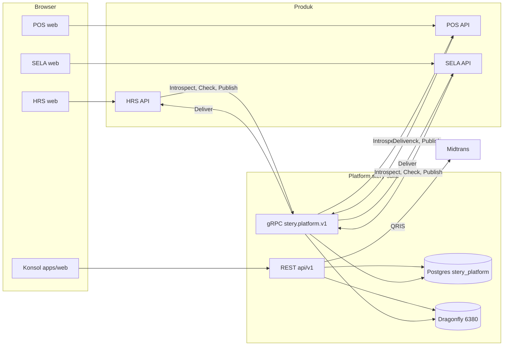
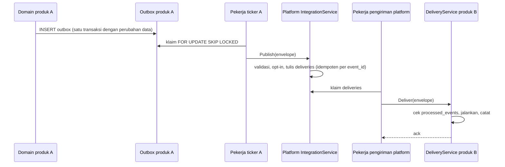
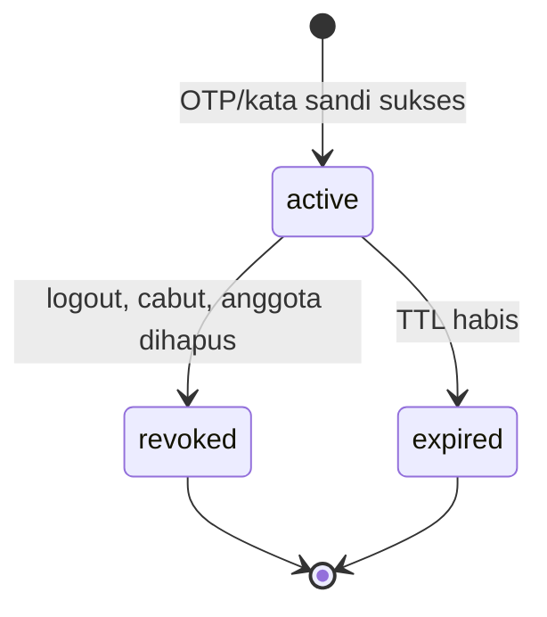
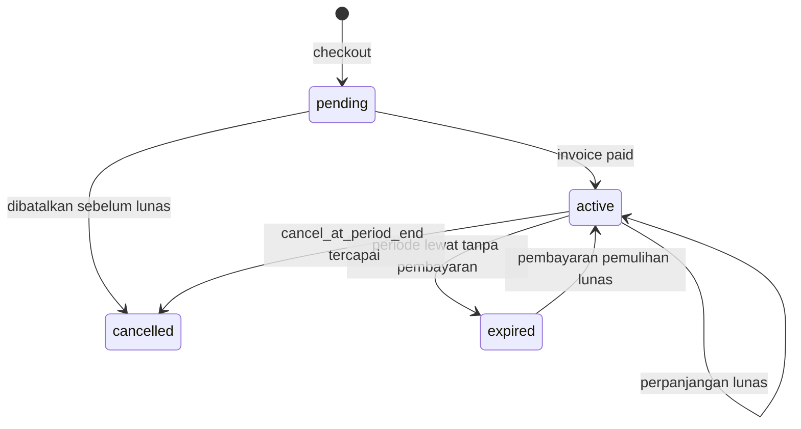
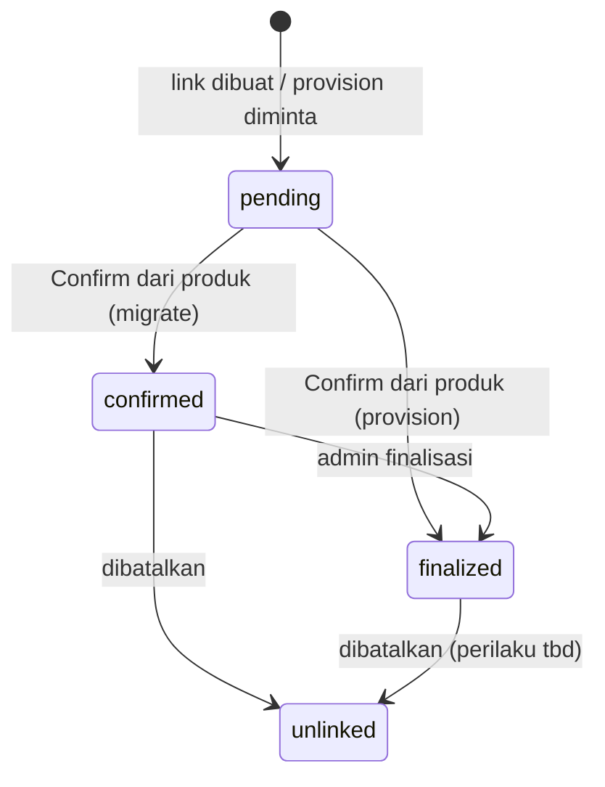
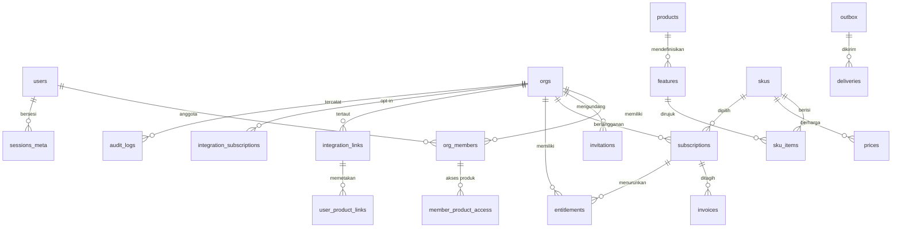
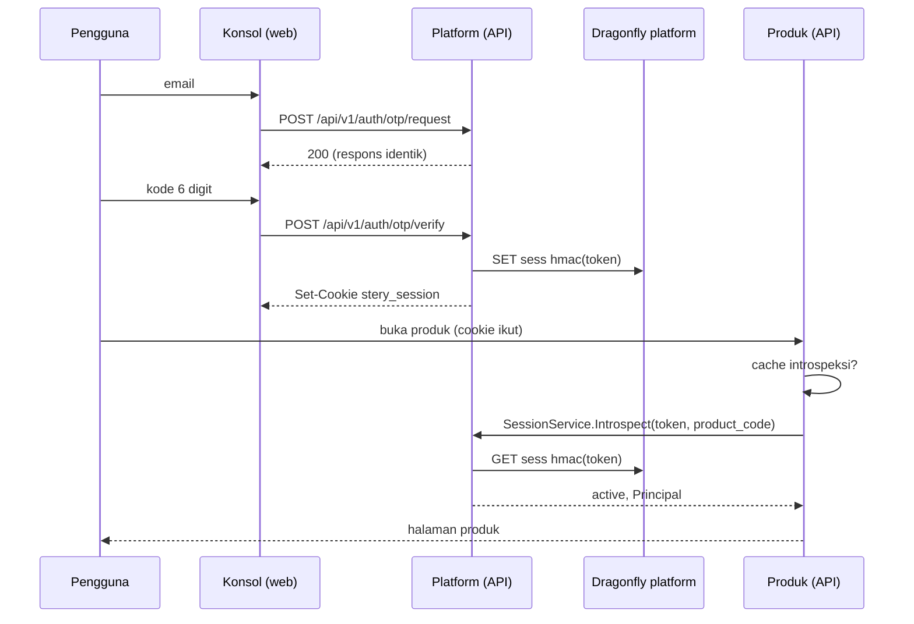
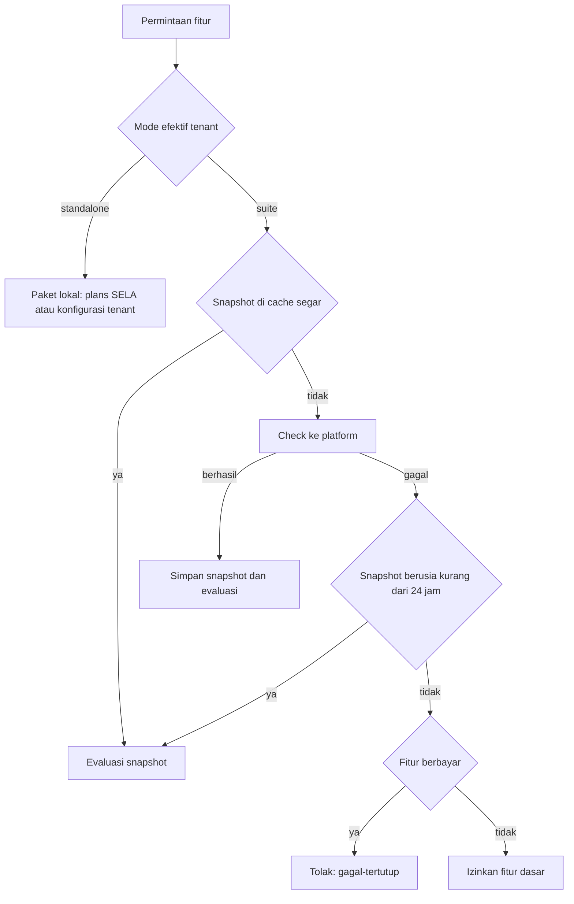
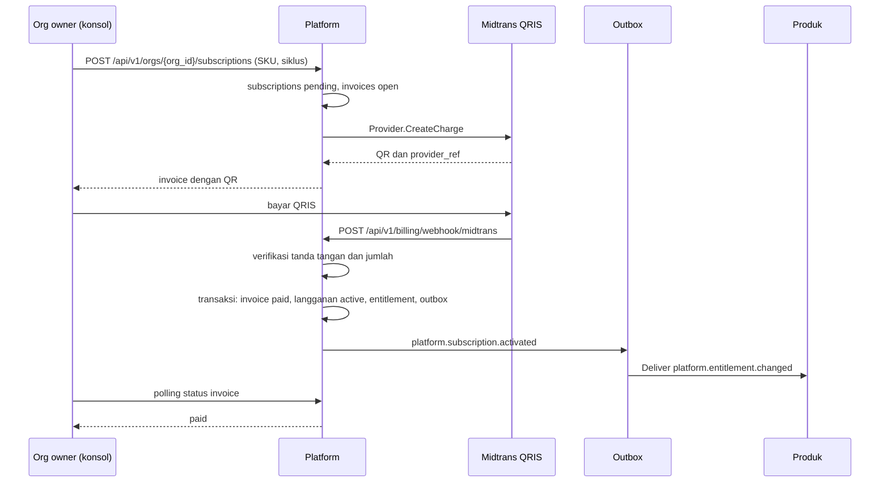

# FSD Stery Suite

*Functional Specification Document (FSD): platform `stery-suite`, mode operasi produk, dan kontrak integrasi untuk HRIS-Stery, POS-Stery, dan SELA*

|                         |                                                                                                                                        |
|-------------------------|----------------------------------------------------------------------------------------------------------------------------------------|
| **Nama Dokumen**        | FSD - Stery Suite (platform, port, kontrak produk, dan strategi penyelarasan)                                                          |
| **Versi**               | 1.0 (Draft)                                                                                                                            |
| **Tanggal**             | 6 November 2026                                                                                                                        |
| **Disusun oleh**        | Tim Produk & Engineering                                                                                                               |
| **Status**              | Draft untuk ditinjau                                                                                                                   |
| **Dokumen Terkait**     | 00_Analisis_Dampak_Risiko, BRD_Stery_Suite, PRD_Stery_Suite, BRD_HRIS, PRD_HRIS, FSD_HRIS, BRD_POS, FSD_POS, `POS-Stery/PRD.md`, BRD/PRD/FSD Sela (v2.5 / v2.5 / v2.55) |
| **Perubahan dari vX**   | Dokumen pertama                                                                                                                        |

## 1. Pendahuluan

### 1.1 Tujuan

Dokumen ini adalah spesifikasi fungsional dan teknis platform `stery-suite` dan kontrak yang harus dipenuhi HRIS-Stery (`HRS`), POS-Stery (`POS`), dan SELA (`SEL`) agar dapat dijual sebagai satu paket maupun sendiri-sendiri. Dokumen ini turunan langsung dari BRD_Stery_Suite (kebutuhan `BR-SUI-01` sampai `BR-SUI-18`, log keputusan `D-SUI-01` sampai `D-SUI-12`) dan PRD_Stery_Suite (`US-SUI-01` sampai `US-SUI-17`, `NFR-SUI-01` sampai `NFR-SUI-16`); ID tersebut hanya dirujuk di sini, tidak didefinisikan ulang.

### 1.2 Ruang lingkup dan batas

- **Dalam lingkup:** platform (IAM, ENT, BIL, NTF, AUD, ADM, INT, DEP), enam port Go dengan dua adapter, kontrak gRPC `stery.platform.v1` dan `stery.product.v1`, model data platform, profil deploy suite, Product Contract, dan strategi penyelarasan S1-S4.
- **Di luar lingkup:** perubahan kode di repo mana pun (fase ini hanya dokumen), fungsi domain HRS dan POS (ada di FSD_HRIS dan FSD_POS), perubahan paket dan harga SELA, observabilitas OpenTelemetry/Prometheus pada baseline (keputusan terbuka D-SUI-11).
- **Status platform hari ini:** `stery-suite` hanya berisi `docs/` (repo git dibuat, tanpa commit dan tanpa kode). Seluruh FR di bagian 4 karena itu berstatus `Belum`, kecuali beberapa yang sebagian sudah dipenuhi oleh aset SELA yang akan dipakai ulang (lihat 1.3).

### 1.3 Konvensi dokumen

| Konvensi | Arti |
|---|---|
| Status | `Selesai`, `Sebagian`, `Belum`, `Pending Verification`, `Ditunda`. Pada dokumen ini `Sebagian` hanya dipakai bila implementasi yang dapat dipakai ulang sudah ada di repo produk (mis. SELA); sisi platform tetap `Belum`. |
| `Bukti` | Path repo relatif terhadap akar `moon-eye` (awalan `SELA/`, `POS-Stery/`, `HRIS-Stery/`, `stery-suite/`). Kolom ini hanya memuat path yang ada saat ini; jalur target hanya muncul pada tabel delta 2.7 dan struktur repo 2.6. |
| Prioritas | M = Must, S = Should, C = Could. |
| `tbd` | Nilai bisnis atau teknis yang belum diputuskan dan tidak ditemukan di repo; selalu disertai pertanyaan terbuka. Tidak ada harga, SLA, kuota, atau target yang diturunkan atau ditebak. Satu-satunya angka harga adalah harga paket SELA yang sudah ada (Rp0, Rp39.000, Rp129.000, Rp350.000). |
| `[INFERENCE]` | Usulan perancangan atau estimasi penulis yang belum didukung bukti kode atau keputusan pemilik. |
| ID | `FR-SUI-<MM>.<n>` dan `FR-SUI-SEC.<n>` hanya didefinisikan di bagian 4. `<MM>` = nomor modul: 01 IAM, 02 ENT, 03 BIL, 04 NTF, 05 AUD, 06 ADM, 07 INT, 08 DEP. FR SELA ditulis dengan namanya sendiri, mis. `SELA FR-05.1`. |
| Kebenaran | Kode adalah kebenaran. Dokumen status atau catatan yang bertentangan dengan kode dicatat di 11.3, tidak diulang sebagai fakta. |

### 1.4 Istilah

| Istilah | Definisi |
|---|---|
| Organisasi (org) | Entitas pelanggan di platform; pemilik langganan, anggota, dan entitlement. |
| Tenant | Satuan isolasi data di dalam produk (HRS/POS: tenant; SELA: host). Pada mode suite, tenant produk ditautkan ke satu org. |
| Mode | `STERY_MODE=standalone` (bawaan) atau `suite`. Mode efektif per tenant dijelaskan di 4.08 (FR-SUI-08.2). |
| Port | Antarmuka Go yang dipakai produk untuk identitas, tenant, entitlement, notifikasi, audit, dan event. Tiap port punya adapter `standalone` dan adapter `suite`. |
| Snapshot entitlement | Dokumen entitlement per org yang ditandatangani platform dan di-cache produk. |
| Envelope | Format event lintas produk (6.4). |
| Product Contract | Daftar syarat bergabungnya sebuah produk ke suite (4.08, FR-SUI-08.3 sampai FR-SUI-08.8). |

## 2. Arsitektur dan Stack

Prinsip arsitektur (D-SUI-01): komposisi, bukan konsolidasi. Tiga produk tetap unit deploy terpisah dengan basis data terpisah; platform adalah unit deploy keempat. Stack seluruh suite adalah stack SELA (keputusan pemilik); HRIS dan POS diselaraskan ke stack itu (2.7).

### 2.1 Stack (STACK-SPEC, sumber SELA)

Tabel berikut normatif untuk platform dan menjadi daftar periksa kesesuaian (FR-SUI-08.7) untuk setiap produk. Kolom sumber menunjuk bukti keberadaan standar itu di SELA. Versi dibaca dari `SELA/apps/api/go.mod` (go 1.25.1, pgx v5.11.0, goose v3.26.0, go-redis v9.22.0, grpc v1.84.0) dan `SELA/apps/web/package.json` (Svelte ^5.56.1, Vite ^8.0.16, TypeScript ^6.0.3, Vitest ^4.1.11, SvelteKit ^2.63.0).

| # | Lapisan | Standar | Sumber di SELA |
|---|---|---|---|
| 1 | Tata letak repo | Per produk: `apps/api`, `apps/web`, `deploy/`, `scripts/`, `docs/`, `Makefile`, `CLAUDE.md`, `AGENTS.md` | `SELA/CLAUDE.md` (bagian Layout), `SELA/docs/FSD_Sela.md` (2.6), `SELA/AGENTS.md`, `SELA/Makefile` |
| 2 | Bahasa | Go >= 1.25.1; satu modul per produk `github.com/<owner>/<product>` (handle pemilik `Briyantama` seperti SELA, belum terverifikasi untuk repo baru, OQ-7) | `SELA/apps/api/go.mod` |
| 3 | Dekomposisi | Modul = paket Go `services/<nama>` dalam satu proses; inti `Service` + repositori Postgres + adapter HTTP + adapter gRPC opsional; batas lewat antarmuka Go dan kontrak proto agar dapat dipisah kemudian | `SELA/apps/api/services`, `SELA/docs/FSD_Sela.md` (2.6) |
| 4 | Transport | REST `/api/v1` pada `net/http` ServeMux, amplop `{success,data,error}` lewat `kit/httpx`; gRPC (`api/proto/v1`, buf, `gen/go` ter-commit, `scripts/proto-gen.sh --check`) untuk klien mesin/internal dengan interceptor deny-by-default; tanpa gateway tier; Caddy hanya sebagai reverse proxy | `SELA/apps/api/cmd/api/routes.go`, `SELA/apps/api/internal/httpx/response.go`, `SELA/apps/api/api/proto/v1/auth.proto`, `SELA/apps/api/buf.yaml`, `SELA/scripts/proto-gen.sh`, `SELA/apps/api/services/auth/interceptor.go` |
| 5 | Basis data | PostgreSQL 18 (`uuidv7()`), pgx/v5 dengan SQL mentah (tanpa sqlc, tanpa ORM), goose v3.26.0 embedded + `cmd/migrate up` atau `down`, `testdb.NewMigrated` (kloning template) | `SELA/apps/api/internal/db/migrate.go`, `SELA/apps/api/cmd/migrate`, `SELA/apps/api/internal/testdb/testdb.go`, `SELA/apps/api/internal/db/migrations` |
| 6 | Isolasi tenant | Untuk HRS, POS, platform: RLS wajib sesuai D-SUI-08 (`ENABLE`+`FORCE`, kebijakan `tenant_isolation` dengan `USING` dan `WITH CHECK`, GUC `app.tenant_id` per transaksi lewat `kit/tenantdb.WithTenant`, POS menambah `app.store_id`, peran aplikasi NOBYPASSRLS, peran migrasi terpisah). SELA sendiri tidak memakai RLS dan tidak berubah | `SELA/apps/api/internal/db/migrations` (tanpa RLS; lihat analisis 3.1) |
| 7 | State store | Dragonfly lewat go-redis/v9: sesi (hanya hash), pembatas laju, kuota, antrean, skrip Lua | `SELA/deploy/docker-compose.yml`, `SELA/apps/api/services/auth/store.go`, `SELA/apps/api/services/auth/limiter.go` |
| 8 | Penyimpanan objek | RustFS (S3) lewat aws-sdk-go-v2 di balik `objstore.Store`; hanya URL bertanda tangan; pemindaian ClamAV (`clamd`) gagal-tertutup pada jalur unggah | `SELA/apps/api/internal/objstore/store.go`, `SELA/apps/api/internal/objstore/s3.go`, `SELA/apps/api/services/media/scan/clamav.go` |
| 9 | Autentikasi | Sesi opaque pada cookie HttpOnly Secure, hash di Dragonfly; tabel RBAC (roles, permissions, actions, role_actions) + `RequirePermission(code)`; tanpa JWT dan tanpa token di peramban | `SELA/apps/api/services/auth/service.go`, `SELA/apps/api/services/auth/http.go`, `SELA/apps/api/services/rbac/http.go`, `SELA/apps/api/internal/db/migrations/0004_rbac_foundation.sql` |
| 10 | Asinkron | Pekerja ticker dalam proses + outbox Postgres + konsumen idempoten; tanpa NATS/Kafka | `SELA/apps/api/services/event/postgres.go`, `SELA/apps/api/services/instant/jobs.go`, `SELA/apps/api/internal/db/migrations/0008_notifications.sql` |
| 11 | Observabilitas | `log/slog` JSON + `/healthz`; OpenTelemetry/Prometheus belum baseline (D-SUI-11, `tbd`) | `SELA/apps/api/internal/health/health.go`, `SELA/apps/api/cmd/api/routes.go` |
| 12 | Konfigurasi | Variabel lingkungan, validasi gagal-cepat, rahasia tidak pernah dicetak, `.env.example` | `SELA/apps/api/internal/config/config.go`, `SELA/.env.example` |
| 13 | PII dan audit | `kit/piicrypt` (AES-256-GCM, AAD per tujuan, blind index HMAC, rotasi kunci); `kit/audit` `audit_logs` append-only dengan trigger basis data | `SELA/apps/api/internal/piicrypt/piicrypt.go`, `SELA/apps/api/internal/audit/audit.go`, `SELA/apps/api/internal/db/migrations/0014_pii_encryption_audit.sql` |
| 14 | Pembayaran | Antarmuka `payment.Provider`, Midtrans QRIS (Xendit dihapus 14 Oktober 2026), webhook bertanda tangan, notifikasi lunas dipercaya hanya bila jumlah cocok | `SELA/apps/api/services/payment/provider.go`, `SELA/apps/api/services/payment/midtrans.go`, `SELA/apps/api/services/payment/postgres.go` |
| 15 | Web | SvelteKit 2 + Svelte 5 + Vite 8 + TypeScript 6, `ssr=false`, `adapter-static`, npm, Node >= 20.19; `apiFetch` + cermin amplop; i18n katalog `{id,en}` dengan tes paritas; Vitest 4 + Testing Library; Playwright (kanal Chrome) | `SELA/apps/web/package.json`, `SELA/apps/web/src/lib/api/client.ts`, `SELA/apps/web/src/lib/api/envelope.ts`, `SELA/apps/web/src/lib/i18n/messages/parity.test.ts` |
| 16 | Deploy | Caddy; web statis (Vercel atau Caddy); `deploy/docker-compose.yml` untuk Dragonfly, RustFS, profil ClamAV; port standalone bawaan API 8080, gRPC 9090, web 5173 | `SELA/deploy/Caddyfile`, `SELA/deploy/docker-compose.yml`, `SELA/deploy/README.md` |
| 17 | Gerbang kualitas | `scripts/check.sh` (drift proto, gofmt, vet, golangci-lint, `go test -cover`, svelte-check, vitest coverage, e2e dengan tumpukan nyata; `CHECK_STAGES`); GitHub Actions job go/web/e2e; ambang cakupan 80%; `-race` di CI | `SELA/scripts/check.sh`, `SELA/.github/workflows/ci.yml` |
| 18 | Proses | TDD RED/GREEN; `docs/tracking/tracker.json` + `scripts/build_tracker.py`; FSD diperbarui bersama kode; artefak `docs/aidlc/` | `SELA/docs/tracking/tracker.json`, `SELA/scripts/build_tracker.py`, `SELA/CLAUDE.md` |
| 19 | Lokal | Indonesia bawaan, Inggris didukung, IDR, WIB | `SELA/CLAUDE.md` (bagian Language), `SELA/apps/web/src/lib/i18n/messages/parity.test.ts` |

Catatan penerapan pada platform:

- Platform tidak menerima unggahan media; baris 8 (RustFS, ClamAV) dipakai platform hanya bila fitur lampiran ditambahkan kemudian. Paket `kit/objstore` dan klien `clamd` tetap disediakan untuk produk.
- Platform tidak memakai ORM, sqlc, JWT, NATS, ataupun gateway tier; ini sama dengan daftar "di luar lingkup" BRD_Stery_Suite 4.4.
- SELA saat ini belum memuat `kit`: `internal/` hanya dapat diimpor dari dalam modul SELA, sehingga pengangkatan ke `kit` (S1) adalah pekerjaan nyata, bukan nama baru (2.6, 2.7).

### 2.2 Dekomposisi modul

Platform adalah satu proses Go dengan modul-modul berikut (baris 3 STACK-SPEC). Batas antarmodul adalah antarmuka Go; kontrak yang dipakai produk dipublikasikan sebagai gRPC.

| Modul | Paket (target) | Tanggung jawab | Bergantung pada | Transport |
|---|---|---|---|---|
| 01 IAM | `services/iam` | Pengguna, organisasi, anggota, undangan, sesi, RBAC platform, token layanan | Postgres, Dragonfly, NTF | REST, gRPC `SessionService`, `LinkService` |
| 02 ENT | `services/entitlement` | Katalog produk/SKU, entitlement, snapshot bertanda tangan, penggunaan | Postgres, BIL (event), IAM | REST, gRPC `EntitlementService` |
| 03 BIL | `services/billing` | Harga, langganan, invoice, `Provider` pembayaran, webhook, pekerjaan perpanjangan/kedaluwarsa | Postgres, ENT, NTF, `Provider` | REST |
| 04 NTF | `services/notification` | Outbox notifikasi, pekerja SMTP, template, preferensi | Postgres, SMTP | gRPC `NotificationService` (untuk produk), internal |
| 05 AUD | `services/audit` | `audit_logs` platform, sink audit produk, pembaca | Postgres | REST, gRPC `AuditService` |
| 06 ADM | `services/admin` + `apps/web` | API operator dan konsol web | Semua modul | REST |
| 07 INT | `services/integration` | Tautan org-tenant, publish/deliver event, retry, dead-letter | Postgres, ENT, IAM | gRPC `IntegrationService`, `LinkService`; klien `DeliveryService` |
| 08 DEP | `deploy/`, `scripts/`, `kit/` | Profil deploy, Product Contract, kit bersama, daftar periksa | semua | tidak berlaku |



### 2.3 Komponen antarmuka

| Komponen | Pengguna | Protokol | Catatan |
|---|---|---|---|
| Konsol platform (`apps/web`) | Org owner, org admin, operator | HTTPS, REST `/api/v1`, cookie `stery_session` | SPA SvelteKit (D-SUI-09); layar di bagian 10 |
| API REST platform | Konsol, Midtrans (webhook) | HTTPS | Amplop `{success,data,error}`; webhook publik, terverifikasi tanda tangan |
| gRPC platform `stery.platform.v1` | API produk (mesin) | gRPC | Deny-by-default; token HMAC layanan; tidak diekspos ke peramban |
| gRPC produk `stery.product.v1` (`DeliveryService/Deliver`) | Platform (mesin) | gRPC | Diimplementasikan tiap produk mode suite |
| Web produk (`apps/web` per produk) | Pengguna produk | HTTPS, REST produk | Tidak berubah di mode standalone; pada mode suite memakai cookie `stery_session` |
| PWA tamu SELA `/e/` | Tamu anonim | HTTPS | Tetap tanpa login pada kedua mode (cookie `sela_guest`); tidak melewati platform |
| SMTP | NTF | SMTP | Pola kirim langsung SELA (`SMTP_*`) |
| Midtrans Core API | BIL | HTTPS | QRIS; webhook ke `/api/v1/billing/webhook/midtrans` |
| Caddy | Semua | HTTPS | Reverse proxy; pola `SELA/deploy/Caddyfile` |


### 2.4 Penggunaan Dragonfly, port Go, kontrak gRPC, dan model data platform

#### 2.4.1 Penggunaan Dragonfly

Platform memakai satu instance Dragonfly sendiri (profil suite: port 6380). Tiap produk tetap memakai instance Dragonfly sendiri (D-SUI-07); kunci SELA tidak berawalan, sehingga produk tidak pernah berbagi instance. Nilai TTL yang tidak tercantum `tbd`.

| Kunci (platform) | Isi | TTL | Pola sumber |
|---|---|---|---|
| `sess:{hmac}` | Rekaman sesi (`session_id`, `user_id`, `org_id` aktif, atribut per produk); kunci = HMAC token dengan awalan domain `session` | TTL sesi; SELA memakai default 12 jam (`SELA/apps/api/services/auth/service.go`), nilai platform `tbd` (OQ-F1) | `SaveSession` SELA: hanya hash yang disimpan |
| `usess:{user_id}` | Himpunan `session_id` pengguna, untuk pencabutan semua sesi (FR-SUI-01.7) | Mengikuti sesi terpanjang | baru |
| `otp:{hmac}` | HMAC kode 6 digit; sekali pakai | 5 menit | `SELA/CLAUDE.md` (invarian Auth) |
| `otpfail:{hmac}` | Penghitung salah; 5 salah mengunci alamat 15 menit | 15 menit | `SELA/CLAUDE.md` |
| `rl:{lingkup}:{subjek}` | Penghitung jendela tetap (OTP, login, undangan, webhook) per alamat dan per alamat koneksi; gagal-tertutup bila pembatas error | per lingkup, `tbd` | `SELA/apps/api/services/auth/limiter.go` |
| `svcnonce:{produk}:{nonce}` | Perlindungan replay token layanan HMAC | sama dengan toleransi jam, `tbd` | baru |

Kunci sisi produk pada mode `suite`: snapshot entitlement di Dragonfly produk pada kunci `ent:snap:<org>` (nama kunci sudah dipakai FSD_HRIS 2.4, TTL 24 jam bawaan D-SUI-04, `tbd`), ditambah salinan tahan restart di tabel `entitlement_snapshots` basis data produk agar restart Dragonfly bersamaan dengan platform mati tidak menghilangkan snapshot (FR-SUI-02.6, `[INFERENCE]`). Cache introspeksi sesi (30 detik, D-SUI-03) berada di memori proses produk, bukan di Dragonfly.

#### 2.4.2 Enam port Go dan dua adapter

Port mendefinisikan satu-satunya cara kode domain produk berhubungan dengan identitas, tenant, entitlement, notifikasi, audit, dan event. Lokasi paket `kit/port` adalah usulan `[INFERENCE]` (OQ-F2); tanda tangan di bawah mengikuti keputusan D-SUI-02. `Entitlement.Limit` adalah tambahan `[INFERENCE]` untuk dimensi batas (FR-SUI-02.9); `Audit.Record` tanpa nilai kembalian mengikuti `audit.Recorder` SELA (`SELA/apps/api/internal/audit/audit.go`).

```go
package port

type Principal struct {
    UserID      string
    OrgID       string            // kosong pada adapter standalone SELA
    TenantID    string            // hasil pemetaan org -> tenant produk (HRS/POS); kosong di SELA
    SessionID   string
    Roles       []string          // peran produk (dari manifest)
    Permissions []string          // kode izin, mis. events:create
    Attributes  map[string]string // atribut sesi per produk, mis. store_id (POS)
    ExpiresAt   time.Time
}

type Scope struct{ StoreID string } // POS mengisi StoreID; produk lain kosong

type Identity interface {
    Verify(ctx context.Context, token string) (Principal, error)
}
type Tenant interface {
    // Menjalankan fn dalam satu transaksi; mengatur app.tenant_id (dan app.store_id) transaksi-lokal.
    WithTenant(ctx context.Context, tenantID string, scope Scope, fn func(ctx context.Context, tx *sql.Tx) error) error
}
type Entitlement interface {
    Allows(ctx context.Context, org, feature string) (bool, error)
    Limit(ctx context.Context, org, dimension string) (value int64, set bool, err error)
}
type Notification interface {
    Enqueue(ctx context.Context, tx *sql.Tx, msg Message) error
}
type Audit interface {
    Record(ctx context.Context, event audit.Event)
}
type Events interface {
    Publish(ctx context.Context, tx *sql.Tx, envelope Envelope) error
}
```

| Port | Adapter `standalone` (bawaan) | Adapter `suite` | Aset yang dipakai ulang |
|---|---|---|---|
| `Identity` | Sesi lokal produk: SELA OTP email + cookie `sela_session`; HRS dan POS kata sandi (hash yang ada) + sesi opaque, JWT dihapus (D-SUI-10) | Introspeksi lewat `SessionService/Introspect` dengan cache 30 detik; cookie `stery_session` | `SELA/apps/api/services/auth/service.go` (`Authenticate`), `SELA/apps/api/services/auth/interceptor.go` |
| `Tenant` | HRS/POS: tenant lokal lewat `kit/tenantdb.WithTenant`; SELA: tanpa tenant (transaksi biasa tanpa GUC) | Org platform dipetakan ke tenant produk (`tenants.org_id`; SELA: `hosts.org_id`), lalu `WithTenant` yang sama | `kit/tenantdb` (baru) |
| `Entitlement` | Paket lokal: SELA `events.package` -> `plans`; HRS/POS: paket lokal `tbd` | `EntitlementService/Check` + snapshot bertanda tangan (FR-SUI-02.4 sampai FR-SUI-02.7) | `SELA/apps/api/services/payment/postgres.go`, `SELA/apps/api/internal/db/migrations/0011_plans_transactions.sql` |
| `Notification` | Outbox lokal + pekerja SMTP | Outbox lokal dalam transaksi, relay ke `NotificationService/Send` | `SELA/apps/api/internal/db/migrations/0008_notifications.sql`, `SELA/apps/api/services/event/postgres.go` |
| `Audit` | `audit_logs` lokal append-only | Lokal ditambah relay ke `AuditService/Record` (best-effort lewat outbox) | `SELA/apps/api/internal/audit/audit.go`, `SELA/apps/api/internal/audit/store.go` |
| `Events` | Outbox lokal; tidak ada pengiriman keluar produk | Outbox lokal, relay ke `IntegrationService/Publish` | `SELA/apps/api/services/instant/jobs.go` (klaim `SKIP LOCKED`) |

#### 2.4.3 Layanan gRPC

Semua layanan platform berada di belakang interceptor deny-by-default (pola `NewUnaryHostInterceptor` SELA) yang mensyaratkan token HMAC layanan; tidak ada metode publik. Sketsa pesan ada di 6.3.

| Layanan | Metode | Pemanggil | Fungsi | FR |
|---|---|---|---|---|
| `stery.platform.v1.SessionService` | `Introspect`, `SetAttribute`, `Revoke` | Produk | Mengubah token sesi menjadi Principal; menetapkan atribut sesi per produk; mencabut sesi | FR-SUI-01.5, FR-SUI-01.12 |
| `stery.platform.v1.EntitlementService` | `Check`, `GetSnapshot`, `ReportUsage` | Produk | Cek fitur, ambil snapshot bertanda tangan, lapor penggunaan | FR-SUI-02.4, FR-SUI-02.5, FR-SUI-02.10 |
| `stery.platform.v1.IntegrationService` | `Publish` | Produk | Menerima envelope dari outbox produk | FR-SUI-07.8 |
| `stery.platform.v1.NotificationService` | `Send` | Produk | Menerima pesan notifikasi untuk dikirim hub | FR-SUI-04.4 |
| `stery.platform.v1.AuditService` | `Record` | Produk | Menerima peristiwa audit (batch, idempoten per `event_id`) | FR-SUI-05.3 |
| `stery.platform.v1.LinkService` | `Confirm`, `GetStatus` | Produk | Handshake tautan org-tenant (migrasi dan provisioning); finalisasi dikirim platform sebagai event `platform.link.finalized` lewat `Deliver` (7.5) | FR-SUI-07.2, FR-SUI-07.3, FR-SUI-07.5 |
| `stery.product.v1.DeliveryService` | `Deliver` | Platform | Menyampaikan envelope ke produk tujuan, termasuk event kontrol platform (`platform.tenant.provision_requested`, `platform.link.finalized`, `platform.entitlement.changed`) | FR-SUI-07.10 |

#### 2.4.4 Model data platform (ringkasan)

Database `stery_platform`, peran aplikasi `stery_platform` (NOBYPASSRLS), peran migrasi terpisah. Kelas PII: T = tinggi (enkripsi `piicrypt`), S = sedang, N = tidak ada. Tenant pada platform = org: kebijakan RLS memakai `current_setting('app.tenant_id', true)::uuid` yang berisi `org_id`. Detail kolom, kebijakan, dan diagram ada di bagian 5.

| Tabel | Isi | Kolom kunci | RLS | PII |
|---|---|---|---|---|
| `users` | Identitas pengguna lintas org | `user_id`, `email_ciphertext`, `email_blind_index`, `name`, `password_hash` (nullable), `status` | Tidak (lintas org); hanya modul IAM yang mengaksesnya | T (email), S (nama), kredensial |
| `orgs` | Organisasi | `org_id`, `name`, `status`, `created_by` | Ya (`org_id` = tenant atau anggota) | N |
| `org_members` | Keanggotaan | `member_id`, `org_id`, `user_id`, `org_role`, `status` | Ya | N |
| `invitations` | Undangan | `invitation_id`, `org_id`, `email_ciphertext`, `email_blind_index`, `token_hmac`, `expires_at`, `accepted_at` | Ya | T |
| `member_product_access` | Akses dan peran per produk | `org_id`, `member_id`, `product_code`, `product_role` | Ya | N |
| `roles`, `resources`, `actions`, `permissions`, `role_actions` | Katalog RBAC platform | pola migrasi 0004 SELA | Tidak (katalog global) | N |
| `products` | Produk terdaftar | `product_code`, `manifest`, `gate_status`, `sellable`, `delivery_endpoint` | Tidak (global) | N |
| `features` | Kunci fitur dan dimensi per produk | `product_code`, `feature_key`, `kind` (flag/limit), `unit` | Tidak | N |
| `skus`, `sku_items` | SKU dan bundel beserta isinya | `sku_code`, `kind`, `product_code`, `feature_key`, `bool_value`, `limit_value` | Tidak | N |
| `prices` | Harga per SKU dan siklus | `sku_code`, `billing_cycle`, `amount_idr`, `valid_from` | Tidak; tanpa baris sampai OQ-1 | N |
| `subscriptions` | Langganan org | `subscription_id`, `org_id`, `sku_code`, `status`, `billing_cycle`, `current_period_end` | Ya | N |
| `invoices` | Tagihan dan pembayaran | `invoice_id`, `org_id`, `subscription_id`, `amount_idr`, `status`, `provider`, `provider_ref`, `expires_at`, `paid_at` | Ya | N |
| `entitlements` | Hak pakai turunan | `org_id`, `product_code`, `feature_key`, `enabled`, `limit_value`, `source_subscription_id` | Ya | N |
| `entitlement_versions` | Versi monoton per org untuk snapshot | `org_id`, `version`, `updated_at` | Ya | N |
| `usage_reports` | Penggunaan dilaporkan produk | `org_id`, `product_code`, `dimension`, `value`, `reported_at` | Ya | N |
| `sessions_meta` | Metadata sesi (bukan token) | `session_id`, `user_id`, `org_id`, `created_at`, `expires_at`, `revoked_at`, `client_hash` | Ya (`user_id`/`org_id`) | S (`client_hash` berkunci) |
| `integration_links` | Tautan org-tenant produk | `link_id`, `org_id`, `product_code`, `tenant_ref`, `status`, `link_code_hmac` | Ya | N |
| `user_product_links` | Pemetaan pengguna platform ke pengguna produk | `org_id`, `user_id`, `product_code`, `external_ref` | Ya | N |
| `integration_subscriptions` | Opt-in integrasi per org | `org_id`, `source_product`, `target_product`, `enabled` | Ya | N |
| `outbox` | Outbox event platform | `event_id`, `kind`, `event_type`, `org_id`, `payload`, `status`, `attempts`, `next_attempt_at` | Tidak (tabel sistem, lihat 5.2) | S (payload tanpa PII mentah) |
| `deliveries` | Pengiriman event ke produk | `delivery_id`, `event_id`, `target_product`, `status`, `attempts`, `dead_at` | Tidak (tabel sistem) | N |
| `notifications` | Outbox notifikasi hub | `id`, `org_id`, `kind`, `user_id`, `dedupe_key`, `status`, `attempts`, `payload_ciphertext` | Tidak (tabel sistem) | T (payload tersegel) |
| `processed_events` | Konsumen idempoten | `consumer`, `event_id`, `processed_at` | Tidak (tabel sistem) | N |
| `audit_logs` | Audit append-only | `audit_id`, `occurred_at`, `action`, `outcome`, `actor_type`, `actor_id`, `org_id`, `product_code`, `event_id`, `details` | Ya untuk SELECT; INSERT terbuka bagi modul | S (tanpa token/kode/email mentah) |

### 2.5 Event, outbox, dan profil deploy

#### 2.5.1 Prinsip event (D-SUI-06)

Tanpa NATS. Tiga tingkat: (1) event domain dalam proses di dalam satu produk; (2) outbox transaksional Postgres per produk: sebuah baris ditulis dalam transaksi yang sama dengan perubahan datanya, dan pekerja ticker mengirimnya kemudian; (3) pengiriman lintas produk lewat platform: outbox produk -> `IntegrationService/Publish` -> platform menyampaikan ke `DeliveryService/Deliver` produk tujuan. Pengiriman at-least-once; konsumen wajib idempoten lewat `processed_events`; pengiriman lintas produk bersifat opt-in per org lewat fitur entitlement `integration.<a>_<b>` dan langganan integrasi yang diaktifkan org admin.



#### 2.5.2 Envelope

`{event_id (UUIDv7), event_type, org_id, store_id?, actor_id, occurred_at, schema_version, payload}`. Spesifikasi lengkap di 6.4. HRIS memiliki envelope NATS dengan `event_id`, `tenant_id`, `actor_id`, `schema_version` dan POS memiliki `event_envelope.go` sebagai acuan skema (`POS-Stery/services/_shared/nats/event_envelope.go`); envelope suite menggantikan keduanya pada penyelarasan (2.7). Nama `event_type` milik produk ditetapkan di FSD produk dan platform hanya merutekan menurut string persis: HRS memakai `hrs.<agregat>.<kejadian>` (`HRIS-Stery/docs/FSD_HRIS.id.md` 2.5, mis. `hrs.employee.terminated`, `hrs.gathering.scheduled` hipotesis); POS memetakan ke `sales.sale.completed`, `inventory.low_stock`, `supplier.stock.received`, `customer.created` (nama final `tbd`, `POS-Stery/docs/FSD_POS.id.md` 2.5); platform memakai `platform.<agregat>.<kejadian>`. Pada mode `standalone`, `org_id` pada envelope HRS sama dengan `tenant_id` lokal (FSD_HRIS 2.5); pada mode `suite` `org_id` adalah org platform dan produk memetakannya ke tenant lokal lewat `tenants.org_id`.

#### 2.5.3 Skema outbox produk (`kit/outbox`)

Tabel `outbox` dan `processed_events` sama di setiap produk; klaim memakai pola yang sudah berjalan di SELA (`FOR UPDATE SKIP LOCKED` dengan sewa `next_attempt_at`; `SELA/apps/api/services/event/postgres.go`, `SELA/apps/api/services/instant/jobs.go`). Skema SELA saat ini terpisah per modul (`notifications`, `instant_outbox`); `kit/outbox` menggeneralisasikannya, jadi ini pekerjaan baru, bukan salinan.

```sql
CREATE TABLE outbox (
    event_id        uuid PRIMARY KEY DEFAULT uuidv7(),
    kind            text        NOT NULL,            -- integration | notification | audit
    event_type      text        NOT NULL,
    org_id          uuid,
    store_id        uuid,
    actor_id        text,
    occurred_at     timestamptz NOT NULL DEFAULT now(),
    schema_version  smallint    NOT NULL DEFAULT 1,
    payload         jsonb       NOT NULL,
    status          text        NOT NULL DEFAULT 'pending',
    attempts        integer     NOT NULL DEFAULT 0,
    next_attempt_at timestamptz NOT NULL DEFAULT now(),
    last_error      text,
    created_at      timestamptz NOT NULL DEFAULT now(),
    sent_at         timestamptz,
    CONSTRAINT outbox_kind_valid   CHECK (kind IN ('integration','notification','audit')),
    CONSTRAINT outbox_status_valid CHECK (status IN ('pending','sent','failed','dead'))
);
CREATE INDEX outbox_pending_idx ON outbox (next_attempt_at) WHERE status = 'pending';

CREATE TABLE processed_events (
    consumer     text        NOT NULL,
    event_id     uuid        NOT NULL,
    processed_at timestamptz NOT NULL DEFAULT now(),
    PRIMARY KEY (consumer, event_id)
);
```

Klaim: `WITH due AS (SELECT event_id FROM outbox WHERE status = 'pending' AND next_attempt_at <= $1 ORDER BY event_id LIMIT $3 FOR UPDATE SKIP LOCKED) UPDATE outbox o SET attempts = o.attempts + 1, next_attempt_at = $2 FROM due WHERE o.event_id = due.event_id RETURNING o.*`. Jumlah percobaan maksimum dan backoff `tbd`; pola SELA: backoff berganda sampai 5 percobaan (`SELA/docs/FSD_Sela.md`, catatan v2.25). Baris yang melewati batas menjadi `dead` dan dapat diulang manual (FR-SUI-07.11).

#### 2.5.4 Profil deploy dan peta port

Profil suite menjalankan platform dan tiga produk pada satu host pengembangan/staging tanpa tabrakan port (BR-SUI-18). Profil standalone setiap produk tidak berubah.

| Layanan | API | gRPC | Web | Catatan |
|---|---|---|---|---|
| Platform | 8180 | 9190 | 5273 | gRPC tidak dibuka ke publik |
| HRIS (`HRS`) | 8280 | 9290 | 5373 | |
| POS (`POS`) | 8380 | 9390 | 5473 | Satu `apps/web` (D-SUI-09) |
| SELA (`SEL`) | 8080 | 9090 | 5173 | Tidak berubah |

| Sumber daya bersama | Port | Isi |
|---|---|---|
| PostgreSQL 18 | 5432 | Empat basis data: `stery_platform`, `hris`, `pos`, `sela`; satu peran aplikasi per basis data (`stery_platform`, `hris`, `pos`, `sela`); satu peran migrasi terpisah per basis data (nama `tbd`) |
| Dragonfly | 6379 SELA, 6380 platform, 6381 HRIS, 6382 POS | Satu instance per produk (D-SUI-07) |
| RustFS | 9000 (S3), 9001 (konsol) | Satu bucket dan satu access key per produk; SELA `sela-media` (bawaan `S3_BUCKET` pada `SELA/deploy/docker-compose.yml`), nama bucket lain `tbd` |
| ClamAV | 3310 | Bersama; profil `scan` seperti di SELA |
| Caddy | 80/443 | Satu domain induk; rute per produk; domain cookie `stery_session` `tbd` (OQ-3) |

Port standalone saat ini (bukti dibaca dari `.env.example`) dan tabrakannya:

| Produk | Port saat ini | Bukti |
|---|---|---|
| SELA | API 8080, gRPC 9090, web 5173; e2e memakai 8081, 9091, 5174, 5175; Postgres lokal 5432; Dragonfly 6379; RustFS 9000/9001; ClamAV 3310 | `SELA/CLAUDE.md`, `SELA/deploy/docker-compose.yml` |
| POS | Gateway `HTTP_PORT=8000`; gRPC 8081 sampai 8086; admin 5173, kasir 5174; Postgres 5432; Redis 6379; NATS 4222; OTLP 4318 (komentar menyebut 4317 untuk gRPC) | `POS-Stery/.env.example` |
| HRIS | Postgres 5432; Redis 6379; NATS 4222; OTLP 4317; port gRPC per layanan lewat `GRPC_PORT` | `HRIS-Stery/.env.example` |

Tabrakan yang terbukti pada port standalone saat ini: 5432 (ketiganya), 6379 (ketiganya), 4222 (HRIS dan POS), 5173 (SELA web dan admin POS), 8081 (gRPC auth POS dan API e2e SELA). Tabrakan 4317 dan 9090 dilaporkan perencana; tidak dibaca ulang sepenuhnya di sini. Setelah penyelarasan, bawaan standalone ketiga produk menjadi API 8080, gRPC 9090, web 5173 (STACK-SPEC baris 16), sehingga profil suite wajib memakai peta port di atas.

### 2.6 Struktur kode dan kontrak

#### 2.6.1 Struktur repo `stery-suite` (target)

```text
stery-suite/
├─ apps/
│  ├─ api/            # modul Go platform: cmd/api, cmd/migrate, services/{iam,entitlement,billing,notification,audit,admin,integration}, migrasi goose embedded
│  └─ web/            # konsol SvelteKit SPA (ssr=false, adapter-static)
├─ kit/               # modul Go terpisah, diimpor produk
│  ├─ httpx/ config/ db/ testdb/ audit/ piicrypt/ objstore/ health/   # diangkat dari SELA apps/api/internal
│  ├─ tenantdb/ session/ outbox/                                       # baru
│  ├─ port/ contract/ gen/                                             # [INFERENCE]: port, tes kontrak adapter, kode gRPC hasil generate
├─ api/proto/v1/      # stery.platform.v1, stery.product.v1 (buf)
├─ deploy/            # docker-compose.yml, profil suite, Caddyfile, README.md
├─ docs/              # BRD/PRD/FSD, tracking/tracker.json, aidlc/
├─ scripts/           # check.sh, proto-gen.sh, e2e.sh, build_tracker.py, conformance.sh
├─ Makefile
├─ CLAUDE.md
└─ AGENTS.md
```

Konsekuensi: `apps/api/go.mod` (platform) dan `kit/go.mod` adalah dua modul dalam satu repo; produk mengimpor `kit` lewat versi bertag `kit/vX.Y.Z` (konvensi tag modul subdirektori Go) dan memakai `go.work` untuk pengembangan lokal (`HRIS-Stery/go.work` dan `POS-Stery/go.work` sudah ada, `SELA` memakai satu modul tanpa `go.work`). Pilihan modul terpisah dan skema tag adalah `[INFERENCE]` (OQ-F3).

#### 2.6.2 Sumber paket `kit`

| Paket `kit` | Sumber di SELA | Perubahan saat diangkat | Usaha `[INFERENCE]` |
|---|---|---|---|
| `kit/httpx` | `SELA/apps/api/internal/httpx` (`response.go`, `decode.go`, `proxy.go`) | Hanya pindah paket | S |
| `kit/config` | `SELA/apps/api/internal/config/config.go` | Struct konfigurasi SELA bersifat khusus produk; yang diangkat hanya pembaca env gagal-cepat, penyunting rahasia, dan parser (mis. proksi tepercaya) | M |
| `kit/db` | `SELA/apps/api/internal/db/migrate.go` | Migrasi dijadikan parameter (`embed.FS`) agar tiap produk membawa migrasinya | M |
| `kit/testdb` | `SELA/apps/api/internal/testdb/testdb.go` | Fingerprint template mengikuti migrasi pemanggil | S |
| `kit/audit` | `SELA/apps/api/internal/audit` | Tambah `org_id` dan `product_code` pada `Event` tanpa mengubah perilaku SELA | M |
| `kit/piicrypt` | `SELA/apps/api/internal/piicrypt/piicrypt.go` | Hanya pindah paket | S |
| `kit/objstore` | `SELA/apps/api/internal/objstore` | Hanya pindah paket | S |
| `kit/health` | `SELA/apps/api/internal/health/health.go` | Hanya pindah paket | S |
| `kit/tenantdb` | baru | `WithTenant`: transaksi + `set_config('app.tenant_id', ..., true)` + `app.store_id` | M |
| `kit/session` | baru (dari `SELA/apps/api/services/auth/service.go`, `store.go`) | Token acak, HMAC, cookie, penyimpanan Dragonfly, klien introspeksi dengan cache 30 detik | M |
| `kit/outbox` | baru (generalisasi `notifications`, `instant_outbox`) | 2.5.3 | M |

#### 2.6.3 Kontrak antar repo

- **Proto:** sumber di `api/proto/v1`; lint dan deteksi kode usang lewat `scripts/proto-gen.sh --check` (pola SELA); perubahan yang melanggar kompatibilitas ditolak di CI (`buf breaking`, `[INFERENCE]`).
- **Versi:** semver pada `kit`; produk memutakhirkan sesuai jadwalnya sendiri; perubahan kontrak adapter harus lolos tes kontrak `kit/contract` di setiap produk (FR-SUI-08.3).
- **Biaya sinkronisasi** `kit` lintas repo adalah kelemahan opsi A yang diterima (analisis bagian 5); dikaji ulang bila terlalu mahal.

### 2.7 Delta penyelarasan: strategi migrasi per produk (S1-S4)

#### 2.7.1 Strategi

Urutan mengikuti D-SUI-12; satu penyelarasan berjalan pada satu waktu; setiap penyelarasan berakhir pada gerbang stabilisasi produk itu (analisis bagian 7).

- **S1 (kit dan platform inti).** `kit` diekstrak dari `internal/` SELA dan SELA mengimpornya kembali tanpa perubahan perilaku (tes SELA yang ada menjadi jaring pengaman). Paralel: platform IAM dan ENT beserta kontrak proto `stery.platform.v1`.
- **S2 (POS).** Enam layanan gRPC dan gateway `chi` menjadi satu modul Go dengan paket `services/<nama>`; saga penjualan menjadi satu transaksi basis data; NATS menjadi outbox; JWT menjadi sesi opaque; `apps/admin` dan `apps/cashier` menjadi satu `apps/web`. Lapisan domain dan application dipertahankan. Rincian di FSD_POS 2.7.
- **S3 (HRIS).** Tujuh layanan gRPC dan gateway Laravel menjadi satu modul Go dengan REST `/api/v1`; sqlc menjadi pgx SQL mentah; migrasi diperbaiki lalu dipindah ke goose; NIK/NPWP/birth_date dienkripsi. Rincian di FSD_HRIS 2.7.
- **S4 (mode suite).** Adapter `suite` di tiga produk (`Identity`, `Tenant`, `Entitlement`, `Notification`, `Audit`, `Events`), kolom tautan (`tenants.org_id` untuk HRS/POS; `hosts.org_id` dan `hosts.external_subject` untuk SELA, nullable, tanpa perubahan RLS), billing, konsol, tautan pelanggan standalone (7.5).
- **Aturan pelindung:** mode `standalone` harus lolos seluruh tes produk tanpa platform sepanjang S1-S5 (FR-SUI-08.16); tidak ada adapter `suite` yang diaktifkan sebelum gerbang stabilisasi produk itu tertutup (FR-SUI-02.2).

#### 2.7.2 Tabel delta

Kolom "kondisi saat ini" menunjuk bukti keberadaan (path ada); kolom "tujuan" memakai nama paket target. Usaha S/M/L adalah `[INFERENCE]` dan konsisten dengan analisis bagian 6.

| As-is -> to-be | Modul terdampak | Reuse (domain dan application dipertahankan, infrastruktur dan antarmuka ditulis ulang) | Usaha |
|---|---|---|---|
| SELA: `internal/{httpx,config,db,testdb,audit,piicrypt,objstore,health}` -> `stery-suite/kit/*` diimpor kembali (S1) | Semua modul SELA | Seluruh paket sebagai sumber; `SELA/apps/api/internal` | M |
| SELA: `services/auth`, `services/payment`, `internal/audit` -> adapter `standalone` untuk `Identity`, `Entitlement`, `Audit` (S1/S4) | 01 IAM, 02 ENT, 05 AUD di sisi SELA | `SELA/apps/api/services/auth/service.go`, `SELA/apps/api/services/payment/provider.go` | M |
| SELA: tabel `hosts` -> kolom nullable `org_id`, `external_subject` pada mode suite (S4) | 01 IAM, 07 INT | `SELA/apps/api/internal/db/migrations/0001_hosts.sql` | S |
| SELA: gerbang S0 (webhook, retensi, 20 Pending Verification, origin media, `zip_full_resolution`) | Seluruh SELA | `SELA/docs/tracking/tracker.json` | M |
| POS: enam layanan gRPC + gateway `chi` -> satu modul Go, REST `/api/v1` ServeMux (S2) | Semua modul POS | `POS-Stery/services/*/internal/domain`, `POS-Stery/services/*/internal/application` | L |
| POS: saga penjualan gRPC -> satu transaksi DB; loyalitas dipanggil dalam proses setelah commit (S2) | POS 04 SAL, 06 CUS | `POS-Stery/services/sales-service/internal/application/commands/create_sale.go`, `POS-Stery/services/customer-service/internal/application/commands/add_loyalty_points.go` | M |
| POS: NATS -> outbox Postgres + konsumen idempoten (S2) | POS event | `POS-Stery/services/_shared/nats/event_envelope.go` | M |
| POS: JWT (`tid`, `sid`, `role`) -> sesi opaque; `store_id` menjadi atribut sesi (S2) | POS 01 AUTH | `POS-Stery/services/auth-service/internal/application/commands/login.go` | M |
| POS: golang-migrate -> goose; zap -> slog; Redis -> Dragonfly; RLS ditambah `WITH CHECK` (S2) | POS data | `POS-Stery/services/sales-service/migrations/000001_create_sales_schema.up.sql` | M |
| POS: `apps/admin` + `apps/cashier` -> satu `apps/web` dengan grup rute `(admin)` dan `(cashier)` (S2) | POS web | `POS-Stery/apps/cashier/src/service-worker.ts`, `POS-Stery/apps/admin/src/routes` | M |
| HRIS: tujuh layanan gRPC + gateway Laravel -> satu modul Go, REST `/api/v1`; Laravel dihapus (S3) | Semua modul HRS | `HRIS-Stery/services`, `HRIS-Stery/apps/api-gateway/routes/api.php` | L |
| HRIS: melengkapi RPC (`UpdateEmployee`, `GetOrgChart`, presign dan rollback dokumen) (S3) | HRS 02 EMP, 07 DOC | `HRIS-Stery/services/employee-service/internal/interfaces/grpc/employee_service.go`, `HRIS-Stery/services/document-service/internal/interfaces/grpc/document_service.go` | M |
| HRIS: migrasi diperbaiki (constraint tidak valid, peran `app`, `FORCE`, `WITH CHECK`) dan dipindah ke goose (S3) | HRS 03 ATT dan lainnya | `HRIS-Stery/services/attendance-service/migrations/001_create_attendance_schema.up.sql` | M |
| HRIS: NIK/NPWP/birth_date -> `kit/piicrypt` dengan blind index (S3) | HRS 02 EMP | `HRIS-Stery/services/employee-service/migrations/001_create_employee_schema.up.sql` | M |
| HRIS: JWT + sqlc + MinIO -> sesi opaque + pgx + RustFS; SvelteKit SSR -> SPA statis (S3) | HRS 01 AUTH, web | `HRIS-Stery/services/auth-service/internal/domain/user.go`, `HRIS-Stery/apps/web/src/routes` | M |
| Tiga produk: adapter `suite` untuk enam port; `STERY_MODE`; tautan `org_id` (S4) | 08 DEP, 01 IAM, 02 ENT, 07 INT | Port `kit/port` dan tes kontrak | L |
| Platform: IAM, ENT (S1); BIL, NTF, AUD, ADM, INT (S4/S5) | 01-07 | `SELA/apps/api/services/payment`, `SELA/apps/api/services/auth`, `SELA/apps/api/internal/audit` sebagai aset acuan | L |
| Payroll, pajak, rekrutmen, kinerja HRIS | HRS 09-12 | Tidak ada (Ditunda, ADR-0004) | Ditunda |

#### 2.7.3 Keselarasan dengan FSD_HRIS dan FSD_POS

Bagian 2 kedua FSD itu ditulis paralel dengan dokumen ini. Catatan keselarasan (peta port, strategi S2/S3, keputusan outbox sistem) ditambahkan pada 12.2 setelah keduanya dibaca.

## 3. Aktor dan Model Hak Akses

### 3.1 Aktor

| Aktor | Deskripsi | Cara masuk |
|---|---|---|
| Pemilik organisasi (`org_owner`) | Membeli paket dan bertanggung jawab atas tagihan; satu atau lebih per org | Konsol; OTP email |
| Admin organisasi (`org_admin`) | Mengelola anggota, akses produk, integrasi, tautan | Konsol |
| Anggota / pengguna produk (`org_member`) | Karyawan, kasir, atau host yang memakai HRS, POS, atau SELA | Produk lewat cookie `stery_session` |
| Operator platform (`platform_operator`) | Tim internal: katalog SKU dan harga, pemantauan pengiriman, dukungan | Konsol (bagian operator) |
| Layanan produk (mesin) | API HRS/POS/SELA mode suite memanggil gRPC platform | Token HMAC layanan |
| Platform (mesin) | Memanggil `DeliveryService/Deliver` produk | Token HMAC layanan arah sebaliknya |
| Midtrans | Mengirim notifikasi pembayaran | Webhook publik bertanda tangan |
| Tamu SELA | Anonim; tidak pernah login ke platform | Cookie `sela_guest` (tidak berubah) |
| Sistem / ticker | Pekerja dalam proses: pengiriman notifikasi, relay outbox, kedaluwarsa langganan dan invoice | Internal |
| Pengembang produk baru | Tidak berinteraksi saat runtime; memenuhi Product Contract (4.08) | Repo dan dokumen |

### 3.2 Peran dan izin platform

Peran dan kode izin di bawah adalah usulan awal `[INFERENCE]` yang mengikuti pola izin `resource:action` SELA (`SELA/apps/api/internal/db/migrations/0004_rbac_foundation.sql`). SELA sendiri hanya menyemai peran `host` dan sedikit izin; seed platform didefinisikan di sini dan tertuang dalam migrasi pertama platform. Izin yang tidak terdaftar ditolak (deny-by-default).

| Izin | `org_owner` | `org_admin` | `org_member` | `platform_operator` |
|---|---|---|---|---|
| `orgs:read` | ya | ya | ya | ya (semua org) |
| `orgs:update` | ya | - | - | - |
| `members:read`, `members:update`, `members:delete` | ya | ya | - | - |
| `invitations:create`, `invitations:read`, `invitations:delete` | ya | ya | - | - |
| `subscriptions:create`, `subscriptions:update` | ya | - | - | - |
| `subscriptions:read`, `invoices:read` | ya | ya | - | ya (semua org) |
| `entitlements:read` | ya | ya | ya | ya |
| `integrations:read`, `integrations:update` | ya | ya | - | - |
| `links:create`, `links:read`, `links:update`, `links:delete` | ya | ya | - | - |
| `audit:read` | ya | ya | - | ya (semua org) |
| `sessions:delete` (mencabut sesi anggota lain) | ya | ya | - | ya |
| `profile:update` (preferensi bahasa/tema sendiri) | ya | ya | ya | ya |
| `catalog:read` | ya | ya | ya | ya |
| `catalog:update` (SKU, harga, dimensi, gerbang produk) | - | - | - | ya |
| `deliveries:read`, `deliveries:update` (pantau, ulang, dead-letter) | - | - | - | ya |
| `platform:read`, `platform:update` (pencarian org, penangguhan) | - | - | - | ya |

### 3.3 Model akses

- **Isolasi org:** setiap kueri data org dibatasi RLS dengan GUC `app.tenant_id` = `org_id` (D-SUI-08). Anggota org A tidak pernah melihat data org B; ini diuji per modul (FR-SUI-SEC.5).
- **Akses produk:** anggota hanya dapat membuka produk yang (1) berentitlement di org dan (2) ditetapkan padanya lewat `member_product_access`. Peran produk berasal dari manifest produk (4.08); POS memakai peran yang ada saat ini `admin`, `cashier`, `stock_manager` (klaim peran pada `POS-Stery/services/auth-service/internal/application/commands/login.go`); peran HRS ditetapkan di FSD_HRIS; peran SELA tetap `host` (`SELA/apps/api/internal/db/migrations/0004_rbac_foundation.sql`).
- **Produk menegakkan sendiri:** platform hanya memberi Principal dan entitlement; produk menegakkan izin dan entitlement di sisi backend, tidak hanya di UI (prinsip produk PRD 1).
- **Tamu SELA:** model akses asimetris SELA (host melihat semua media event; tamu hanya media sesinya) tidak berubah dan tidak melewati platform.

### 3.4 Titik penegakan

| Lapisan | Mekanisme | FR |
|---|---|---|
| gRPC platform | Interceptor deny-by-default + token HMAC layanan | FR-SUI-01.13 |
| REST platform | `RequirePermission(code)` + sesi `stery_session` | FR-SUI-01.11 |
| Basis data platform | RLS `ENABLE`+`FORCE`, `USING`+`WITH CHECK` | FR-SUI-SEC.5 |
| Produk | Adapter `Identity`, `Entitlement` pada setiap permintaan; `Tenant.WithTenant` untuk RLS produk | FR-SUI-02.6, FR-SUI-08.2 |

### 3.5 Perbedaan per mode

| Aspek | `standalone` | `suite` (tenant tertaut) |
|---|---|---|
| Login | Pengguna dan sesi produk | Login platform; produk memanggil `Introspect` |
| Peran | Peran lokal produk | Peran produk ditetapkan di platform (`member_product_access`) |
| Entitlement | Paket lokal | Snapshot platform |
| Tenant tidak tertaut pada deployment `suite` | Tidak berlaku | Tetap memakai adapter `standalone` (FR-SUI-08.2) |

## 4. Spesifikasi Fungsional per Modul

Seluruh FR berstatus `Belum` pada sisi platform; `Sebagian` berarti hanya aset reuse di repo produk yang sudah ada (1.3). Kolom `Bukti` memuat path yang ada hari ini; tanpa path berarti belum ada kode atau dokumen yang relevan.

### 4.01 IAM: Identitas, organisasi, dan sesi

Modul IAM menerbitkan dan memvalidasi sesi suite, mengelola pengguna, organisasi, anggota, undangan, dan RBAC platform. SELA tidak punya konsep organisasi atau identitas eksternal (`SELA/apps/api/services/auth/service.go`, `SELA/apps/api/internal/db/migrations/0001_hosts.sql`); HRS dan POS memakai kata sandi dan JWT.

| ID | Requirement | Prioritas | Status | Bukti |
|---|---|---|---|---|
| FR-SUI-01.1 | Pendaftaran pengguna dan pembuatan organisasi: pengguna terverifikasi membuat org baru dan menjadi `org_owner`; satu pengguna dapat menjadi anggota banyak org. Aturan nama/slug unik `tbd`. | M | Belum | Belum ada kode platform; SELA hanya membuat host saat OTP pertama: `SELA/apps/api/services/auth/service.go` |
| FR-SUI-01.2 | Login OTP email platform mengikuti invarian SELA: kode 6 digit, hanya HMAC disimpan, TTL 5 menit, sekali pakai, 5 salah mengunci alamat 15 menit, respons permintaan identik untuk alamat dikenal dan tidak dikenal, pembatas laju per alamat dan per koneksi. | M | Belum | Acuan implementasi: `SELA/apps/api/services/auth/service.go`, `SELA/apps/api/services/auth/limiter.go`, `SELA/CLAUDE.md` |
| FR-SUI-01.3 | Login kata sandi untuk pengguna yang dimigrasi dari HRS/POS: hash bcrypt diimpor saat finalisasi tautan dan diverifikasi tanpa mengubah hash (D-SUI-10); pengguna dapat beralih ke OTP. Kebijakan kata sandi baru `tbd` (OQ-F4). | S | Belum | Login lama: `HRIS-Stery/services/auth-service/internal/domain/user.go`, `POS-Stery/services/auth-service/internal/application/commands/login.go` |
| FR-SUI-01.4 | Penerbitan sesi opaque: token acak, hanya HMAC-nya disimpan di Dragonfly (`sess:{hmac}`), cookie `stery_session` HttpOnly, Secure, SameSite=Lax, Domain `tbd` (OQ-3); token tidak pernah ada di badan JSON REST. | M | Belum | Acuan cookie dan penyimpanan hash: `SELA/apps/api/services/auth/http.go`, `SELA/apps/api/services/auth/store.go` |
| FR-SUI-01.5 | `SessionService/Introspect`: menerima token sesi dan `product_code`; mengembalikan `active` dan Principal (pengguna, org aktif, peran produk, izin, atribut). Token tak dikenal, kedaluwarsa, atau dicabut menghasilkan `active=false` tanpa membedakan alasannya. Anggota tanpa akses produk menerima `active=true` dan `product_access=false`. | M | Belum | Acuan `Authenticate`: `SELA/apps/api/services/auth/service.go` |
| FR-SUI-01.6 | Cache introspeksi di produk (`kit/session`): 30 detik per hash token (D-SUI-03); pencabutan sesi menjangkau produk paling lambat 30 detik. Lama cache hasil negatif `tbd`. | M | Belum | Belum ada kode; paket kit/session baru (2.6.2) |
| FR-SUI-01.7 | Logout dan pencabutan: logout sesi ini; cabut semua sesi pengguna; pencabutan otomatis saat anggota dihapus atau dinonaktifkan atau org ditangguhkan; `SessionService/Revoke` untuk produk. | M | Belum | Acuan `Logout`: `SELA/apps/api/services/auth/service.go` |
| FR-SUI-01.8 | Anggota organisasi dengan peran org `org_owner`, `org_admin`, `org_member`; minimal satu `org_owner` aktif per org; perubahan peran dan penghapusan dicatat audit. | M | Belum | Belum ada kode platform |
| FR-SUI-01.9 | Undangan anggota: token 128 bit, hanya HMAC disimpan dan ditampilkan sekali; kedaluwarsa `tbd`; sekali pakai; email undangan lewat NTF; menerima undangan setelah OTP membuat pengguna bila belum ada. | M | Belum | Acuan token berhash: `SELA/apps/api/internal/db/migrations/0012_hof_share_links.sql` |
| FR-SUI-01.10 | Akses produk per anggota: `member_product_access` menetapkan produk yang boleh dibuka anggota beserta peran produknya (dari manifest); hanya produk yang berentitlement di org yang dapat ditetapkan. | M | Belum | Belum ada kode platform |
| FR-SUI-01.11 | RBAC platform: tabel `roles`, `resources`, `actions`, `permissions`, `role_actions`; middleware `RequirePermission(code)`; izin tak terdaftar ditolak (deny-by-default); seed di 3.2. | M | Belum | Acuan: `SELA/apps/api/internal/db/migrations/0004_rbac_foundation.sql`, `SELA/apps/api/services/rbac/http.go` |
| FR-SUI-01.12 | Atribut sesi per produk: `SessionService/SetAttribute(session, product, key, value)`; kunci harus tercantum di `session_attributes` manifest produk (POS: `store_id`, D-SUI-10); atribut ikut Principal dan hilang bersama sesi. | M | Belum | Pemilihan toko POS saat ini: `POS-Stery/services/api-gateway/cmd/server/main.go` |
| FR-SUI-01.13 | Token layanan HMAC dan interceptor gRPC deny-by-default: setiap metode platform menolak panggilan tanpa token layanan sah (`product_code`, waktu, nonce, HMAC dengan rahasia per produk, rotasi dengan rahasia sebelumnya); tidak ada metode publik. | M | Belum | Acuan interceptor deny-by-default: `SELA/apps/api/services/auth/interceptor.go` |
| FR-SUI-01.14 | Pengalih produk: `GET /api/v1/me/products` mengembalikan produk berentitlement dan berakses untuk org aktif beserta URL masuk; org aktif dipilih lewat `POST /api/v1/orgs/{org_id}/select`. | M | Belum | Belum ada kode platform |

**Aturan bisnis.**

1. Platform adalah satu-satunya penerbit `stery_session`; produk tidak pernah menerbitkan atau memperpanjangnya pada tenant tertaut.
2. Tidak ada JWT dan tidak ada token di penyimpanan peramban (STACK-SPEC baris 9).
3. Pengguna yang dihapus dari org kehilangan semua sesi dan akses produk org itu seketika di platform; produk berhenti menerima sesinya setelah cache 30 detik (FR-SUI-01.6).
4. Pengguna tidak dapat menetapkan produk yang tidak berentitlement; menurunkan paket menonaktifkan akses produk terkait tanpa menghapus data produk.
5. Org tanpa `org_owner` aktif tidak diperbolehkan (penghapusan atau penurunan peran owner terakhir ditolak).
6. Respons gagal OTP, token undangan, dan sesi tidak membedakan sebab (anti-enumerasi, mengikuti SELA).

**Mesin status.**



| Objek | Status | Transisi |
|---|---|---|
| Undangan | `pending` -> `accepted`, `expired`, `revoked` | Diterima sekali; kedaluwarsa oleh waktu; dicabut admin |
| Anggota | `active` -> `suspended` -> `removed` | Admin; `removed` mencabut sesi dan akses produk |
| Org | `active` -> `suspended` | Operator; sesi org ditangguhkan dicabut |

**Event.**

| Dihasilkan | Dikonsumsi |
|---|---|
| `platform.org.created`, `platform.member.added`, `platform.member.removed`, `platform.member.role_changed`, `platform.session.revoked` (ke AUD dan, untuk org tertaut, ke produk lewat `Deliver`) | Tidak ada dari luar; `platform.subscription.expired` (BIL) memicu penonaktifan akses produk |

### 4.02 ENT: Entitlement

Modul ENT menyimpan katalog produk, SKU, fitur, dan dimensi batas sebagai data; menurunkan entitlement dari langganan aktif; menerbitkan snapshot bertanda tangan; dan menegakkan perilaku degrade. Satu-satunya entitlement yang ada hari ini adalah `events.package` -> `plans` per event di SELA (`SELA/apps/api/services/payment/postgres.go`, `SELA/apps/api/internal/db/migrations/0011_plans_transactions.sql`); tidak ada entitlement organisasi atau bundel.

Nilai dimensi SELA di katalog berasal dari `plans` (verifikasi: `0011_plans_transactions.sql` dengan retensi diperbarui oleh `0015_plan_retention_policy.sql`): Gratis guest_cap 30, retensi 7 hari, watermark ya; Hemat 80 dan 30 hari; Standar 200 dan 365 hari, video dan `zip_full_resolution` ya; Premium tanpa batas tamu dan 730 hari; Partner tanpa batas tamu dan retensi tidak pernah. Nilai awal 0011 (retensi 3/14/30/365) sudah digantikan oleh 0015 (11.3).

| ID | Requirement | Prioritas | Status | Bukti |
|---|---|---|---|---|
| FR-SUI-02.1 | Katalog sebagai data: tabel `products`, `features` (jenis `flag` atau `limit`), `skus`, `sku_items`; SKU `HRS`, `POS`, `SEL`, `HRS+POS`, `HRS+SEL`, `POS+SEL`, `SUITE`; dimensi `hrs.employees.max`, `pos.stores.max`, `pos.devices.max`, `sel.guest_cap`, `sel.retention_days`, `sel.watermark`, `sel.video`, `sel.zip_full_resolution`. SKU tanpa harga tidak dapat dibeli (pola SELA). Nilai HRS/POS `tbd`. | M | Belum | Acuan katalog sebagai data: `SELA/apps/api/internal/db/migrations/0011_plans_transactions.sql` |
| FR-SUI-02.2 | Gerbang stabilisasi per produk: `products.gate_status`; SKU yang memuat produk dengan gerbang belum tertutup tidak dapat ditandai `sellable` dan tidak dapat dibeli; penutupan gerbang dicatat operator dengan audit (BR-SUI-15). | M | Belum | Daftar gerbang: `stery-suite/docs/00_Analisis_Dampak_Risiko.id.md` |
| FR-SUI-02.3 | Penurunan entitlement: pada langganan `active`, baris `entitlements` per org, produk, fitur diturunkan dari `sku_items`; bundel adalah gabungan produknya; versi org naik (`entitlement_versions`). | M | Belum | Belum ada kode; SELA menaikkan paket per event dengan `UPDATE events ... FROM plans`: `SELA/apps/api/services/payment/postgres.go` |
| FR-SUI-02.4 | `EntitlementService/Check(org_id, product, feature)` mengembalikan `allowed`, `limit` (bila dimensi), dan `version`; org tanpa entitlement fitur tersebut menerima `allowed=false`. | M | Belum | Belum ada kode platform |
| FR-SUI-02.5 | Snapshot bertanda tangan: dokumen JSON kanonik `{org_id, version, issued_at, entitlements[]}` ditandatangani Ed25519 (`crypto/ed25519`, stdlib) oleh platform; produk hanya memegang kunci publik; `GetSnapshot(org_id, if_version)` mengembalikan kosong bila versi sama. Algoritma tanda tangan adalah `[INFERENCE]`. | M | Belum | Belum ada kode platform |
| FR-SUI-02.6 | Adapter `Entitlement` suite di produk: `Allows` dan `Limit` dibaca dari snapshot lokal (Dragonfly produk `ent:snap:<org>` dan salinan tahan restart di tabel `entitlement_snapshots`); snapshot diverifikasi tanda tangannya sebelum dipakai; penyegaran periodik (interval `tbd`) dan saat event `platform.entitlement.changed`; `Check` sebagai fallback bila snapshot tidak ada. | M | Belum | Belum ada kode; pola entitlement lokal: `SELA/apps/api/services/payment/postgres.go` |
| FR-SUI-02.7 | Degrade (D-SUI-04): platform tak terjangkau -> produk memakai snapshot terakhir hingga masa tenggang 24 jam (dapat dikonfigurasi, `tbd`, OQ-4); setelahnya fitur berbayar gagal-tertutup, fitur dasar tetap; tenant standalone dan tenant tidak tertaut tidak pernah terpengaruh (BR-SUI-09). Keputusan di 7.2. | M | Belum | Belum ada kode platform |
| FR-SUI-02.8 | Galat terstruktur `entitlement_required` (`product`, `feature`, `upsell_url`) dikembalikan REST produk (HTTP 403) agar UI menampilkan halaman upsell, bukan galat umum (PRD 5.3). | M | Belum | Acuan galat plan di SELA: `ErrVideoNotInPlan` pada `SELA/apps/api/services/media/upload.go` |
| FR-SUI-02.9 | Penegakan dimensi batas oleh produk lewat `Entitlement.Limit`: HRS menolak pembuatan karyawan melebihi `hrs.employees.max`; POS menolak toko dan perangkat melebihi `pos.stores.max` dan `pos.devices.max`; nilai `tbd`; dimensi tak diset (`set=false`) berarti tak terbatas. | M | Belum | Acuan penegakan batas di SELA: `SELA/apps/api/services/media/postgres.go` (`guest_cap`) |
| FR-SUI-02.10 | `EntitlementService/ReportUsage(org_id, product, dimension, value)` agar konsol menampilkan pemakaian terhadap batas; nilai pelaporan tidak pernah menjadi sumber penegakan. | S | Belum | Belum ada kode platform |
| FR-SUI-02.11 | SELA pada mode suite: entitlement platform untuk `SEL` hanya mengatur akses produk (`sel.access`) dan fitur integrasi; nilai `sel.*` per event tetap milik `plans` SELA dan checkout per-event tetap di SELA (D-SUI-05, BR-SUI-05); katalog platform mencerminkan nilai itu hanya untuk tampilan. | M | Sebagian | `SELA/apps/api/internal/db/migrations/0011_plans_transactions.sql`, `SELA/apps/api/services/payment/service.go` |
| FR-SUI-02.12 | Setiap perubahan entitlement org menulis event `platform.entitlement.changed` ke outbox (transaksi yang sama) dan audit; org tertaut menerima event itu lewat `Deliver`. | S | Belum | Belum ada kode platform |

**Aturan bisnis.**

1. Entitlement diturunkan dari langganan `active`; tidak ada jalur lain yang menulis `entitlements` (selain koreksi operator yang diaudit).
2. Bundel tidak menyalin produk; ia gabungan `sku_items` produk penyusunnya (aturan diskon `tbd`, OQ-1, OQ-6).
3. Platform tidak menghapus data produk saat entitlement dicabut; produk menonaktifkan fitur berbayar (PRD 5.5).
4. `zip_full_resolution` saat ini tidak ditegakkan SELA pada ekspor (analisis 3.1: `SELA/apps/api/services/media/export.go` tidak membaca bendera); itu bagian gerbang S0, bukan pekerjaan platform.
5. Fitur dasar tetap tersedia setelah masa tenggang; daftar "fitur dasar" per produk ditetapkan di manifest (`feature_keys` bertanda `paid=false`).

**Mesin status (keputusan degrade).**

| Kondisi snapshot | Platform | Hasil `Allows` fitur berbayar |
|---|---|---|
| Segar (versi terkini) | Terjangkau | Sesuai snapshot |
| Lama tetapi dalam masa tenggang | Tak terjangkau | Sesuai snapshot terakhir |
| Lewat masa tenggang | Tak terjangkau | `false` (gagal-tertutup); fitur dasar tetap |
| Tidak ada snapshot sama sekali | Tak terjangkau | `false` untuk fitur berbayar |
| Tenant standalone / tidak tertaut | Tidak dipanggil | Adapter `standalone` |

**Event.**

| Dihasilkan | Dikonsumsi |
|---|---|
| `platform.entitlement.changed` | `platform.subscription.activated`, `platform.subscription.expired`, `platform.subscription.canceled` (dari BIL, dalam proses) |

### 4.03 BIL: Billing

Modul BIL menagih langganan suite (HRS, POS, bundel) lewat Midtrans QRIS dengan abstraksi `Provider` SELA (D-SUI-05). Checkout per-event SELA tidak melewati modul ini. Provider `sandbox` dan `midtrans` sudah ada di SELA; Midtrans sudah diuji ke sandbox sungguhan (tagihan QRIS, tanda tangan SHA512, kedaluwarsa, pembayaran simulator) tetapi webhook masuk pada URL publik belum terbukti (`SELA/docs/aidlc/intents/261014-closed-beta-readiness/10-lembar-jawaban-pemilik.md`, T29.1 Pending Verification); ini bagian gerbang S0 dan prasyarat penagihan produksi suite (RISK-SUI-14). Xendit sudah dihapus (14 Oktober 2026).

| ID | Requirement | Prioritas | Status | Bukti |
|---|---|---|---|---|
| FR-SUI-03.1 | Harga sebagai data: tabel `prices(sku_code, billing_cycle, amount_idr, valid_from)` diisi operator; tidak ada harga di kode; seluruh harga HRS, POS, dan bundel `tbd` (OQ-1) sehingga tabel kosong dan checkout menolak SKU tanpa harga. | M | Belum | Acuan "paket tanpa harga tidak dapat dibeli": `SELA/apps/api/services/payment/service.go`, `SELA/.env.example` |
| FR-SUI-03.2 | Checkout langganan: org memilih SKU dan siklus -> platform membuat `subscriptions` (`pending`) dan `invoices` (`open`) dan memanggil `Provider.CreateCharge`; satu invoice `open` per langganan (indeks unik parsial); hanya `org_owner`. | M | Belum | Acuan tabel dan indeks: `SELA/apps/api/internal/db/migrations/0011_plans_transactions.sql` (`transactions_one_pending_per_event`) |
| FR-SUI-03.3 | Abstraksi `Provider` identik dengan SELA (`Name`, `CreateCharge`, `ParseNotification`; tipe `Charge`, `ChargeResult`, `Notification`) dengan adapter `midtrans` dan `sandbox`; `PAYMENT_PROVIDER` kosong membuat checkout menjawab 503. Salinan atau ekstraksi ke `kit/payment` adalah keputusan terbuka (OQ-F5). | M | Sebagian | `SELA/apps/api/services/payment/provider.go`, `SELA/apps/api/services/payment/midtrans.go` |
| FR-SUI-03.4 | Webhook `POST /api/v1/billing/webhook/{provider}`: publik, keaslian diverifikasi provider (Midtrans: `SHA512(order_id + status_code + gross_amount + server key)`), notifikasi lunas dipercaya hanya bila jumlah cocok, notifikasi ulang idempoten. | M | Belum | Acuan perilaku: `SELA/apps/api/services/payment/postgres.go` (`ApplyNotification`), `SELA/apps/api/services/payment/midtrans.go` |
| FR-SUI-03.5 | Aktivasi transaksional: pada notifikasi `paid` yang sah, satu transaksi basis data menandai invoice `paid`, langganan `active`, menurunkan entitlement (FR-SUI-02.3), dan menulis event outbox; kegagalan di tengah tidak meninggalkan langganan aktif tanpa entitlement atau sebaliknya. | M | Belum | Acuan transaksi tunggal: `SELA/apps/api/services/payment/postgres.go` |
| FR-SUI-03.6 | Upsell dan upgrade: org menambah produk atau naik ke bundel; selisih tagihan atau prorata `tbd` (OQ-6); entitlement tambahan aktif setelah lunas tanpa login ulang. | M | Belum | Acuan "upgrade dikenai selisih": `SELA/apps/api/services/payment/service.go` |
| FR-SUI-03.7 | Perpanjangan: siklus penagihan `tbd`; pekerja membuat invoice perpanjangan sebelum akhir periode (jeda `tbd`); notifikasi lewat NTF. | S | Belum | Belum ada kode platform |
| FR-SUI-03.8 | Kedaluwarsa dan penurunan: langganan yang periodenya lewat tanpa pembayaran menjadi `expired`; entitlement dicabut dan event `platform.subscription.expired` ditulis; masa tenggang pembayaran `tbd`; data produk tidak dihapus. | M | Belum | Belum ada kode platform |
| FR-SUI-03.9 | Pembatalan oleh `org_owner`: `cancel_at_period_end`; entitlement berlaku sampai akhir periode; tanpa refund (Won't, PRD 4.4). | S | Belum | Belum ada kode platform |
| FR-SUI-03.10 | Riwayat: daftar dan detail langganan dan invoice per org (REST), gambar QR invoice terbuka, status `pending`/`paid`/`failed`/`expired`/`cancelled`. | M | Belum | Acuan riwayat: `SELA/apps/api/services/payment/http.go` |
| FR-SUI-03.11 | Sandbox hanya non-produksi: `POST /api/v1/billing/simulate/{invoice_id}` menandai lunas lewat jalur yang sama dengan notifikasi sah; dengan provider nyata rute menjawab 404. | S | Belum | Acuan: `SELA/apps/api/services/payment/http.go` |
| FR-SUI-03.12 | Invoice `open` yang melewati `expires_at` (bawaan 30 menit mengikuti `PAYMENT_CHECKOUT_TTL` SELA, nilai platform `tbd`) menjadi `expired` oleh pekerja; checkout berikutnya diizinkan. | M | Belum | Acuan TTL: `SELA/.env.example` |

**Aturan bisnis.**

1. Platform tidak menagih paket per-event SELA; SELA tetap melakukannya pada kedua mode (BR-SUI-05).
2. Penagihan produksi suite tidak diaktifkan sebelum webhook Midtrans terbukti pada URL publik (gerbang S0, RISK-SUI-14).
3. Hanya QRIS pada fase awal; refund, e-wallet, dan kartu bukan lingkup (PRD 4.4). Pajak (PPN) pada invoice suite: keputusan `tbd` (OQ-8 mencakup PPN POS; untuk invoice platform pertanyaan terbuka OQ-F6).
4. Jumlah dalam rupiah bulat (`bigint`), tanpa pecahan.
5. Notifikasi yang jumlahnya tidak cocok ditolak dan dicatat audit.
6. Harga bersifat data; mengubah harga tidak memerlukan rilis kode (BR-SUI-10); harga berlaku dari `valid_from`.

**Mesin status.**



| Invoice | Transisi |
|---|---|
| `open` -> `paid` | Notifikasi sah, jumlah cocok |
| `open` -> `expired` | `expires_at` lewat (pekerja) atau notifikasi `expire` |
| `open` -> `failed` atau `cancelled` | Notifikasi provider |
| `paid` | Akhir; notifikasi ulang tidak mengubah apa pun |

**Event.**

| Dihasilkan | Dikonsumsi |
|---|---|
| `platform.invoice.created`, `platform.invoice.paid`, `platform.subscription.activated`, `platform.subscription.expired`, `platform.subscription.canceled` | Notifikasi Midtrans (eksternal, via webhook); jadwal waktu (ticker) |

### 4.04 NTF: Notification hub

Modul NTF mengirim email platform (OTP, undangan, invoice) dan menerima pesan dari produk mode suite. Pola tersedia di SELA: outbox `notifications` dengan `UNIQUE (event_id, kind)`, penerima tidak disimpan, sewa `next_attempt_at`, klaim `FOR UPDATE SKIP LOCKED` (`SELA/apps/api/internal/db/migrations/0008_notifications.sql`, `SELA/apps/api/services/event/postgres.go`) dan preferensi opt-out per jenis (`SELA/apps/api/internal/db/migrations/0028_notification_prefs.sql`). Kanal in-app, WhatsApp, dan notifikasi untuk tamu bukan lingkup.

| ID | Requirement | Prioritas | Status | Bukti |
|---|---|---|---|---|
| FR-SUI-04.1 | Outbox notifikasi hub: tabel `notifications` (`kind`, `org_id`, `user_id`, `dedupe_key` unik per `(org_id, kind)`, `payload_ciphertext` tersegel, `status`, `attempts`, `next_attempt_at`); alamat tujuan tidak disimpan di outbox, dibaca saat kirim dari `users`. | M | Belum | Acuan: `SELA/apps/api/internal/db/migrations/0008_notifications.sql` |
| FR-SUI-04.2 | Pekerja ticker dalam proses mengklaim baris dengan sewa dan `FOR UPDATE SKIP LOCKED`, mengirim lewat SMTP di luar transaksi basis data, mencatat percobaan dan galat; backoff berganda; batas percobaan dan interval `tbd`; baris di atas batas menjadi `failed`. | M | Belum | Acuan: `SELA/apps/api/services/event/postgres.go`, `SELA/apps/api/services/auth/smtp.go` |
| FR-SUI-04.3 | Email platform dalam Indonesia dan Inggris: kode OTP, undangan anggota, invoice dibuat, invoice lunas, peringatan kedaluwarsa langganan. Bahasa mengikuti preferensi pengguna. | M | Belum | Acuan pengirim SMTP dan preferensi bahasa: `SELA/apps/api/services/auth/smtp.go` |
| FR-SUI-04.4 | `NotificationService/Send` untuk produk mode suite: adapter `Notification.Enqueue(ctx, tx, msg)` menulis outbox produk dalam transaksi domain, relay mengirim ke hub; hub memetakan `msg.template` ke template terdaftar di manifest dan mengirim. Tanpa PII mentah di payload outbox produk selain `user_ref`. | S | Belum | Acuan relay outbox: `SELA/apps/api/services/instant/jobs.go` |
| FR-SUI-04.5 | Preferensi opt-out per pengguna dan jenis; pesan transaksional wajib (OTP, invoice, pemulihan) tidak dapat dimatikan; baris yang di-opt-out ditandai `skipped` tanpa percobaan ulang. | S | Belum | Acuan: `SELA/apps/api/internal/db/migrations/0028_notification_prefs.sql` |

**Aturan bisnis.**

1. Tidak ada pengiriman SMTP di dalam transaksi basis data.
2. Notifikasi bersifat at-least-once; `dedupe_key` mencegah ganda pada percobaan ulang.
3. Pesan email tidak memuat token atau kode di log atau audit (mengikuti `audit.Sanitize`).
4. Template di bawah kendali platform; produk hanya menyebut `template` dan parameter.

**Event.**

| Dihasilkan | Dikonsumsi |
|---|---|
| Tidak ada | `platform.invitation.created`, `platform.invoice.created`, `platform.invoice.paid`, `platform.subscription.expired` (dalam proses); permintaan OTP; pesan produk lewat `NotificationService/Send` |

### 4.05 AUD: Audit sink

Modul AUD menyimpan jejak audit platform dan menjadi sink audit untuk produk mode suite. Audit lokal per produk tetap ada pada kedua mode. Pola yang dipakai ulang: tabel `audit_logs` append-only dengan trigger yang menolak `UPDATE`, `DELETE`, dan `TRUNCATE` (`SELA/apps/api/internal/db/migrations/0014_pii_encryption_audit.sql`), `audit.Logger` dengan `Sanitize`, middleware HTTP, dan pembaca (`SELA/apps/api/internal/audit/audit.go`, `SELA/apps/api/internal/audit/http.go`, `SELA/apps/api/internal/audit/reader.go`).

| ID | Requirement | Prioritas | Status | Bukti |
|---|---|---|---|---|
| FR-SUI-05.1 | `audit_logs` platform append-only: kolom `audit_id`, `occurred_at`, `action`, `outcome` (`success`/`failure`/`denied`), `actor_type`, `actor_id`, `org_id`, `product_code`, `event_id`, `subject_type`, `subject_id`, `client_hash`, `details` (objek JSON); trigger menolak `UPDATE`/`DELETE`/`TRUNCATE`; `event_id` unik parsial untuk idempotensi sink. | M | Belum | Acuan skema dan trigger: `SELA/apps/api/internal/db/migrations/0014_pii_encryption_audit.sql` |
| FR-SUI-05.2 | Peristiwa platform yang dicatat: login, logout, pencabutan sesi, pembuatan org, perubahan anggota dan peran, undangan, checkout, invoice, perubahan langganan dan entitlement, tautan dan finalisasi, penutupan gerbang produk, tindakan operator. Rincian tidak pernah memuat token, kode OTP, atau email/telepon mentah; alamat klien hanya hash berkunci. | M | Belum | Acuan `Sanitize` dan middleware: `SELA/apps/api/internal/audit/audit.go`, `SELA/apps/api/internal/audit/http.go` |
| FR-SUI-05.3 | `AuditService/Record`: menerima batch peristiwa produk (`product_code`, `org_id`, aktor, aksi, hasil, `event_id`); idempoten per `event_id`; produk tidak dapat menulis atas nama produk atau org lain (diperiksa terhadap token layanan dan tautan org). | S | Belum | Belum ada kode platform |
| FR-SUI-05.4 | Adapter `Audit`: `standalone` hanya menulis `audit_logs` lokal; `suite` menulis lokal dan menaruh salinan di outbox (`kind=audit`) untuk relay ke `AuditService/Record`; kegagalan atau keterlambatan sink tidak pernah menggagalkan permintaan produk. | S | Belum | Acuan perekam tanpa nilai kembali: `SELA/apps/api/internal/audit/audit.go` |
| FR-SUI-05.5 | Pembaca audit: `GET /api/v1/orgs/{org_id}/audit` (izin `audit:read`, hanya org sendiri lewat RLS) dan `GET /api/v1/admin/audit` (operator, semua org); filter `action`, `product_code`, rentang waktu; paginasi kursor. | S | Belum | Acuan pembaca: `SELA/apps/api/internal/audit/reader.go` |

**Aturan bisnis.**

1. Audit bersifat append-only; koreksi dilakukan dengan baris baru, tidak mengubah baris lama.
2. Kebijakan retensi audit dan benturannya dengan hak penghapusan data pribadi UU PDP adalah keputusan terbuka (`tbd`, OQ-F7); `details` dirancang tanpa PII mentah agar tidak ada yang perlu dihapus.
3. Audit lokal produk tetap sumber utama; sink platform adalah salinan untuk tampilan lintas produk.
4. Peristiwa operator selalu mencatat `actor_type=operator` dan `org_id` yang disentuh.

**Event.**

| Dihasilkan | Dikonsumsi |
|---|---|
| Tidak ada | Seluruh event platform yang layak diaudit (dalam proses) dan `AuditService/Record` dari produk |

### 4.06 ADM: Konsol admin

Konsol adalah `stery-suite/apps/web`, SPA SvelteKit dengan konvensi SELA (STACK-SPEC baris 15): `ssr=false`, `adapter-static`, `apiFetch` dengan `credentials: 'include'`, cermin amplop, katalog i18n `{id,en}` dengan tes paritas. Daftar layar ada di bagian 10.

| ID | Requirement | Prioritas | Status | Bukti |
|---|---|---|---|---|
| FR-SUI-06.1 | Konvensi web konsol: SvelteKit 2, Svelte 5, Vite 8, TypeScript 6, `ssr=false`, `adapter-static`, npm, Node >= 20.19; satu-satunya pemanggil API adalah `apiFetch` (path relatif, 15 detik, `ApiError`); `?next=` hanya lewat `safeNextPath`. | M | Belum | Acuan: `SELA/apps/web/package.json`, `SELA/apps/web/src/lib/api/client.ts`, `SELA/apps/web/src/lib/api/envelope.ts` |
| FR-SUI-06.2 | Layar masuk: permintaan OTP, verifikasi 6 digit, galat tanpa membocorkan alamat dikenal atau tidak, logout; pengguna tanpa org diarahkan ke pembuatan org. | M | Belum | Acuan alur masuk host: `SELA/apps/web/src/lib/api/auth.ts` |
| FR-SUI-06.3 | Wizard onboarding org: buat org, pilih SKU (`HRS`, `POS`, `SEL`, `HRS+POS`, `HRS+SEL`, `POS+SEL`, `SUITE`), tinjau ringkasan harga (`tbd` bila belum ada), bayar QRIS, lalu lanjut ke produk pertama (PRD 5.1). | M | Belum | Acuan pemilih paket dan halaman bayar: `SELA/apps/web/src/lib/api/payments.ts` |
| FR-SUI-06.4 | Pengalih org dan pengalih produk di navigasi (`GET /api/v1/me/products`); produk dibuka pada URL produknya; sesi yang kedaluwarsa mengarahkan ke login dengan `?next=`. | M | Belum | Belum ada kode; pola menu berbasis peran: `SELA/apps/web/src/lib/api/rbac.ts` |
| FR-SUI-06.5 | Layar anggota: daftar, undang, ubah peran org, tetapkan akses produk dan peran produk, hapus anggota (konfirmasi), status undangan. | M | Belum | Belum ada kode platform |
| FR-SUI-06.6 | Layar entitlement: daftar produk, fitur, dimensi batas beserta pemakaian (`ReportUsage`), tanggal berakhir, dan penjelasan perilaku degrade. | M | Belum | Belum ada kode platform |
| FR-SUI-06.7 | Layar billing: langganan aktif, tambah produk atau naik bundel, halaman bayar QRIS dengan polling status, daftar invoice, batalkan di akhir periode. | M | Belum | Acuan halaman bayar: `SELA/apps/web/src/lib/api/payments.ts` |
| FR-SUI-06.8 | Layar integrasi dan tautan: daftar tautan produk (status), buat kode tautan, tinjau pemetaan pengguna, finalisasi, saklar integrasi `integration.<a>_<b>` (hanya bila berentitlement). | S | Belum | Belum ada kode platform |
| FR-SUI-06.9 | Layar audit org (filter dan paginasi kursor) dan, untuk operator, audit lintas org. | S | Belum | Acuan API pembaca audit: `SELA/apps/web/src/lib/api/admin.ts` |
| FR-SUI-06.10 | Bagian operator: katalog (produk, fitur, SKU, harga, dimensi, gerbang), pencarian org, penangguhan, pemantauan `deliveries` (status, ulang, dead-letter), impor manifest produk. | S | Belum | Acuan panel admin SELA: `SELA/apps/web/src/lib/api/admin.ts` |
| FR-SUI-06.11 | Dwibahasa Indonesia (bawaan) dan Inggris dengan tes paritas katalog (kunci sama, Inggris berbeda kecuali dikecualikan, tanpa tanda pisah panjang), mata uang IDR, zona waktu WIB; bahasa mengikuti preferensi profil, lalu pilihan tersimpan, lalu bahasa peramban. | S | Belum | Acuan: `SELA/apps/web/src/lib/i18n/messages/parity.test.ts`, `SELA/apps/web/src/lib/i18n/messages/host-account.ts` |

**Aturan bisnis.**

1. Konsol tidak pernah menyimpan token di peramban; sesi hanya cookie `stery_session`.
2. UI boleh menyembunyikan aksi tetapi tidak pernah menjadi satu-satunya penjaga; setiap aksi dijaga `RequirePermission` di API.
3. Harga yang `tbd` ditampilkan sebagai "belum tersedia" dan tombol bayar dinonaktifkan; tidak ada harga bawaan di UI.
4. Layar operator hanya terlihat bagi `platform_operator`.

**Event.** ADM tidak menghasilkan atau mengonsumsi event; seluruh perubahan melewati API modul lain.

### 4.07 INT: Integrasi lintas produk

Modul INT memiliki dua bagian yang wajib dipisahkan: (A) tautan org-tenant, yang diperlukan untuk menjual produk sebagai paket dan memigrasikan pelanggan standalone (BR-SUI-04, BR-SUI-07); (B) event lintas produk dan tiga integrasi hipotesis INT-1 sampai INT-3, yang bersifat opsional dan baru dibangun bila permintaan tervalidasi (BR-SUI-14, OQ-9). Tidak ada integrasi selain INT-1 sampai INT-3.

**A. Tautan org-tenant.**

| ID | Requirement | Prioritas | Status | Bukti |
|---|---|---|---|---|
| FR-SUI-07.1 | `integration_links`: satu tautan per `(org_id, product_code)`; kolom `kind` (`provision` untuk org baru, `migrate` untuk pelanggan standalone), `tenant_ref` (id tenant/host produk), `status` (`pending`, `confirmed`, `finalized`, `unlinked`); data produk tidak pernah dipindah antar basis data. | M | Belum | Belum ada kode platform |
| FR-SUI-07.2 | Tautan `migrate`: org admin membuat tautan di konsol, platform menampilkan kode tautan sekali pakai (hanya HMAC disimpan); admin tenant standalone memasukkan kode di pengaturan produk; produk memanggil `LinkService/Confirm(link_code, product_code, tenant_ref, local_users[])` dengan token layanan; tautan menjadi `confirmed`. Produk standalone yang sudah dijalankan tidak berubah sampai finalisasi (dual-run). | M | Belum | Acuan token tautan berhash tampil sekali: `SELA/apps/api/internal/db/migrations/0012_hof_share_links.sql` |
| FR-SUI-07.3 | Tautan `provision`: saat entitlement produk pertama kali aktif untuk org tanpa tautan, platform membuat tautan `pending` dan mengirim `platform.tenant.provision_requested` (`link_id`, `org_id`, nama org, pemilik) lewat `Deliver`; produk membuat tenant secara idempoten per `org_id` dengan konfigurasi awal, menyetel `tenants.org_id`, lalu memanggil `LinkService/Confirm`; tautan langsung `finalized` karena tidak ada pengguna lokal. | M | Belum | Perilaku pemasangan tenant pada mode `suite` oleh platform dinyatakan di `POS-Stery/docs/BRD_POS.id.md` (BR-POS-21) |
| FR-SUI-07.4 | Pemetaan pengguna (`user_product_links`: `org_id`, `user_id`, `product_code`, `external_ref`): otomatis hanya bila email pengguna lokal sama dengan email anggota platform yang sudah terverifikasi OTP; selain itu admin menetapkan manual atau mengundang; pengguna lokal tanpa pasangan tidak dapat login setelah finalisasi sampai dipasangkan. | M | Belum | Pengguna lokal HRS/POS: `HRIS-Stery/services/auth-service/internal/domain/user.go`, `POS-Stery/services/auth-service/internal/application/commands/login.go` |
| FR-SUI-07.5 | Finalisasi `migrate`: admin menekan finalisasi di konsol; platform mengirim `platform.link.finalized` lewat `Deliver`; produk menyetel `tenants.org_id` (SELA: `hosts.org_id`), mencabut sesi native tenant itu, menonaktifkan login native, menulis audit, dan menjawab ack; tautan menjadi `finalized`. | M | Belum | Belum ada kode platform |
| FR-SUI-07.6 | Pembatalan tautan dan kembali ke standalone: tautan `finalized` dapat menjadi `unlinked`; perilaku rinci (apakah login native diaktifkan kembali, nasib pengguna yang dibuat di platform) `tbd` (OQ-F10); sebelum finalisasi pembatalan tidak mengubah apa pun pada produk. | S | Belum | Belum ada kode platform |
| FR-SUI-07.7 | SELA: kolom nullable `hosts.org_id` dan `hosts.external_subject` hanya dipakai pada mode suite; host dibuat just-in-time pada login suite pertama (email dari Principal dienkripsi `piicrypt` karena kendala `hosts_contact_present`); host tanpa `org_id` tetap standalone; tanpa perubahan RLS (D-SUI-08). | M | Belum | `SELA/apps/api/internal/db/migrations/0001_hosts.sql`, `SELA/apps/api/internal/db/migrations/0014_pii_encryption_audit.sql` |

**B. Event lintas produk.**

| ID | Requirement | Prioritas | Status | Bukti |
|---|---|---|---|---|
| FR-SUI-07.8 | `IntegrationService/Publish`: menerima batch envelope dari outbox produk; menolak envelope tidak valid (`event_id` bukan UUIDv7, `org_id` tak tertaut ke produk pemanggil, `event_type` tidak ada di `events_published` manifest); idempoten per `event_id`. | S | Belum | Acuan relay outbox: `SELA/apps/api/services/instant/jobs.go` |
| FR-SUI-07.9 | Perutean dan opt-in: platform menulis `deliveries` hanya bila org berentitlement `integration.<a>_<b>` dan admin mengaktifkan `integration_subscriptions` untuk pasangan produk dan jenis event; event kontrol platform (`platform.tenant.provision_requested`, `platform.link.finalized`, `platform.entitlement.changed`) selalu dikirim ke produk org itu. | S | Belum | Belum ada kode platform |
| FR-SUI-07.10 | `DeliveryService/Deliver` di produk: at-least-once; konsumen wajib idempoten lewat `processed_events` per `(consumer, event_id)`; galat sementara menghasilkan nack sehingga dicoba ulang; tenant tujuan dipetakan dari `org_id`. | S | Belum | Acuan klaim dan sewa: `SELA/apps/api/services/event/postgres.go` |
| FR-SUI-07.11 | Retry, dead-letter, dan ulang manual: backoff berganda; batas percobaan dan interval `tbd` (pola SELA: berganda sampai 5 percobaan); melewati batas menjadi `dead`; operator dapat memantau dan mengulang (`POST /api/v1/admin/deliveries/{delivery_id}/retry`). | S | Belum | Acuan pola retry: `SELA/apps/api/internal/db/migrations/0008_notifications.sql` |
| FR-SUI-07.12 | Kebijakan `schema_version`: perubahan kompatibel menaikkan versi minor tanpa mengubah `event_type`; perubahan tidak kompatibel memakai `event_type` atau versi mayor baru; konsumen yang menerima versi mayor tak dikenal menolak ke dead-letter, tidak diam-diam mengabaikan. | S | Belum | Acuan skema envelope: `POS-Stery/services/_shared/nats/event_envelope.go` |

**C. Integrasi hipotesis (hipotesis, validasi permintaan; fase S5).**

Ketiganya Could (C). Syarat bersama: bukti permintaan pelanggan (OQ-9), S4 selesai, org berentitlement `integration.<a>_<b>`, admin mengaktifkan opt-in, dan tinjauan UU PDP atas data yang berpindah (hanya identifikator dan metadata minimum; tidak pernah NIK, NPWP, atau tanggal lahir).

| ID | Requirement | Prioritas | Status | Bukti |
|---|---|---|---|---|
| FR-SUI-07.13 | INT-1, tautan staf HRS <-> POS (fitur `integration.hrs_pos`): `hrs.employee.terminated` dari HRS diperkaya platform dengan pemetaan `user_product_links` (`external_ref` pengguna POS) dan menonaktifkan pengguna POS: platform mencabut akses produk POS anggota itu (efektif setelah cache 30 detik) dan mengirim event ke POS untuk menonaktifkan rekaman pengguna lokal. Pemetaan karyawan <-> pengguna POS dibuat admin (bukan otomatis). | C | Belum | Peristiwa as-is `hris.workforce.employee.terminated`: `HRIS-Stery/services/employee-service/internal/infrastructure/nats_publisher.go` |
| FR-SUI-07.14 | INT-2, gathering HRS membuat acara SELA (fitur `integration.hrs_sel`): `hrs.gathering.scheduled` (hipotesis di FSD_HRIS 2.5; HRS belum punya konsep gathering sehingga sumber event `tbd`) menyebabkan SELA membuat acara draf berkategori `gathering` untuk host yang dipetakan ke aktor di org itu; arah satu jalur. | C | Belum | Peristiwa hipotesis: `HRIS-Stery/docs/FSD_HRIS.id.md` (2.5); kategori acara SELA: `SELA/apps/api/internal/db/migrations/0002_event_categories.sql` |
| FR-SUI-07.15 | INT-3, acara toko POS membuat acara SELA dan mengundang pelanggan loyalitas yang opt-in (fitur `integration.pos_sel`): POS belum memiliki konsep acara toko maupun persetujuan pelanggan (nama event `tbd`, FSD_POS); undangan hanya untuk pelanggan dengan persetujuan tercatat; pengiriman lewat notification hub. | C | Belum | Pelanggan dan loyalitas POS: `POS-Stery/services/customer-service/internal/application/commands/add_loyalty_points.go`; BR-POS-20 pada `POS-Stery/docs/BRD_POS.id.md` |

**Aturan bisnis.**

1. Tautan adalah pasangan satu org dan satu tenant produk; tenant yang sudah tertaut ke org lain ditolak.
2. Kode tautan sekali pakai; hanya HMAC-nya disimpan; kedaluwarsa `tbd`.
3. Selama tautan `confirmed` belum `finalized`, tenant tetap berjalan standalone penuh (dual-run); finalisasi mencabut sesi native.
4. Event lintas produk tidak pernah membawa NIK, NPWP, tanggal lahir, atau kata sandi; payload minimum berisi identifikator dan atribut yang dibutuhkan penerima.
5. Platform tidak menyimpan data bisnis produk, hanya `deliveries` dan envelope selama pengiriman.
6. Integrasi bersifat opt-in per org; mematikannya menghentikan pengiriman baru tanpa menghapus yang sudah terkirim.

**Mesin status tautan.**



| Delivery | Transisi |
|---|---|
| `pending` -> `sent` | `Deliver` sukses (ack) |
| `pending` -> `pending` | galat sementara; `attempts` naik; `next_attempt_at` mundur |
| `pending` -> `dead` | melewati batas percobaan; operator dapat mengulang |

**Event.**

| Dihasilkan | Dikonsumsi |
|---|---|
| `platform.tenant.provision_requested`, `platform.link.finalized`, `platform.entitlement.changed` (ke produk); event produk yang diteruskan sesuai opt-in | Event produk dari `Publish`: `hrs.employee.terminated` (INT-1), `hrs.gathering.scheduled` (INT-2), nama event POS `tbd` (INT-3); `platform.subscription.activated` (memicu provisioning) |

### 4.08 DEP: Deployment dan Product Contract

Modul DEP mengatur mode operasi, profil deploy, dan kontrak yang harus dipenuhi sebuah produk untuk bergabung (BR-SUI-06, BR-SUI-18). SELA hari ini sudah memenuhi hampir seluruh butir kontrak karena kontrak diturunkan dari SELA; HRS dan POS memenuhinya melalui penyelarasan S2 dan S3.

| ID | Requirement | Prioritas | Status | Bukti |
|---|---|---|---|---|
| FR-SUI-08.1 | `STERY_MODE=standalone` (bawaan) atau `suite`, divalidasi gagal-cepat saat start; nilai lain ditolak; `suite` mensyaratkan `STERY_PRODUCT_CODE`, `PLATFORM_GRPC_ADDR`, `STERY_SERVICE_SECRET`, dan kunci publik snapshot; rahasia tidak pernah dicetak. Nama variabel adalah usulan `[INFERENCE]` kecuali `STERY_MODE`. | M | Belum | Acuan validasi env gagal-cepat: `SELA/apps/api/internal/config/config.go`, `SELA/.env.example` |
| FR-SUI-08.2 | Mode efektif per tenant: pada deployment `suite`, tenant yang tertaut (`org_id` terisi) memakai adapter `suite`; tenant tidak tertaut tetap memakai adapter `standalone` (SELA: `hosts.org_id` NULL); pada deployment `standalone` platform tidak pernah dipanggil. Kegagalan platform tidak pernah memengaruhi tenant tidak tertaut. Pemilihan adapter dilakukan sekali per permintaan oleh adapter perutean. | M | Belum | Penjelasan keputusan di 7.2; kolom `hosts.org_id` nullable pada D-SUI-08 |
| FR-SUI-08.3 | Enam port (`Identity`, `Tenant`, `Entitlement`, `Notification`, `Audit`, `Events`) dengan dua adapter masing-masing, ditulis terhadap `kit/port` (2.4.2) dan lolos paket tes kontrak `kit/contract` yang sama untuk kedua adapter. Port diperkenalkan pada S2 (POS) dengan adapter lokal, sebelum S4 (FSD_POS 2.7). | M | Belum | Aset acuan adapter lokal SELA: `SELA/apps/api/services/auth/service.go`, `SELA/apps/api/internal/audit/audit.go` |
| FR-SUI-08.4 | Manifest produk (`product_code`, kunci fitur dengan jenis `flag`/`limit` dan penanda `paid`, dimensi batas dan satuan, peran produk, `session_attributes`, `events_published`, `events_consumed`, `notification_templates`, `web_url`, titik `Deliver`); diimpor operator ke `products` dan `features` (FR-SUI-06.10); format di 4.08 bagian "Manifest". | M | Belum | Belum ada kode; dimensi SELA bersumber dari `SELA/apps/api/internal/db/migrations/0011_plans_transactions.sql` |
| FR-SUI-08.5 | `GET /healthz` pada API tiap produk dan platform (HTTP 200 bila hidup). | M | Sebagian | `SELA/apps/api/internal/health/health.go`, `SELA/apps/api/cmd/api/routes.go` |
| FR-SUI-08.6 | Publikasi outbox transaksional (`kit/outbox`, 2.5.3) dengan konsumen idempoten; tidak ada event yang dipublikasikan di luar transaksi bisnis. | M | Belum | Acuan klaim `SKIP LOCKED`: `SELA/apps/api/services/event/postgres.go`, `SELA/apps/api/services/instant/jobs.go` |
| FR-SUI-08.7 | Daftar periksa kesesuaian STACK-SPEC 19 butir (tabel di bawah) dijalankan sebagai `scripts/conformance.sh` dan sebagai lulus/gagal manual yang dicatat pada FSD produk bagian 2.1; satu butir gagal berarti produk belum memenuhi Product Contract. | S | Belum | Acuan daftar kesesuaian: `SELA/scripts/check.sh` |
| FR-SUI-08.8 | Tripel dokumen BRD, PRD, FSD gaya rumah SELA (tabel header, kolom `Bukti`, matriks ketertelusuran 11.1-11.3) untuk setiap produk baru; HRS dan POS: BRD dan FSD (POS memakai `POS-Stery/PRD.md`). | M | Sebagian | `SELA/docs/BRD_Sela.md`, `SELA/docs/PRD_Sela.md`, `SELA/docs/FSD_Sela.md`, `POS-Stery/PRD.md` |
| FR-SUI-08.9 | Profil deploy suite (`deploy/docker-compose.yml` dengan profil suite) menjalankan platform dan tiga produk tanpa tabrakan port sesuai peta 2.5.4; profil standalone setiap produk tidak berubah. | S | Belum | Acuan compose: `SELA/deploy/docker-compose.yml` |
| FR-SUI-08.10 | Satu server PostgreSQL 18 dengan empat basis data (`stery_platform`, `hris`, `pos`, `sela`); satu peran aplikasi per basis data (NOBYPASSRLS untuk platform, HRS, POS) dan satu peran migrasi terpisah; tanpa FK lintas basis data; referensi lintas produk berupa UUID + kolom `external_ref`. | M | Belum | Peran saat ini di POS: `POS-Stery/deploy/docker/init-postgres.sql`; migrasi SELA tidak memakai RLS: `SELA/apps/api/internal/db/migrations` |
| FR-SUI-08.11 | Satu Dragonfly per produk (6379 SELA, 6380 platform, 6381 HRIS, 6382 POS); satu RustFS dengan satu bucket dan satu access key per produk; ClamAV bersama dengan profil `scan`. | S | Belum | Acuan compose: `SELA/deploy/docker-compose.yml` |
| FR-SUI-08.12 | Caddy: satu domain induk, rute web dan `/api` per produk pada origin yang sama dengan webnya (API tidak punya CORS), `TRUSTED_PROXY_CIDRS` diatur, `COOKIE_SECURE=true`; domain cookie `stery_session` `tbd` (OQ-3). | S | Belum | `SELA/deploy/Caddyfile`, `SELA/deploy/README.md`, `SELA/apps/api/internal/httpx/proxy.go` |
| FR-SUI-08.13 | Profil suite tidak memakai tag `:latest`: image Dragonfly, RustFS, aws-cli, ClamAV dipatok pada tag atau digest (RISK-SUI-13). | S | Belum | Kondisi saat ini memakai `:latest`: `SELA/deploy/docker-compose.yml` |
| FR-SUI-08.14 | Gerbang kualitas platform dan `kit`: `scripts/check.sh` (drift proto, gofmt, vet, golangci-lint, `go test -cover`, svelte-check, vitest dengan cakupan, e2e tumpukan nyata), `CHECK_STAGES`, job CI go/web/e2e, ambang cakupan 80%, `-race` di CI. | M | Belum | Acuan: `SELA/scripts/check.sh`, `SELA/.github/workflows/ci.yml` |
| FR-SUI-08.15 | Observabilitas baseline: `log/slog` JSON, `/healthz`, id permintaan diteruskan antar gRPC (`x-request-id`); OpenTelemetry/Prometheus opsional sebagai modul `kit` terpisah, `tbd` (D-SUI-11, OQ-2). | S | Belum | Acuan baseline: `SELA/apps/api/internal/health/health.go` |
| FR-SUI-08.16 | Kemandirian mode standalone: setiap produk menjalankan seluruh tes dan e2e-nya tanpa platform pada tiap tahap S1-S5 (job CI "tanpa platform"); fitur berbayar mode standalone tidak pernah memanggil platform. | M | Sebagian | SELA berjalan standalone penuh hari ini: `SELA/apps/api/services/auth/service.go`, `SELA/apps/api/cmd/api/routes.go` |

**Manifest produk (format).** Berkas `manifest.json` ditanam di `apps/api` produk. Nilai di bawah adalah contoh bentuk, bukan data final; peran POS diambil dari klaim peran yang ada, peran HRS ditetapkan di FSD_HRIS, nilai batas tidak pernah diisi di manifest.

```json
{
  "product_code": "POS",
  "manifest_version": 1,
  "features": [
    { "key": "pos.access", "kind": "flag", "paid": true },
    { "key": "pos.stores.max", "kind": "limit", "unit": "store" },
    { "key": "pos.devices.max", "kind": "limit", "unit": "device" },
    { "key": "integration.hrs_pos", "kind": "flag", "paid": true },
    { "key": "integration.pos_sel", "kind": "flag", "paid": true }
  ],
  "product_roles": ["admin", "cashier", "stock_manager"],
  "session_attributes": ["store_id"],
  "events_published": ["sales.sale.completed", "inventory.low_stock", "supplier.stock.received", "customer.created"],
  "events_consumed": ["platform.tenant.provision_requested", "platform.link.finalized", "platform.entitlement.changed"],
  "notification_templates": [],
  "web_url": "tbd",
  "deliver_endpoint": "tbd"
}
```

Aturan nama: kode produk huruf besar (`HRS`, `POS`, `SEL`); kunci fitur huruf kecil dengan awalan produk (`hrs.`, `pos.`, `sel.`); kunci integrasi `integration.<a>_<b>` dengan kode produk huruf kecil terurut alfabet (`hrs_pos`, `hrs_sel`, `pos_sel`).

**Syarat Product Contract.** Produk baru bergabung bila seluruh baris berikut terpenuhi (PRD 10.2).

| # | Syarat | Verifikasi | FR |
|---|---|---|---|
| 1 | Manifest valid | Impor manifest oleh operator berhasil; skema divalidasi | FR-SUI-08.4 |
| 2 | Enam port dengan dua adapter | Tes kontrak `kit/contract` hijau untuk kedua adapter | FR-SUI-08.3 |
| 3 | `STERY_MODE` | Start gagal pada nilai tidak sah; bawaan `standalone` | FR-SUI-08.1, FR-SUI-08.2 |
| 4 | `/healthz` | Probe HTTP 200 | FR-SUI-08.5 |
| 5 | Publikasi outbox | Event hanya ditulis dalam transaksi bisnis; konsumen idempoten teruji | FR-SUI-08.6 |
| 6 | STACK-SPEC 19 butir | `scripts/conformance.sh` atau pencatatan manual | FR-SUI-08.7 |
| 7 | Tripel BRD/PRD/FSD | Berkas ada dengan header, `Bukti`, dan 11.1-11.3 | FR-SUI-08.8 |

**Daftar periksa kesesuaian STACK-SPEC.** Kolom "kesesuaian saat ini" memuat catatan baris produk; evidensi untuk HRS dan POS berasal dari analisis 3.2 dan 3.3 dan FSD masing-masing.

| # | Butir | Cara verifikasi | SELA | POS | HRS |
|---|---|---|---|---|---|
| 1 | Tata letak repo | Berkas `apps/api`, `apps/web`, `deploy`, `scripts`, `docs`, `Makefile`, `CLAUDE.md`, `AGENTS.md` ada | Selesai | Belum (`apps/admin`, `apps/cashier`, `services/*-service`) | Belum (`apps/web`, `apps/api-gateway`, `services/*-service`) |
| 2 | Go >= 1.25.1, satu modul | `go.mod` | Selesai | Belum (modul per layanan) | Belum (modul per layanan) |
| 3 | Dekomposisi paket | `services/<nama>` dalam satu proses | Selesai | Belum | Belum |
| 4 | REST `/api/v1` + gRPC ber-interceptor | Pencarian rute dan interceptor | Selesai | Belum (gateway `chi`, gRPC antar layanan) | Belum (gateway Laravel) |
| 5 | PostgreSQL 18, pgx, goose | `go.mod`, `cmd/migrate` | Selesai | Belum (golang-migrate) | Belum (golang-migrate, sqlc) |
| 6 | RLS sesuai D-SUI-08 | Migrasi dan tes lintas tenant | Tidak berlaku | Sebagian | Sebagian (absensi tidak valid) |
| 7 | Dragonfly | Compose | Selesai | Belum (Redis) | Belum (Redis) |
| 8 | RustFS + ClamAV | Compose, `objstore` | Selesai | Tidak berlaku | Belum (MinIO) |
| 9 | Sesi opaque + RBAC | Tanpa JWT | Selesai | Belum (JWT) | Belum (JWT) |
| 10 | Ticker + outbox | Tanpa NATS | Selesai | Belum (NATS) | Belum (NATS) |
| 11 | `slog` + `/healthz` | Kode | Selesai | Belum (zap) | Belum (zap) |
| 12 | Env gagal-cepat | `config` | Selesai | Sebagian | Sebagian |
| 13 | `piicrypt` + `audit_logs` append-only | Migrasi 0014-setara | Selesai | Belum | Belum (NIK/NPWP polos) |
| 14 | `payment.Provider` | Kode | Selesai | Tidak berlaku | Tidak berlaku |
| 15 | SvelteKit SPA statis, i18n, Vitest, Playwright | `package.json` | Selesai | Belum (SSR, BFF) | Belum (SSR) |
| 16 | Caddy + compose | `deploy/` | Sebagian | Belum (PM2) | Belum |
| 17 | `scripts/check.sh` + CI | Berkas | Selesai | Belum (CI usang) | Belum |
| 18 | TDD, tracker, FSD diperbarui | `docs/tracking/tracker.json` | Selesai | Belum | Belum |
| 19 | Indonesia/Inggris, IDR, WIB | Katalog i18n | Selesai | Sebagian | Sebagian |

Bukti baris tabel di atas: SELA `SELA/apps/api/go.mod`, `SELA/scripts/check.sh`, `SELA/.github/workflows/ci.yml`; POS `POS-Stery/services/api-gateway/cmd/server/main.go`, `POS-Stery/services/_shared/nats/streams.go`, `POS-Stery/.github/workflows/ci.yml`; HRS `HRIS-Stery/apps/api-gateway/routes/api.php`, `HRIS-Stery/services/auth-service/sqlc.yaml`, `HRIS-Stery/docs/adr/0003-nats-jetstream-event-backbone.md`. Butir bertanda "Selesai" untuk SELA mengikuti definisi bahwa SELA adalah sumber standar; butir 16 `Sebagian` karena PostgreSQL tidak ada di compose SELA dan image memakai `:latest` (`SELA/deploy/docker-compose.yml`); butir 17 SELA: `check.sh` ada tetapi T18.1 mencatat belum ada satu pun run penuh yang keluar 0 (`SELA/docs/tracking/tracker.json`).

**Aturan bisnis.**

1. Produk tidak bergabung ke suite sebelum gerbang stabilisasinya tertutup (FR-SUI-02.2).
2. Mode `standalone` tidak boleh berubah perilaku dan tidak boleh mensyaratkan platform (BR-SUI-01, BR-SUI-04).
3. Satu penyelarasan berjalan pada satu waktu (D-SUI-12).
4. Perubahan Product Contract menaikkan versi manifest; produk lama tetap berjalan sampai memutakhirkan.

**Event.** DEP tidak menghasilkan event runtime. Ia mendefinisikan kontrak outbox (FR-SUI-08.6) dan daftar `events_published`/`events_consumed` pada manifest.

### 4.09 SEC: Kebutuhan keamanan lintas modul

FR keamanan berlaku untuk platform dan menjadi syarat adapter `suite` di produk. Penjelasan ancaman dan UU PDP ada di bagian 8.

| ID | Requirement | Prioritas | Status | Bukti |
|---|---|---|---|---|
| FR-SUI-SEC.1 | Cookie `stery_session`: HttpOnly, Secure (kecuali pengembangan lokal `COOKIE_SECURE=false`), SameSite=Lax, Path `/`, Domain sesuai OQ-3; kedaluwarsa mengikuti TTL sesi; dibersihkan saat logout. | M | Belum | Acuan: `SELA/apps/api/services/auth/http.go` |
| FR-SUI-SEC.2 | Tanpa JWT dan tanpa token di `localStorage` atau JSON; sesi hanya cookie HttpOnly; Dragonfly hanya menyimpan HMAC; log dan audit tidak pernah memuat token. | M | Belum | Acuan: `SELA/apps/api/services/auth/service.go`; kondisi JWT di HRS/POS: `HRIS-Stery/apps/web/src/lib/stores/auth.ts`, `POS-Stery/services/auth-service/internal/application/commands/login.go` |
| FR-SUI-SEC.3 | Token layanan HMAC antar produk dan platform: `product_code`, waktu, nonce, tanda tangan; toleransi jam `tbd`; perlindungan replay lewat `svcnonce`; rahasia per produk dengan rotasi (rahasia sebelumnya diterima selama masa peralihan); perbandingan waktu-konstan. | M | Belum | Acuan HMAC berkunci dan rotasi: `SELA/apps/api/internal/piicrypt/piicrypt.go`, `SELA/apps/api/services/auth/service.go` |
| FR-SUI-SEC.4 | Transport gRPC platform-produk: TLS wajib bila pemanggilan melintasi host atau jaringan tidak tepercaya; pada satu host dengan loopback boleh polos dan terdokumentasi. Token sesi mentah melintasi `Introspect`, sehingga ini lebih ketat daripada gRPC polos POS saat ini (OQ-F8). | M | Belum | Kondisi POS saat ini (polos, disengaja): `POS-Stery/docs/security/grpc-transport-security.md` |
| FR-SUI-SEC.5 | RLS platform: `ENABLE`+`FORCE`, kebijakan `tenant_isolation` dengan `USING` dan `WITH CHECK` atas `current_setting('app.tenant_id', true)::uuid`, peran aplikasi NOBYPASSRLS, peran migrasi terpisah; tes lintas tenant wajib untuk setiap modul (org A tidak membaca atau menulis data org B). | M | Belum | Preseden RLS di POS (`pos_admin` BYPASSRLS hanya untuk migrasi, `pos_app` tunduk RLS): `POS-Stery/deploy/docker/init-postgres.sql` |
| FR-SUI-SEC.6 | Email dan telepon pengguna, email undangan, dan payload notifikasi dienkripsi `kit/piicrypt` (AES-256-GCM, AAD per tujuan, ID kunci pada ciphertext, blind index HMAC untuk pencarian, kunci sebelumnya untuk rotasi); kunci hanya dari lingkungan; tanpa kunci, platform menolak start pada produksi (berbeda dari SELA yang hanya memberi peringatan). | M | Belum | `SELA/apps/api/internal/piicrypt/piicrypt.go`, `SELA/apps/api/internal/db/migrations/0014_pii_encryption_audit.sql` |
| FR-SUI-SEC.7 | Pembatas laju Dragonfly gagal-tertutup pada permintaan OTP, verifikasi, login kata sandi, undangan, tautan, dan webhook, per alamat dan per alamat koneksi; alamat koneksi dibaca lewat `httpx.TrustedProxies` hanya untuk proksi tepercaya. | M | Belum | `SELA/apps/api/services/auth/limiter.go`, `SELA/apps/api/internal/httpx/proxy.go` |
| FR-SUI-SEC.8 | Rahasia tidak pernah ada di repo atau log: `.env.example` tanpa nilai rahasia, validasi gagal-cepat, konfigurasi mencetak nilai tersunting; pemindaian rahasia menjadi tahap `check.sh` (`tbd`); tidak ada biner di repo. | M | Belum | Acuan penyuntingan: `SELA/apps/api/internal/config/config.go`; kondisi rahasia terlacak POS: `POS-Stery/ecosystem.config.cjs`, `POS-Stery/deploy/docker/init-postgres.sql` |
| FR-SUI-SEC.9 | Perlindungan permintaan lintas situs: API hanya pada origin yang sama dengan webnya tanpa CORS; operasi mengubah data memeriksa header `Origin` terhadap origin konsol; SameSite=Lax; header keamanan Caddy (HSTS, `nosniff`, `X-Frame-Options`, `Referrer-Policy`, CSP). | M | Belum | Acuan header: `SELA/deploy/Caddyfile` |
| FR-SUI-SEC.10 | Hak subjek data UU PDP: pengguna dapat meminta salinan dan penghapusan atau anonimisasi data identitasnya; penghapusan platform meng-anonimkan `users` dan mengaitkan audit dengan pseudonim, tanpa menghapus catatan tagihan yang wajib disimpan; kebijakan retensi dan peran DPO `tbd`. | S | Belum | Acuan penghapusan berdasar retensi: `SELA/apps/api/services/media/retention.go` |
| FR-SUI-SEC.11 | Minimasi data lintas produk: platform hanya menyimpan identitas dan metadata organisasi; NIK, NPWP, tanggal lahir, dan data transaksi POS tidak pernah direplikasi ke platform atau ke produk lain; payload event dibatasi pada identifikator dan atribut minimum. | M | Belum | Letak data pribadi HRS: `HRIS-Stery/services/employee-service/migrations/001_create_employee_schema.up.sql` |
| FR-SUI-SEC.12 | Webhook pembayaran: tanda tangan diverifikasi, jumlah dicocokkan, notifikasi ulang idempoten, dan notifikasi tak sah dijawab tanpa membocorkan kunci. | M | Belum | `SELA/apps/api/services/payment/midtrans.go`, `SELA/apps/api/services/payment/postgres.go` |


## 5. Model Data

Model data platform ditulis dengan konvensi SELA: PostgreSQL 18, kunci utama `uuid DEFAULT uuidv7()`, migrasi goose tertanam bernomor 4 digit (`SELA/apps/api/internal/db/migrations/`), SQL mentah dengan pgx, tanpa ORM. Tabel di bagian ini adalah target (Belum); tidak ada skema platform di repo. Model produk (HRS, POS) didefinisikan di FSD masing-masing; bagian 5.4 hanya memuat tambahan yang diwajibkan suite.

### 5.1 Diagram entitas platform



Sesi itu sendiri tidak ada di PostgreSQL; hanya `sessions_meta` (tanpa token). Tabel sistem `outbox`, `deliveries`, `notifications`, `processed_events` ada di skema tetapi tidak memiliki relasi ke org lewat FK karena diproses lintas org.

### 5.2 Kebijakan RLS

Pola kebijakan (D-SUI-08) untuk setiap tabel yang memiliki kolom `org_id`:

```sql
ALTER TABLE subscriptions ENABLE ROW LEVEL SECURITY;
ALTER TABLE subscriptions FORCE ROW LEVEL SECURITY;
CREATE POLICY tenant_isolation ON subscriptions
  USING      (org_id = current_setting('app.tenant_id', true)::uuid)
  WITH CHECK (org_id = current_setting('app.tenant_id', true)::uuid);
```

- Peran aplikasi `stery_platform` berstatus NOBYPASSRLS; peran migrasi terpisah memiliki tabel. Tanpa `SET LOCAL app.tenant_id` kueri mengembalikan nol baris (fail-closed lewat `true` pada `current_setting`).
- GUC diset per transaksi oleh `kit/tenantdb.WithTenant` (2.4.2); untuk platform nilainya `org_id`.
- Tabel `orgs` memakai kolom `org_id` sebagai kunci utama dalam ekspresi yang sama.
- Kebijakan tambahan `user_self` pada `org_members` dan `sessions_meta` memakai GUC `app.user_id` `[INFERENCE]` agar pengguna dapat mendaftar org miliknya sebelum org aktif dipilih (daftar org di `GET /api/v1/orgs`, pencabutan sesi sendiri). GUC ini hanya diisi jalur yang sudah terotentikasi.
- `users` bersifat lintas org dan tidak memakai RLS; hanya modul IAM yang menyentuhnya (batas paket Go dan izin SQL), karena login terjadi sebelum org dipilih.
- Katalog (`products`, `features`, `skus`, `sku_items`, `prices`, `roles`, `resources`, `actions`, `permissions`, `role_actions`) adalah data global tanpa RLS; tulis hanya oleh operator.
- **Pengecualian tabel sistem `[INFERENCE]`:** `outbox`, `deliveries`, `notifications`, `processed_events` tidak memakai RLS karena pekerja memprosesnya lintas org, sama seperti `notifications` dan `instant_outbox` SELA (`SELA/apps/api/internal/db/migrations/0008_notifications.sql`). D-SUI-08 mewajibkan RLS untuk data tenant; pengecualian ini dicatat sebagai keputusan terbuka (OQ-F9) beserta mitigasinya: hanya paket `kit/outbox` dan pekerja yang memiliki izin SQL pada tabel ini dan payload tidak berisi PII mentah.
- `audit_logs`: `SELECT` dibatasi RLS per `org_id`; `INSERT` dibuka bagi modul (baris `org_id` NULL untuk peristiwa platform) dan `UPDATE`/`DELETE`/`TRUNCATE` ditolak trigger.
- Tes lintas tenant wajib untuk setiap tabel ber-`org_id` (FR-SUI-SEC.5): sisipkan data org A, set GUC ke org B, harapkan nol baris dan penolakan penulisan.

### 5.3 Enumerasi dan status

| Entitas | Kolom | Nilai |
|---|---|---|
| `orgs` | `status` | `active`, `suspended`, `deleted` |
| `org_members` | `org_role` | `org_owner`, `org_admin`, `org_member` |
| `org_members` | `status` | `active`, `removed` |
| `invitations` | derived | `pending`, `accepted`, `expired`, `revoked` |
| `subscriptions` | `status` | `pending`, `active`, `grace`, `expired`, `cancelled` |
| `invoices` | `status` | `open`, `paid`, `failed`, `expired`, `cancelled` |
| `integration_links` | `status` | `pending`, `confirmed`, `finalized`, `unlinked` |
| `integration_links` | `kind` | `provision`, `migrate` |
| `deliveries` | `status` | `pending`, `sent`, `dead` |
| `outbox` | `status` | `pending`, `sent`, `failed` |
| `products` | `gate_status` | `open`, `closed` |
| `features` | `kind` | `flag`, `limit` |
| `skus` | `kind` | `product`, `bundle` |
| `audit_logs` | `outcome` | `success`, `failure`, `denied` |

Status langganan `grace` mewakili masa tenggang pembayaran yang `tbd` (OQ-1); entitlement tetap berlaku selama `grace`.

### 5.4 Tambahan skema di produk

| Produk | Tabel atau kolom | Tujuan | Mode | FR |
|---|---|---|---|---|
| Semua | `entitlement_snapshots` (`org_id`, `version`, `payload`, `signature`, `fetched_at`) | Snapshot entitlement bertanda tangan yang tahan pemadaman platform | `suite` | FR-SUI-02.6 |
| Semua | `outbox` (pola 2.5.3), `processed_events` (`consumer`, `event_id`, `processed_at`) | Publikasi dan konsumsi idempoten | keduanya | FR-SUI-08.6 |
| HRS, POS | `tenants.org_id uuid NULL` (unik bila terisi), `tenants.link_status` | Tautan ke org platform | `suite` | FR-SUI-07.5 |
| HRS, POS | `users.external_ref text NULL` | Pasangan pengguna platform | `suite` | FR-SUI-07.4 |
| SELA | `hosts.org_id uuid NULL`, `hosts.external_subject text NULL` (tanpa RLS) | Tautan host ke org platform | `suite` | FR-SUI-07.7 |
| SELA | `hosts.external_subject` terenkripsi blind-index bila memuat email | Pencarian host JIT | `suite` | FR-SUI-07.7 |

Kolom tautan nullable agar mode standalone tidak berubah; migrasi aditif, dapat dijalankan sebelum S4 dan dibalik dengan `down`.

### 5.5 Rencana migrasi platform

Migrasi goose tertanam, `cmd/migrate up|down`, bernomor mulai `0001`. Urutan yang direncanakan (judul `[INFERENCE]`):

| Berkas | Isi |
|---|---|
| `0001_identity.sql` | `users`, `orgs`, `org_members`, `invitations`, `member_product_access`, `sessions_meta`; peran aplikasi dan RLS |
| `0002_rbac.sql` | Katalog RBAC dan seed peran/izin 3.2 |
| `0003_catalog.sql` | `products`, `features`, `skus`, `sku_items`, `prices` |
| `0004_billing.sql` | `subscriptions`, `invoices` (indeks unik invoice `open`), `entitlements`, `entitlement_versions`, `usage_reports` |
| `0005_integration.sql` | `integration_links`, `user_product_links`, `integration_subscriptions` |
| `0006_events.sql` | `outbox`, `deliveries`, `notifications`, `processed_events` |
| `0007_audit.sql` | `audit_logs` dan trigger append-only |
| `0008_pii.sql` | Kolom ciphertext dan blind index (dapat digabung ke 0001 karena tidak ada data lama) |

Setiap migrasi harus lolos up -> down -> up pada basis data baru di CI (FR-SUI-08.14), termasuk uji bahwa `app` tidak dapat melewati RLS.

### 5.6 Klasifikasi data pribadi

| Data | Lokasi | Kelas | Perlindungan |
|---|---|---|---|
| Email pengguna dan undangan | `users`, `invitations` | T (terenkripsi) | `piicrypt` + blind index (FR-SUI-SEC.6) |
| Nama tampilan | `users` | S | RLS tidak berlaku; akses hanya IAM |
| Hash kata sandi migrasi | `users.password_hash` | Kredensial | Hash terimpor tanpa diubah (FR-SUI-01.3); tidak pernah di log |
| Token sesi | tidak disimpan; Dragonfly menyimpan HMAC | Rahasia | FR-SUI-SEC.2 |
| Alamat klien | `sessions_meta.client_hash`, `audit_logs.client_hash` | S | HMAC berkunci |
| Payload notifikasi | `notifications.payload_ciphertext` | T | `piicrypt` |
| Pemetaan pengguna | `user_product_links.external_ref` | N | Identifikator internal |
| NIK, NPWP, tanggal lahir, data transaksi POS | tidak ada di platform | Tidak berlaku | Dilarang direplikasi (FR-SUI-SEC.11) |

Kelas: T = tinggi/terenkripsi, S = sensitif/terbatas, N = non-pribadi.

## 6. Spesifikasi API

### 6.1 Konvensi

- REST di bawah `/api/v1` pada `net/http` `ServeMux` (Go 1.22+ pola `METHOD /path`), amplop `{success,data,error}` melalui `kit/httpx` (`SELA/apps/api/internal/httpx/response.go`); `error` berisi `code` dan `message`; kode galat stabil bergaya `snake_case`.
- Otentikasi sesi: cookie `stery_session`; operasi pengubah data memeriksa `Origin` (FR-SUI-SEC.9). Identifikator memakai UUIDv7.
- Setiap rute pengguna dijaga `RequirePermission(<izin>)` (3.4); rute publik hanya login, verifikasi OTP, penerimaan undangan, webhook, `healthz`.
- gRPC: paket proto `stery.platform.v1` dan `stery.product.v1` di `api/proto/v1`, `buf`, `gen/go` ter-commit, `scripts/proto-gen.sh --check` di CI; interceptor deny-by-default dengan token layanan (FR-SUI-01.13).

### 6.2 Rute REST platform

| Metode | Path | Izin | FR |
|---|---|---|---|
| POST | `/api/v1/auth/otp/request` | publik, dibatasi laju | FR-SUI-01.2 |
| POST | `/api/v1/auth/otp/verify` | publik, dibatasi laju | FR-SUI-01.2, FR-SUI-01.4 |
| POST | `/api/v1/auth/logout` | sesi | FR-SUI-01.4 |
| GET | `/api/v1/auth/me` | sesi | FR-SUI-01.5 |
| GET | `/api/v1/auth/sessions` | sesi (milik sendiri) | FR-SUI-01.7 |
| DELETE | `/api/v1/auth/sessions/{session_id}` | `sessions:delete` atau milik sendiri | FR-SUI-01.7 |
| POST | `/api/v1/orgs` | sesi | FR-SUI-01.1 |
| GET | `/api/v1/orgs` | sesi (org milik sendiri) | FR-SUI-01.1 |
| GET | `/api/v1/orgs/{org_id}` | `orgs:read` | FR-SUI-01.1 |
| PATCH | `/api/v1/orgs/{org_id}` | `orgs:update` | FR-SUI-01.1 |
| POST | `/api/v1/orgs/{org_id}/select` | anggota org | FR-SUI-01.14 |
| GET | `/api/v1/orgs/{org_id}/members` | `members:read` | FR-SUI-01.8 |
| PATCH | `/api/v1/orgs/{org_id}/members/{member_id}` | `members:update` | FR-SUI-01.8 |
| DELETE | `/api/v1/orgs/{org_id}/members/{member_id}` | `members:delete` | FR-SUI-01.8 |
| PUT | `/api/v1/orgs/{org_id}/members/{member_id}/products/{product_code}` | `members:update` | FR-SUI-01.10 |
| DELETE | `/api/v1/orgs/{org_id}/members/{member_id}/products/{product_code}` | `members:update` | FR-SUI-01.10 |
| POST | `/api/v1/orgs/{org_id}/invitations` | `invitations:create` | FR-SUI-01.9 |
| GET | `/api/v1/orgs/{org_id}/invitations` | `invitations:read` | FR-SUI-01.9 |
| DELETE | `/api/v1/orgs/{org_id}/invitations/{invitation_id}` | `invitations:delete` | FR-SUI-01.9 |
| POST | `/api/v1/invitations/accept` | sesi | FR-SUI-01.9 |
| GET | `/api/v1/me/products` | sesi | FR-SUI-01.14 |
| GET | `/api/v1/catalog/skus` | `catalog:read` | FR-SUI-02.1, FR-SUI-03.1 |
| GET | `/api/v1/orgs/{org_id}/entitlements` | `entitlements:read` | FR-SUI-02.3 |
| GET | `/api/v1/orgs/{org_id}/usage` | `entitlements:read` | FR-SUI-02.10 |
| POST | `/api/v1/orgs/{org_id}/subscriptions` | `subscriptions:create` | FR-SUI-03.2 |
| GET | `/api/v1/orgs/{org_id}/subscriptions` | `subscriptions:read` | FR-SUI-03.10 |
| PATCH | `/api/v1/orgs/{org_id}/subscriptions/{subscription_id}` | `subscriptions:update` | FR-SUI-03.6 |
| GET | `/api/v1/orgs/{org_id}/invoices` | `invoices:read` | FR-SUI-03.10 |
| GET | `/api/v1/orgs/{org_id}/invoices/{invoice_id}` | `invoices:read` | FR-SUI-03.10 |
| GET | `/api/v1/orgs/{org_id}/invoices/{invoice_id}/qr.png` | `invoices:read` | FR-SUI-03.10 |
| POST | `/api/v1/billing/webhook/{provider}` | publik, tanda tangan provider | FR-SUI-03.4 |
| POST | `/api/v1/billing/simulate/{invoice_id}` | `subscriptions:update`, hanya sandbox | FR-SUI-03.11 |
| GET | `/api/v1/orgs/{org_id}/links` | `links:read` | FR-SUI-07.1 |
| POST | `/api/v1/orgs/{org_id}/links` | `links:create` | FR-SUI-07.2 |
| GET | `/api/v1/orgs/{org_id}/links/{link_id}` | `links:read` | FR-SUI-07.4 |
| PUT | `/api/v1/orgs/{org_id}/links/{link_id}/user-mappings` | `links:update` | FR-SUI-07.4 |
| POST | `/api/v1/orgs/{org_id}/links/{link_id}/finalize` | `links:update` | FR-SUI-07.5 |
| DELETE | `/api/v1/orgs/{org_id}/links/{link_id}` | `links:delete` | FR-SUI-07.6 |
| GET | `/api/v1/orgs/{org_id}/integrations` | `integrations:read` | FR-SUI-07.9 |
| PUT | `/api/v1/orgs/{org_id}/integrations/{source}/{target}` | `integrations:update` | FR-SUI-07.9 |
| GET | `/api/v1/orgs/{org_id}/audit` | `audit:read` | FR-SUI-05.5 |
| GET | `/api/v1/admin/audit` | `audit:read` operator | FR-SUI-05.5 |
| GET | `/api/v1/admin/orgs` | `platform:read` | FR-SUI-06.10 |
| PATCH | `/api/v1/admin/orgs/{org_id}` | `platform:update` | FR-SUI-06.10 |
| GET | `/api/v1/admin/products` | `catalog:read` | FR-SUI-06.10 |
| PUT | `/api/v1/admin/products/{product_code}/manifest` | `catalog:update` | FR-SUI-08.4 |
| PUT | `/api/v1/admin/products/{product_code}/gate` | `catalog:update` | FR-SUI-02.2 |
| PUT | `/api/v1/admin/skus/{sku_code}` | `catalog:update` | FR-SUI-02.1 |
| PUT | `/api/v1/admin/skus/{sku_code}/prices` | `catalog:update` | FR-SUI-03.1 |
| GET | `/api/v1/admin/deliveries` | `deliveries:read` | FR-SUI-07.11 |
| POST | `/api/v1/admin/deliveries/{delivery_id}/retry` | `deliveries:update` | FR-SUI-07.11 |
| GET | `/healthz` | publik | FR-SUI-08.5 |

Rute di atas adalah target; tidak ada yang sudah ada kecuali pola `GET /healthz` SELA. Pembacaan daftar memakai paginasi kursor (`?cursor=&limit=`).

### 6.3 Kontrak gRPC

Sketsa proto berikut menetapkan nama layanan dan metode (D-SUI-03 sampai D-SUI-06); field final ditetapkan di `api/proto/v1` saat S1.

```proto
// stery.platform.v1 — dipanggil oleh produk dengan token layanan
service SessionService {
  rpc Introspect(IntrospectRequest) returns (IntrospectResponse);   // token, product_code
  rpc SetAttribute(SetAttributeRequest) returns (SetAttributeResponse); // mis. store_id
  rpc Revoke(RevokeRequest) returns (RevokeResponse);
}
service EntitlementService {
  rpc Check(CheckRequest) returns (CheckResponse);                  // org_id, product, feature
  rpc GetSnapshot(GetSnapshotRequest) returns (GetSnapshotResponse); // bertanda tangan Ed25519
  rpc ReportUsage(ReportUsageRequest) returns (ReportUsageResponse);
}
service IntegrationService {
  rpc Publish(PublishRequest) returns (PublishResponse);            // batch envelope
}
service NotificationService {
  rpc Send(SendRequest) returns (SendResponse);                     // idempoten per dedupe_key
}
service AuditService {
  rpc Record(RecordRequest) returns (RecordResponse);               // batch, idempoten per event_id
}
service LinkService {
  rpc Confirm(ConfirmRequest) returns (ConfirmResponse);
  rpc GetStatus(GetStatusRequest) returns (GetStatusResponse);
}

// stery.product.v1 — dipanggil platform ke produk
service DeliveryService {
  rpc Deliver(DeliverRequest) returns (DeliverResponse);            // envelope; ack atau nack
}
```

| Layanan | Metode | Pemanggil | FR |
|---|---|---|---|
| `SessionService` | `Introspect`, `SetAttribute`, `Revoke` | Produk | FR-SUI-01.5, FR-SUI-01.6, FR-SUI-01.7, FR-SUI-01.12 |
| `EntitlementService` | `Check`, `GetSnapshot`, `ReportUsage` | Produk | FR-SUI-02.4, FR-SUI-02.5, FR-SUI-02.10 |
| `IntegrationService` | `Publish` | Produk | FR-SUI-07.8 |
| `NotificationService` | `Send` | Produk | FR-SUI-04.4 |
| `AuditService` | `Record` | Produk | FR-SUI-05.3 |
| `LinkService` | `Confirm`, `GetStatus` | Produk | FR-SUI-07.2, FR-SUI-07.3 |
| `DeliveryService` | `Deliver` | Platform | FR-SUI-07.10 |

Semua metode mengembalikan kode gRPC baku (`InvalidArgument`, `Unauthenticated`, `PermissionDenied`, `NotFound`, `FailedPrecondition`, `Unavailable`); `Introspect` mengembalikan `active=false` untuk token tidak sah, bukan galat.

### 6.4 Contoh amplop

```json
{ "success": true, "data": { "org_id": "0192f0aa-...", "products": [ { "product_code": "POS", "url": "tbd" } ] }, "error": null }
```

```json
{ "success": false, "data": null, "error": { "code": "forbidden", "message": "Akses ditolak" } }
```

### 6.5 Pemetaan galat

| Kondisi | HTTP | Kode galat | Catatan |
|---|---|---|---|
| Tidak bersesi | 401 | `unauthorized` | Cookie tidak ada atau tidak sah |
| Tanpa izin | 403 | `forbidden` | Peran tidak memiliki izin |
| Fitur tidak berentitlement | 403 | `entitlement_required` | Tersedia untuk upsell di UI `[INFERENCE]` |
| Batas dimensi terlampaui | 409 | `limit_exceeded` | Menyertakan nama dimensi |
| Tidak ditemukan atau org lain | 404 | `not_found` | RLS menyamarkan keberadaan |
| Terlalu sering | 429 | `rate_limited` | `Retry-After` |
| Provider pembayaran tidak dikonfigurasi | 503 | `payment_unavailable` | Mengikuti SELA |
| Webhook tidak sah | 401 | `invalid_signature` | Tanpa detail kunci |

## 7. Alur Proses Kritis

### 7.1 Login SSO

Pengguna masuk satu kali di konsol dan membuka produk tanpa login kedua (BR-SUI-08).



| Langkah | Aturan | Kegagalan |
|---|---|---|
| Permintaan OTP | Respons identik untuk alamat dikenal/tidak; pembatas laju per alamat dan per koneksi | 429 `rate_limited` |
| Verifikasi | 5 salah mengunci alamat 15 menit; kode sekali pakai | 401 tanpa membedakan alasan |
| Penerbitan sesi | Token acak, hanya HMAC tersimpan, cookie `stery_session` | Dragonfly gagal: 503, tidak ada sesi |
| Introspeksi | Cache 30 detik di produk; token ditolak tanpa petunjuk alasan | Platform tak terjangkau: tenant tertaut gagal-tertutup untuk sesi baru, sesi yang sudah di-cache bertahan sampai cache habis (FR-SUI-01.6) |
| Tanpa akses produk | `active=true`, `product_access=false` → produk menampilkan halaman tanpa akses | Tidak ada data produk dibuka |

Pada mode standalone alur ini tidak dipakai; produk memakai login lokalnya.

### 7.2 Pengecekan entitlement dan degrade

Produk memeriksa fitur lewat port `Entitlement.Allows`; jalur cepat memakai snapshot bertanda tangan yang di-cache, jalur lambat memanggil `EntitlementService/Check`.



| Situasi | Perilaku produk | Dasar |
|---|---|---|
| Platform sehat | Hasil `Check` atau snapshot segar | FR-SUI-02.4 |
| Platform tak terjangkau, snapshot kurang dari 24 jam | Pakai snapshot terakhir (batas 24 jam `tbd`, dapat dikonfigurasi) | D-SUI-04, FR-SUI-02.7 |
| Platform tak terjangkau, snapshot lebih tua | Fitur berbayar ditolak; fitur dasar dan data tetap dapat dibaca | FR-SUI-02.7 |
| Langganan berakhir | Dimensi turun ke tingkat dasar; data tidak dihapus; pembuatan baru yang melewati batas ditolak | FR-SUI-03.8 |
| Mode standalone | Tidak pernah memanggil platform; tidak pernah gagal-tertutup karena platform | FR-SUI-08.16 |
| Snapshot tanda tangan tidak sah | Ditolak seperti tidak ada snapshot | FR-SUI-02.5 |

Perubahan entitlement dikirim ke produk sebagai `platform.entitlement.changed`; produk memperbarui snapshot tanpa menunggu kedaluwarsa.

### 7.3 Billing menuju aktivasi entitlement



| Langkah | Aturan |
|---|---|
| Pembuatan | Satu invoice `open` per langganan; hanya `org_owner`; harga dari `prices` (kosong sampai OQ-1 → checkout dinonaktifkan) |
| Webhook | Tanda tangan harus sah; jumlah harus sama dengan invoice; notifikasi ulang tidak menggandakan |
| Aktivasi | Satu transaksi basis data; entitlement versi baru dan event outbox ditulis bersama |
| Kedaluwarsa | Invoice melewati `expires_at` menjadi `expired`; checkout baru diizinkan |
| Provisioning | Bila produk belum tertaut, `platform.tenant.provision_requested` dikirim (FR-SUI-07.3) |
| Guard | Penagihan produksi tidak diaktifkan sebelum webhook terbukti di URL publik (gerbang S0) |

### 7.4 Tautan staf (INT-1, hipotesis)

Hipotesis, validasi permintaan (OQ-9). Alur berlaku hanya bila `integration.hrs_pos` aktif dan pemetaan karyawan-pengguna sudah dibuat admin.

```mermaid
sequenceDiagram
  participant H as HRS (API)
  participant P as Platform
  participant S as POS (API)
  H->>H: karyawan dinonaktifkan; tulis outbox hrs.employee.terminated
  H->>P: IntegrationService.Publish(envelope)
  P->>P: cek entitlement integration.hrs_pos dan opt-in
  P->>P: cari user_product_links karyawan -> pengguna POS
  P->>P: cabut member_product_access POS
  P->>S: DeliveryService.Deliver(event diperkaya external_ref)
  S->>S: nonaktifkan pengguna lokal; cabut sesi lokal; processed_events
  S-->>P: ack
```

| Aspek | Aturan |
|---|---|
| Pemetaan | Dibuat admin (FR-SUI-07.4); tanpa pemetaan tidak ada tindakan, hanya audit |
| Efek | Akses POS dicabut dalam 30 detik; pengguna lokal dinonaktifkan secara idempoten |
| Pembalikan | Mengaktifkan kembali karyawan tidak otomatis mengaktifkan kembali pengguna POS `[INFERENCE]` |
| Data | Payload hanya `employee_id`, `org_id`, waktu; tanpa data kepegawaian lain |

### 7.5 Tautan standalone ke suite (migrasi)

Pelanggan standalone menjadi bagian suite tanpa memindahkan data (BR-SUI-07; PRD 5.4).

```mermaid
sequenceDiagram
  participant A as Org admin (konsol)
  participant P as Platform
  participant T as Admin tenant produk
  participant X as Produk (standalone)
  A->>P: buat tautan migrate
  P-->>A: kode tautan sekali pakai
  A->>T: sampaikan kode
  T->>X: masukkan kode di pengaturan produk
  X->>P: LinkService.Confirm(kode, product_code, tenant_ref, pengguna lokal)
  P-->>X: confirmed
  P-->>A: usulan pemetaan pengguna (email terverifikasi sama)
  A->>P: setujui atau ubah pemetaan, lalu finalisasi
  P->>X: Deliver platform.link.finalized
  X->>X: set org_id; cabut sesi native; matikan login native
  X-->>P: ack
  P-->>A: tautan finalized
```

| Fase | Perilaku produk |
|---|---|
| `pending` | Tidak ada perubahan |
| `confirmed` | Dual-run: login native tetap berfungsi; pemetaan sedang ditinjau |
| `finalized` | Login hanya lewat platform; pengguna tak berpasangan tidak dapat masuk sampai dipetakan |
| `unlinked` | Perilaku `tbd` (OQ-F10) |

Kegagalan di tengah (misalnya `Deliver` tidak sampai) membuat `finalized` menunggu ack; pengiriman diulang sampai berhasil atau dead-letter terlihat bagi operator.

## 8. Keamanan, Privasi dan UU PDP

### 8.1 Model ancaman ringkas

| Ancaman | Kontrol | FR |
|---|---|---|
| Pengambilalihan sesi | Cookie HttpOnly, Secure, SameSite; hanya HMAC tersimpan; pencabutan 30 detik | FR-SUI-SEC.1, FR-SUI-SEC.2, FR-SUI-01.7 |
| Platform sebagai satu titik gagal | Snapshot entitlement 24 jam, standalone mandiri | FR-SUI-02.7, FR-SUI-08.16 |
| Produk memanggil API platform tanpa hak | Token layanan HMAC, deny-by-default, nonce | FR-SUI-SEC.3, FR-SUI-01.13 |
| Kebocoran lintas org | RLS FORCE dengan WITH CHECK, tes lintas tenant | FR-SUI-SEC.5 |
| Brute force OTP | Penguncian 5 salah, laju per alamat dan koneksi | FR-SUI-SEC.7, FR-SUI-01.2 |
| CSRF | Origin sama, pemeriksaan `Origin`, SameSite=Lax | FR-SUI-SEC.9 |
| Pemalsuan webhook | Tanda tangan dan kecocokan jumlah | FR-SUI-SEC.12 |
| Replay token layanan | Nonce di Dragonfly dan jendela waktu | FR-SUI-SEC.3 |
| Penyadapan token sesi antar layanan | TLS bila melintasi host | FR-SUI-SEC.4 |
| Kebocoran PII dalam log | Penyuntingan, enkripsi kolom, tanpa token di audit | FR-SUI-SEC.6, FR-SUI-05.2 |
| Rahasia atau biner di repo | Pemindaian rahasia, `.env.example` tanpa nilai | FR-SUI-SEC.8 |
| Rantai pasok image | Tag atau digest terpatok | FR-SUI-08.13 |

### 8.2 Otentikasi dan sesi

OTP email untuk pengguna baru (invarian SELA, FR-SUI-01.2) dan kata sandi hanya untuk pengguna terimpor (FR-SUI-01.3). Sesi opaque; tanpa JWT; dua faktor di luar lingkup awal. TTL sesi bawaan SELA 12 jam, nilai platform `tbd` (OQ-F1).

### 8.3 Otorisasi

RBAC org (3.2) di platform; peran produk dikelola produk tetapi penugasan akses produk dilakukan di platform (FR-SUI-01.10). Setiap rute dijaga `RequirePermission`; gRPC dijaga token layanan.

### 8.4 Isolasi tenant

Satu org = satu tenant platform; RLS paksa (5.2). Produk menjaga isolasi tenantnya sendiri dengan RLS masing-masing (HRS dan POS) atau dengan kepemilikan host (SELA). Kebocoran lintas produk dicegah karena tiap produk memiliki basis data dan peran sendiri (FR-SUI-08.10).

### 8.5 Perlindungan data pribadi

| Data | Perlindungan | Retensi |
|---|---|---|
| Email dan telepon | `piicrypt` AES-256-GCM, AAD per tujuan, blind index | Selama akun aktif; penghapusan lewat FR-SUI-SEC.10 |
| Log dan audit | Tanpa PII mentah | `tbd` (OQ-F7) |
| Token layanan dan rahasia | Env, rotasi | Tidak disimpan di basis data |
| Data HRS (NIK, NPWP, tanggal lahir) | Tidak masuk platform | Diatur di FSD_HRIS bagian 8 |

### 8.6 UU PDP

Platform menyimpan identitas pengguna dan metadata organisasi, sehingga termasuk pengendali atau pemroses data pribadi menurut UU No. 27 Tahun 2022 (UU PDP; rujukan norma sama dengan `SELA/CLAUDE.md`). Pemetaan kewajiban ke kontrol:

| Kewajiban `[INFERENCE]` | Kontrol |
|---|---|
| Dasar pemrosesan dan persetujuan | Persetujuan pada pendaftaran; teks final `tbd` |
| Hak akses dan salinan | FR-SUI-SEC.10 |
| Hak koreksi dan penghapusan | FR-SUI-SEC.10 |
| Keamanan data pribadi | FR-SUI-SEC.1 sampai FR-SUI-SEC.8 |
| Minimasi dan pembatasan tujuan | FR-SUI-SEC.11 |
| Pemberitahuan insiden | Prosedur `tbd` (operasional) |
| Pejabat PDP | Penunjukan `tbd` |

Penafsiran hukum berada pada tinjauan hukum pemilik; dokumen ini tidak memberikan nasihat hukum. Pemisahan basis data per produk membatasi radius ledakan antara data publik SELA dan data kepegawaian HRS (RISK-SUI-07).

### 8.7 Jejak audit dan peristiwa keamanan

Login berhasil dan gagal, pencabutan sesi, perubahan peran, tindakan operator, tautan, dan webhook dicatat (FR-SUI-05.2). Peringatan otomatis atas pola serangan `tbd`.

### 8.8 Rahasia dan rantai pasok

Rahasia hanya di env atau penyimpan rahasia host; rotasi token layanan dengan masa peralihan; tanpa biner dan rahasia di repo (kondisi POS dan HRS yang harus dibersihkan di gerbang stabilisasi masing-masing: `POS-Stery/ecosystem.config.cjs`, `HRIS-Stery/services/auth-service/server.exe`); image dipatok (FR-SUI-08.13); `go.sum` dan `package-lock.json` ter-commit.

## 9. Kebutuhan Non-Fungsional Teknis

Seluruh target kuantitatif yang tidak ditemukan di repo bernilai `tbd` (tidak ada SLA, kuota, atau target latensi di repo mana pun). Referensi NFR berasal dari PRD suite bagian 6.

| Aspek | Spesifikasi teknis | NFR terkait | Verifikasi |
|---|---|---|---|
| Performa sesi | Introspeksi dilayani cache 30 detik per hash token; pemanggilan `Introspect` hanya saat cache kosong; target latensi p95 `tbd` | NFR-SUI-01 | Tes unit `kit/session` (kadaluarsa cache), uji beban `tbd` |
| Ketahanan | Snapshot entitlement bertanda tangan dipakai sampai 24 jam saat platform mati (konfigurasi, `tbd`); gagal-tertutup untuk fitur berbayar sesudahnya; tenant standalone tidak terpengaruh | NFR-SUI-02, NFR-SUI-12 | Tes kontrak adapter `Entitlement`; uji matikan platform pada e2e |
| Ketersediaan platform | Target `tbd`; platform bukan jalur kritis mode standalone; pemulihan: restore basis data lalu Dragonfly (sesi dapat dibuat ulang lewat OTP) | NFR-SUI-03 | Latihan pemulihan `tbd` |
| Isolasi data | RLS `ENABLE`+`FORCE`, `USING`+`WITH CHECK`, peran NOBYPASSRLS, tes lintas tenant per modul | NFR-SUI-04 | Tes lintas tenant di CI platform; tinjauan migrasi |
| Keamanan sesi | Cookie HttpOnly/Secure/SameSite=Lax; hanya HMAC di Dragonfly; tanpa JWT | NFR-SUI-05 | Tes cookie atribut; pemindaian kode atas `localStorage` dan JWT |
| Keamanan antar-layanan | Interceptor gRPC deny-by-default; token HMAC layanan dengan nonce dan rotasi | NFR-SUI-06 | Tes interceptor (tanpa token, token lama, replay) |
| Pengiriman event | At-least-once; konsumen idempoten dengan `processed_events`; `event_id` UUIDv7 | NFR-SUI-07 | Tes pengiriman ganda dan crash di tengah klaim |
| Kerahasiaan | Rahasia tak pernah di repo atau log; konfigurasi gagal-cepat; `.env.example` tanpa nilai rahasia | NFR-SUI-08 | Tes penyuntingan konfigurasi; pemindaian rahasia `tbd` |
| Data pribadi | `piicrypt` untuk email/telepon platform; NIK, NPWP, tanggal lahir terenkripsi di HRS dan tidak pernah masuk platform | NFR-SUI-09 | Tes round-trip dan rotasi kunci |
| Audit | `audit_logs` append-only dengan trigger | NFR-SUI-10 | Tes trigger menolak `UPDATE`/`DELETE` |
| Pembayaran | Tanda tangan webhook diverifikasi, jumlah dicocokkan, notifikasi ulang idempoten | NFR-SUI-11 | Tes tabel webhook (sah, palsu, jumlah beda, ganda) |
| Kompatibilitas | Mode standalone tidak berubah perilaku dan tidak membutuhkan platform | NFR-SUI-12 | Job CI "tanpa platform" per produk |
| Lokalisasi | Indonesia bawaan, Inggris; IDR; WIB; tes paritas katalog | NFR-SUI-13 | Tes paritas i18n |
| Gerbang kualitas | `scripts/check.sh`, cakupan 80%, `-race` | NFR-SUI-14 | CI go/web/e2e hijau |
| Port | Peta 2.5.4 tanpa tabrakan; standalone tidak berubah | NFR-SUI-15 | Tes `docker compose config` dan pemindaian port `tbd` |
| Observabilitas | `slog` JSON, `/healthz`, `x-request-id` lintas gRPC; OpenTelemetry opsional `tbd` | NFR-SUI-16 | Tes middleware id permintaan |

Catatan tambahan yang spesifik FSD (bukan NFR PRD):

- **Kinerja basis data:** indeks pada `(org_id, ...)` untuk semua tabel ber-RLS; `deliveries` diindeks pada `(status, next_attempt_at)`; ukuran halaman maksimum 100 `[INFERENCE]`.
- **Waktu:** semua `timestamptz` UTC; tampilan WIB di klien; jam token layanan memerlukan sinkronisasi NTP antar host.
- **Skala:** satu proses API platform, pekerja ticker di proses yang sama; pemisahan proses `tbd` (dapat dipisah karena batas modul berupa antarmuka Go dan proto).
- **Kompatibilitas mundur kontrak:** perubahan proto mengikuti `buf breaking` `[INFERENCE]`; manifest dan envelope memiliki versi (FR-SUI-07.12).

## 10. Struktur Layar

Konsol baru karena platform belum memiliki kode. Layar produk (HRS, POS, SELA) didefinisikan di FSD masing-masing; di sini hanya layar yang diwajibkan suite pada produk.

### 10.1 Konsol platform (`stery-suite/apps/web`)

| Layar | Rute (target) | Peran | Isi utama | FR |
|---|---|---|---|---|
| Masuk | `/login` | publik | Email, kode OTP, galat terkendali | FR-SUI-06.2 |
| Pilih atau buat org | `/orgs` | pengguna | Daftar org, buat org | FR-SUI-01.1, FR-SUI-06.4 |
| Onboarding | `/onboarding` | `org_owner` | Pilih SKU, ringkasan, bayar, produk pertama | FR-SUI-06.3 |
| Beranda org | `/` | anggota | Produk berentitlement, pengalih produk | FR-SUI-01.14, FR-SUI-06.4 |
| Anggota | `/members` | `org_admin`, `org_owner` | Daftar, undang, peran, akses produk | FR-SUI-06.5 |
| Entitlement | `/entitlements` | anggota | Fitur, dimensi, pemakaian, tanggal berakhir | FR-SUI-06.6 |
| Billing | `/billing` | `org_owner` (baca: `org_admin`) | Langganan, invoice, tambah produk, QRIS | FR-SUI-06.7 |
| Integrasi dan tautan | `/integrations` | `org_admin`, `org_owner` | Tautan produk, kode tautan, pemetaan pengguna, finalisasi, saklar integrasi | FR-SUI-06.8 |
| Audit | `/audit` | `org_admin`, `org_owner` | Daftar dengan filter dan kursor | FR-SUI-06.9 |
| Sesi dan profil | `/account` | anggota | Bahasa, sesi aktif, cabut sesi | FR-SUI-01.7, FR-SUI-06.11 |
| Operator | `/admin/*` | `platform_operator` | Katalog, harga, gerbang, org, pengiriman, audit global | FR-SUI-06.10 |
| Penerimaan undangan | `/invite` | pengguna | Terima undangan setelah OTP | FR-SUI-01.9 |

### 10.2 Layar yang diwajibkan pada produk (mode suite)

| Layar produk | Produk | Isi | FR |
|---|---|---|---|
| Halaman upsell (entitlement tidak ada) | HRS, POS, SELA | Menjelaskan fitur, tombol ke `upsell_url` konsol | FR-SUI-02.8 |
| Halaman tanpa akses produk | HRS, POS | Anggota ada tetapi tanpa akses produk | FR-SUI-01.10 |
| Pengaturan tautan suite | HRS, POS, SELA | Masukkan kode tautan, status tautan | FR-SUI-07.2 |
| Pengalih produk | semua | Tautan ke konsol dan produk lain | FR-SUI-01.14 |
| Peringatan masa tenggang | HRS, POS, SELA | Banner saat platform tak terjangkau dan snapshot menua | FR-SUI-02.7 |

### 10.3 Prinsip layar

Dwibahasa dengan tes paritas; WIB dan IDR; label formulir dan galat dapat dibaca pembaca layar; fokus dan navigasi keyboard dasar; status tidak hanya dengan warna. Kontras dan standar aksesibilitas yang ditargetkan `tbd` (tidak ada standar di repo).

## 11. Matriks Ketertelusuran dan Status

### 11.1 Status per FR

Status mengikuti definisi 1.3. Baris tabel dihasilkan dari tabel bagian 4; `Sebagian` hanya untuk aset SELA yang dapat dipakai ulang.

| Modul | Jumlah FR | Selesai | Sebagian | Belum | Pending Verification | Ditunda |
|---|---|---|---|---|---|---|
| 4.01 IAM | 14 | 0 | 0 | 14 | 0 | 0 |
| 4.02 ENT | 12 | 0 | 1 | 11 | 0 | 0 |
| 4.03 BIL | 12 | 0 | 1 | 11 | 0 | 0 |
| 4.04 NTF | 5 | 0 | 0 | 5 | 0 | 0 |
| 4.05 AUD | 5 | 0 | 0 | 5 | 0 | 0 |
| 4.06 ADM | 11 | 0 | 0 | 11 | 0 | 0 |
| 4.07 INT | 15 | 0 | 0 | 15 | 0 | 0 |
| 4.08 DEP | 16 | 0 | 3 | 13 | 0 | 0 |
| 4.09 SEC | 12 | 0 | 0 | 12 | 0 | 0 |
| Total | 102 | 0 | 5 | 97 | 0 | 0 |


| ID | Modul | Prioritas | Status | Bukti |
|---|---|---|---|---|
| FR-SUI-01.1 | IAM | M | Belum | Acuan: `SELA/apps/api/services/auth/service.go` |
| FR-SUI-01.2 | IAM | M | Belum | Acuan: `SELA/apps/api/services/auth/service.go` |
| FR-SUI-01.3 | IAM | S | Belum | Acuan: `HRIS-Stery/services/auth-service/internal/domain/user.go` |
| FR-SUI-01.4 | IAM | M | Belum | Acuan: `SELA/apps/api/services/auth/http.go` |
| FR-SUI-01.5 | IAM | M | Belum | Acuan: `SELA/apps/api/services/auth/service.go` |
| FR-SUI-01.6 | IAM | M | Belum | Belum ada kode (lihat 4.01) |
| FR-SUI-01.7 | IAM | M | Belum | Acuan: `SELA/apps/api/services/auth/service.go` |
| FR-SUI-01.8 | IAM | M | Belum | Belum ada kode (lihat 4.01) |
| FR-SUI-01.9 | IAM | M | Belum | Acuan: `SELA/apps/api/internal/db/migrations/0012_hof_share_links.sql` |
| FR-SUI-01.10 | IAM | M | Belum | Belum ada kode (lihat 4.01) |
| FR-SUI-01.11 | IAM | M | Belum | Acuan: `SELA/apps/api/internal/db/migrations/0004_rbac_foundation.sql` |
| FR-SUI-01.12 | IAM | M | Belum | Acuan: `POS-Stery/services/api-gateway/cmd/server/main.go` |
| FR-SUI-01.13 | IAM | M | Belum | Acuan: `SELA/apps/api/services/auth/interceptor.go` |
| FR-SUI-01.14 | IAM | M | Belum | Belum ada kode (lihat 4.01) |
| FR-SUI-02.1 | ENT | M | Belum | Acuan: `SELA/apps/api/internal/db/migrations/0011_plans_transactions.sql` |
| FR-SUI-02.2 | ENT | M | Belum | Acuan: `stery-suite/docs/00_Analisis_Dampak_Risiko.id.md` |
| FR-SUI-02.3 | ENT | M | Belum | Acuan: `SELA/apps/api/services/payment/postgres.go` |
| FR-SUI-02.4 | ENT | M | Belum | Belum ada kode (lihat 4.02) |
| FR-SUI-02.5 | ENT | M | Belum | Belum ada kode (lihat 4.02) |
| FR-SUI-02.6 | ENT | M | Belum | Acuan: `SELA/apps/api/services/payment/postgres.go` |
| FR-SUI-02.7 | ENT | M | Belum | Belum ada kode (lihat 4.02) |
| FR-SUI-02.8 | ENT | M | Belum | Acuan: `SELA/apps/api/services/media/upload.go` |
| FR-SUI-02.9 | ENT | M | Belum | Acuan: `SELA/apps/api/services/media/postgres.go` |
| FR-SUI-02.10 | ENT | S | Belum | Belum ada kode (lihat 4.02) |
| FR-SUI-02.11 | ENT | M | Sebagian | `SELA/apps/api/internal/db/migrations/0011_plans_transactions.sql` |
| FR-SUI-02.12 | ENT | S | Belum | Belum ada kode (lihat 4.02) |
| FR-SUI-03.1 | BIL | M | Belum | Acuan: `SELA/apps/api/services/payment/service.go` |
| FR-SUI-03.2 | BIL | M | Belum | Acuan: `SELA/apps/api/internal/db/migrations/0011_plans_transactions.sql` |
| FR-SUI-03.3 | BIL | M | Sebagian | `SELA/apps/api/services/payment/provider.go` |
| FR-SUI-03.4 | BIL | M | Belum | Acuan: `SELA/apps/api/services/payment/postgres.go` |
| FR-SUI-03.5 | BIL | M | Belum | Acuan: `SELA/apps/api/services/payment/postgres.go` |
| FR-SUI-03.6 | BIL | M | Belum | Acuan: `SELA/apps/api/services/payment/service.go` |
| FR-SUI-03.7 | BIL | S | Belum | Belum ada kode (lihat 4.03) |
| FR-SUI-03.8 | BIL | M | Belum | Belum ada kode (lihat 4.03) |
| FR-SUI-03.9 | BIL | S | Belum | Belum ada kode (lihat 4.03) |
| FR-SUI-03.10 | BIL | M | Belum | Acuan: `SELA/apps/api/services/payment/http.go` |
| FR-SUI-03.11 | BIL | S | Belum | Acuan: `SELA/apps/api/services/payment/http.go` |
| FR-SUI-03.12 | BIL | M | Belum | Acuan: `SELA/.env.example` |
| FR-SUI-04.1 | NTF | M | Belum | Acuan: `SELA/apps/api/internal/db/migrations/0008_notifications.sql` |
| FR-SUI-04.2 | NTF | M | Belum | Acuan: `SELA/apps/api/services/event/postgres.go` |
| FR-SUI-04.3 | NTF | M | Belum | Acuan: `SELA/apps/api/services/auth/smtp.go` |
| FR-SUI-04.4 | NTF | S | Belum | Acuan: `SELA/apps/api/services/instant/jobs.go` |
| FR-SUI-04.5 | NTF | S | Belum | Acuan: `SELA/apps/api/internal/db/migrations/0028_notification_prefs.sql` |
| FR-SUI-05.1 | AUD | M | Belum | Acuan: `SELA/apps/api/internal/db/migrations/0014_pii_encryption_audit.sql` |
| FR-SUI-05.2 | AUD | M | Belum | Acuan: `SELA/apps/api/internal/audit/audit.go` |
| FR-SUI-05.3 | AUD | S | Belum | Belum ada kode (lihat 4.05) |
| FR-SUI-05.4 | AUD | S | Belum | Acuan: `SELA/apps/api/internal/audit/audit.go` |
| FR-SUI-05.5 | AUD | S | Belum | Acuan: `SELA/apps/api/internal/audit/reader.go` |
| FR-SUI-06.1 | ADM | M | Belum | Acuan: `SELA/apps/web/package.json` |
| FR-SUI-06.2 | ADM | M | Belum | Acuan: `SELA/apps/web/src/lib/api/auth.ts` |
| FR-SUI-06.3 | ADM | M | Belum | Acuan: `SELA/apps/web/src/lib/api/payments.ts` |
| FR-SUI-06.4 | ADM | M | Belum | Acuan: `SELA/apps/web/src/lib/api/rbac.ts` |
| FR-SUI-06.5 | ADM | M | Belum | Belum ada kode (lihat 4.06) |
| FR-SUI-06.6 | ADM | M | Belum | Belum ada kode (lihat 4.06) |
| FR-SUI-06.7 | ADM | M | Belum | Acuan: `SELA/apps/web/src/lib/api/payments.ts` |
| FR-SUI-06.8 | ADM | S | Belum | Belum ada kode (lihat 4.06) |
| FR-SUI-06.9 | ADM | S | Belum | Acuan: `SELA/apps/web/src/lib/api/admin.ts` |
| FR-SUI-06.10 | ADM | S | Belum | Acuan: `SELA/apps/web/src/lib/api/admin.ts` |
| FR-SUI-06.11 | ADM | S | Belum | Acuan: `SELA/apps/web/src/lib/i18n/messages/parity.test.ts` |
| FR-SUI-07.1 | INT | M | Belum | Belum ada kode (lihat 4.07) |
| FR-SUI-07.2 | INT | M | Belum | Acuan: `SELA/apps/api/internal/db/migrations/0012_hof_share_links.sql` |
| FR-SUI-07.3 | INT | M | Belum | Acuan: `POS-Stery/docs/BRD_POS.id.md` |
| FR-SUI-07.4 | INT | M | Belum | Acuan: `HRIS-Stery/services/auth-service/internal/domain/user.go` |
| FR-SUI-07.5 | INT | M | Belum | Belum ada kode (lihat 4.07) |
| FR-SUI-07.6 | INT | S | Belum | Belum ada kode (lihat 4.07) |
| FR-SUI-07.7 | INT | M | Belum | Acuan: `SELA/apps/api/internal/db/migrations/0001_hosts.sql` |
| FR-SUI-07.8 | INT | S | Belum | Acuan: `SELA/apps/api/services/instant/jobs.go` |
| FR-SUI-07.9 | INT | S | Belum | Belum ada kode (lihat 4.07) |
| FR-SUI-07.10 | INT | S | Belum | Acuan: `SELA/apps/api/services/event/postgres.go` |
| FR-SUI-07.11 | INT | S | Belum | Acuan: `SELA/apps/api/internal/db/migrations/0008_notifications.sql` |
| FR-SUI-07.12 | INT | S | Belum | Acuan: `POS-Stery/services/_shared/nats/event_envelope.go` |
| FR-SUI-07.13 | INT | C | Belum | Acuan: `HRIS-Stery/services/employee-service/internal/infrastructure/nats_publisher.go` |
| FR-SUI-07.14 | INT | C | Belum | Acuan: `HRIS-Stery/docs/FSD_HRIS.id.md` |
| FR-SUI-07.15 | INT | C | Belum | Acuan: `POS-Stery/services/customer-service/internal/application/commands/add_loyalty_points.go` |
| FR-SUI-08.1 | DEP | M | Belum | Acuan: `SELA/apps/api/internal/config/config.go` |
| FR-SUI-08.2 | DEP | M | Belum | Belum ada kode (lihat 4.08) |
| FR-SUI-08.3 | DEP | M | Belum | Acuan: `SELA/apps/api/services/auth/service.go` |
| FR-SUI-08.4 | DEP | M | Belum | Acuan: `SELA/apps/api/internal/db/migrations/0011_plans_transactions.sql` |
| FR-SUI-08.5 | DEP | M | Sebagian | `SELA/apps/api/internal/health/health.go` |
| FR-SUI-08.6 | DEP | M | Belum | Acuan: `SELA/apps/api/services/event/postgres.go` |
| FR-SUI-08.7 | DEP | S | Belum | Acuan: `SELA/scripts/check.sh` |
| FR-SUI-08.8 | DEP | M | Sebagian | `SELA/docs/BRD_Sela.md` |
| FR-SUI-08.9 | DEP | S | Belum | Acuan: `SELA/deploy/docker-compose.yml` |
| FR-SUI-08.10 | DEP | M | Belum | Acuan: `POS-Stery/deploy/docker/init-postgres.sql` |
| FR-SUI-08.11 | DEP | S | Belum | Acuan: `SELA/deploy/docker-compose.yml` |
| FR-SUI-08.12 | DEP | S | Belum | Acuan: `SELA/deploy/Caddyfile` |
| FR-SUI-08.13 | DEP | S | Belum | Acuan: `SELA/deploy/docker-compose.yml` |
| FR-SUI-08.14 | DEP | M | Belum | Acuan: `SELA/scripts/check.sh` |
| FR-SUI-08.15 | DEP | S | Belum | Acuan: `SELA/apps/api/internal/health/health.go` |
| FR-SUI-08.16 | DEP | M | Sebagian | `SELA/apps/api/services/auth/service.go` |
| FR-SUI-SEC.1 | SEC | M | Belum | Acuan: `SELA/apps/api/services/auth/http.go` |
| FR-SUI-SEC.2 | SEC | M | Belum | Acuan: `SELA/apps/api/services/auth/service.go` |
| FR-SUI-SEC.3 | SEC | M | Belum | Acuan: `SELA/apps/api/internal/piicrypt/piicrypt.go` |
| FR-SUI-SEC.4 | SEC | M | Belum | Acuan: `POS-Stery/docs/security/grpc-transport-security.md` |
| FR-SUI-SEC.5 | SEC | M | Belum | Acuan: `POS-Stery/deploy/docker/init-postgres.sql` |
| FR-SUI-SEC.6 | SEC | M | Belum | Acuan: `SELA/apps/api/internal/piicrypt/piicrypt.go` |
| FR-SUI-SEC.7 | SEC | M | Belum | Acuan: `SELA/apps/api/services/auth/limiter.go` |
| FR-SUI-SEC.8 | SEC | M | Belum | Acuan: `SELA/apps/api/internal/config/config.go` |
| FR-SUI-SEC.9 | SEC | M | Belum | Acuan: `SELA/deploy/Caddyfile` |
| FR-SUI-SEC.10 | SEC | S | Belum | Acuan: `SELA/apps/api/services/media/retention.go` |
| FR-SUI-SEC.11 | SEC | M | Belum | Acuan: `HRIS-Stery/services/employee-service/migrations/001_create_employee_schema.up.sql` |
| FR-SUI-SEC.12 | SEC | M | Belum | Acuan: `SELA/apps/api/services/payment/midtrans.go` |

### 11.2 Matriks BR ke FR

| BR | Kebutuhan bisnis (ringkas) | FR yang menjalankan |
|---|---|---|
| BR-SUI-01 | Produk berdiri sendiri | FR-SUI-08.1, FR-SUI-08.2, FR-SUI-08.16, FR-SUI-02.11 |
| BR-SUI-02 | Bundel dua produk | FR-SUI-02.1, FR-SUI-02.3, FR-SUI-03.2, FR-SUI-03.6 |
| BR-SUI-03 | Bundel `SUITE` satu login satu tagihan | FR-SUI-02.1, FR-SUI-02.3, FR-SUI-03.2, FR-SUI-01.14, FR-SUI-01.4 |
| BR-SUI-04 | Standalone atau suite per pelanggan | FR-SUI-08.1, FR-SUI-08.2, FR-SUI-07.2, FR-SUI-07.5, FR-SUI-08.16 |
| BR-SUI-05 | Paket SELA tetap | FR-SUI-02.11, FR-SUI-08.16 |
| BR-SUI-06 | Product Contract | FR-SUI-08.3, FR-SUI-08.4, FR-SUI-08.5, FR-SUI-08.6, FR-SUI-08.7, FR-SUI-08.8 |
| BR-SUI-07 | Migrasi standalone ke suite | FR-SUI-07.1, FR-SUI-07.2, FR-SUI-07.3, FR-SUI-07.4, FR-SUI-07.5, FR-SUI-07.6, FR-SUI-07.7, FR-SUI-01.3 |
| BR-SUI-08 | SSO dengan sesi opaque | FR-SUI-01.2, FR-SUI-01.4, FR-SUI-01.5, FR-SUI-01.6, FR-SUI-01.7, FR-SUI-01.14, FR-SUI-SEC.1, FR-SUI-SEC.2 |
| BR-SUI-09 | Entitlement dan degrade | FR-SUI-02.4, FR-SUI-02.5, FR-SUI-02.6, FR-SUI-02.7, FR-SUI-02.8, FR-SUI-02.9, FR-SUI-02.12 |
| BR-SUI-10 | Billing QRIS dengan harga sebagai data | FR-SUI-03.1, FR-SUI-03.2, FR-SUI-03.3, FR-SUI-03.4, FR-SUI-03.5, FR-SUI-03.12, FR-SUI-SEC.12 |
| BR-SUI-11 | Pemisahan data dan UU PDP | FR-SUI-08.10, FR-SUI-SEC.5, FR-SUI-SEC.6, FR-SUI-SEC.10, FR-SUI-SEC.11 |
| BR-SUI-12 | Notifikasi dan audit hub | FR-SUI-04.1, FR-SUI-04.4, FR-SUI-05.3, FR-SUI-05.4 |
| BR-SUI-13 | Konsol | FR-SUI-06.1, FR-SUI-06.2, FR-SUI-06.3, FR-SUI-06.4, FR-SUI-06.5, FR-SUI-06.6, FR-SUI-06.7, FR-SUI-06.8, FR-SUI-06.9, FR-SUI-06.10, FR-SUI-05.5 |
| BR-SUI-14 | Integrasi INT-1..3 opt-in | FR-SUI-07.8, FR-SUI-07.9, FR-SUI-07.10, FR-SUI-07.11, FR-SUI-07.12, FR-SUI-07.13, FR-SUI-07.14, FR-SUI-07.15 |
| BR-SUI-15 | Gerbang stabilisasi | FR-SUI-02.2 |
| BR-SUI-16 | Harga ditetapkan pemilik | FR-SUI-03.1, FR-SUI-06.10 |
| BR-SUI-17 | Dwibahasa, IDR, WIB | FR-SUI-06.11, FR-SUI-04.3 |
| BR-SUI-18 | Profil deploy suite | FR-SUI-08.9, FR-SUI-08.10, FR-SUI-08.11, FR-SUI-08.12 |

### 11.3 Kontradiksi dokumen status vs kode

Kontradiksi yang ditemukan saat menyusun FSD ini. Dokumen yang bertentangan dengan kode tidak diulang sebagai fakta; kode yang menang. Dokumen SELA dan `POS-Stery/PRD.md` tidak diubah oleh FSD ini.

| # | Klaim dokumen | Kenyataan | Bukti | Tindak lanjut |
|---|---|---|---|---|
| 1 | Lembar jawaban pemilik menyebut 56 tugas Pending Verification | Tracker menghitung 20 Pending Verification dari 105 tugas (76 Completed, 9 Not Started), per 2026-10-25 | `SELA/docs/aidlc/intents/261014-closed-beta-readiness/10-lembar-jawaban-pemilik.md`, `SELA/docs/tracking/tracker.json` | Pemilik menyelaraskan; gerbang S0 memakai tracker |
| 2 | `FSD_Sela.md` menyebut "v2.1" pada baris 67, 1351, dan 1444 | Header dokumen menyatakan v2.55 | `SELA/docs/FSD_Sela.md` | Perbaiki rujukan versi di SELA |
| 3 | `PRD_Sela.md` baris 208 menyebut BRD v2.1 dan header menyebut FSD v2.54 | BRD adalah v2.5 dan FSD v2.55 | `SELA/docs/PRD_Sela.md`, `SELA/docs/BRD_Sela.md` | Perbaiki rujukan versi di SELA |
| 4 | `CLAUDE.md` menyebut FSD_Sela v2.21 (baris 7) dan v2.4 (baris 76) | FSD_Sela v2.55 | `SELA/CLAUDE.md` | Perbarui `CLAUDE.md` SELA |
| 5 | Catatan vault `Projects/SELA.md` masih menyebut Xendit | Xendit dihapus 2026-10-14; hanya `sandbox` dan `midtrans` | `SELA/docs/verification/owner-decisions.md`, `SELA/apps/api/services/payment/provider.go` | Catatan vault berada di luar repo dan tidak dibaca ulang; pemilik memperbarui |
| 6 | Keputusan pemilik A8: retensi Gratis 7, Hemat 30, Standar 365, Premium 730 hari dari tabel `plans`, "aktif di semua lingkungan" | Tracker T18.3 menulis retensi opt-in lewat env `RETENTION_DAYS_*` (tidak ada penghapusan bila tidak diatur); mana yang berlaku harus dipastikan terhadap kode retensi | `SELA/docs/verification/owner-decisions.md`, `SELA/docs/tracking/tracker.json`, `SELA/apps/api/services/media/retention.go` | Keputusan dicatat pada gerbang S0 (SELA) |
| 7 | Migrasi 0011 mendefinisikan retensi 3/14/30/365 hari | Migrasi 0015 menggantinya menjadi 7/30/365/730 | `SELA/apps/api/internal/db/migrations/0011_plans_transactions.sql`, `SELA/apps/api/internal/db/migrations/0015_plan_retention_policy.sql` | Nilai di FSD ini mengikuti 0015 |
| 8 | Basis awal rencana: penegakan `guest_cap` dan `video` pada jalur media tidak ditemukan | Kode menegakkan keduanya (`ErrVideoNotInPlan`, batas tamu `ErrEventFull`); `zip_full_resolution` hanya muncul di skema `plans` dan respons paket, tidak ada penggunaan di `services/media` | `SELA/apps/api/services/media/upload.go`, `SELA/apps/api/services/media/postgres.go`, `SELA/apps/api/services/payment/http.go` | Gerbang S0 menyisakan verifikasi `zip_full_resolution` (analisis C-1) |
| 9 | `POS-Stery/PRD.md` bagian 10 menyebut gateway Laravel | Gateway adalah Go chi | `POS-Stery/PRD.md`, `POS-Stery/services/api-gateway/cmd/server/main.go` | Dicatat di FSD_POS 11.3 |
| 10 | `HRIS-Stery/PROJECT_PROGRESS.md` menyatakan lima layanan Fase 1 "100% COMPLETE" dan siap produksi | `docs/PHASE5_SUMMARY.md` memberi kesiapan keseluruhan 45/100 | `HRIS-Stery/PROJECT_PROGRESS.md`, `HRIS-Stery/docs/PHASE5_SUMMARY.md` | Gerbang S3 menutup cacat |
| 11 | `HRIS-Stery/IMPLEMENTATION_COMPLETE.md` menyatakan "PRODUCTION READY" dan kesiapan rilis 100% | Migrasi absensi memuat `CONSTRAINT ... UNIQUE ... WHERE` yang tidak valid di PostgreSQL (baris 25) dan `GRANT ... TO app` untuk peran yang tidak ada | `HRIS-Stery/IMPLEMENTATION_COMPLETE.md`, `HRIS-Stery/services/attendance-service/migrations/001_create_attendance_schema.up.sql` | Gerbang S3: up -> down -> up di CI |

Daftar cacat HRS yang lengkap ada di FSD_HRIS 11.3; butir 11 hanya mengambil cacat yang relevan bagi gerbang S3.

## 12. Catatan Penutup

### 12.1 Ringkasan dokumen

FSD ini menetapkan platform Stery Suite (`stery-suite`) sebagai deployable keempat yang menyediakan organisasi dan identitas, entitlement, billing, notification hub, audit sink, dan konsol, serta kontrak (Product Contract) agar produk dapat berdiri sendiri atau bergabung. Seluruh fungsi platform berstatus Belum karena belum ada kode; yang ada adalah aset SELA yang menjadi sumber pola dan `kit`. Arsitektur dan tumpukan mengikuti SELA (2.1) dan keputusan D-SUI-01 sampai D-SUI-12.

Dokumen ini tidak mengubah kode atau dokumen produk. Nilai komersial (harga HRS, POS, bundel, diskon, siklus penagihan, uji coba, SLA) tetap `tbd` dan terdaftar sebagai pertanyaan terbuka.

### 12.2 Keselarasan dengan FSD_HRIS dan FSD_POS

Bagian 2 `FSD_HRIS.id.md` dan `FSD_POS.id.md` dibaca saat menyusun dokumen ini (keduanya masih bisa berubah). Titik keselarasan:

| Topik | Keputusan di FSD suite | Rujukan pada FSD produk |
|---|---|---|
| Nama peristiwa | HRS `hrs.<agregat>.<kejadian>` (`hrs.employee.terminated`, `hrs.gathering.scheduled`); POS `sales.sale.completed`, `inventory.low_stock`, `supplier.stock.received`, `customer.created`; platform `platform.<agregat>.<kejadian>` | FSD_HRIS 2.5; FSD_POS 2.5 |
| Cookie sesi | `stery_session` pada mode suite; nama cookie standalone ditentukan produk (HRS: `tbd`; POS: cookie sesi POS) | FSD_HRIS 6; FSD_POS 2.7 |
| Snapshot entitlement | Kunci Dragonfly `ent:snap:<org>` dan tabel produk `entitlement_snapshots` | FSD_HRIS 2.4 |
| Port Dragonfly | HRIS 6381, POS 6382 | FSD_HRIS dan FSD_POS 2.5 |
| Basis data dan peran | Satu basis data per produk; POS peran aplikasi tunggal `pos` dan peran migrasi terpisah | FSD_POS 2.7 |
| Port dan adapter | Enam port diperkenalkan pada S2 (POS) dan S3 (HRIS) dengan adapter lokal dahulu | FSD_POS 2.7 |
| Tautan INT-1 dan INT-2 | Hipotesis (BR-HRS-21); sumber `hrs.gathering.scheduled` belum ada di HRS | FSD_HRIS 2.5 |
| INT-3 | Pemicu "acara toko" belum ada di POS; nama event `tbd` | FSD_POS (BR-POS-20) |
| Provisioning tenant | Mode suite: tenant dipasang platform | BR-POS-21 |

Konsekuensi urutan: `kit/port`, `kit/tenantdb`, `kit/outbox`, dan `kit/httpx` harus terbit pada S1 karena POS (S2) dan HRIS (S3) mengonsumsinya sebelum S4. Perbedaan yang dicatat tetapi tidak diselesaikan di sini: gRPC leave dan audit HRS memakai port 50054 yang sama pada kondisi as-is (diselesaikan di FSD_HRIS), metrik HRS pada `:8081`, dan peran POS `pos_admin`/`pos_app` pada kondisi as-is. Bila FSD produk berubah, 12.2 harus diperiksa ulang.

### 12.3 Pertanyaan terbuka khusus FSD

Pertanyaan komersial dan arsitektural suite (OQ-1 sampai OQ-10) berada di BRD/analisis dan tidak diulang. Pertanyaan berikut muncul saat merinci FSD dan perlu keputusan pemilik; nilai bawaan yang dipakai dokumen ini tertulis di kolom kedua.

| ID | Pertanyaan | Bawaan yang dipakai dokumen ini |
|---|---|---|
| OQ-F1 | TTL sesi platform | Mengikuti SELA (12 jam), `tbd` |
| OQ-F2 | Lokasi paket `kit/port` | `kit/port` pada modul `kit` `[INFERENCE]` |
| OQ-F3 | `kit` sebagai modul Go terpisah dan skema tag | Modul terpisah dengan tag `kit/vX.Y.Z` `[INFERENCE]` |
| OQ-F4 | Kebijakan kata sandi pengguna terimpor | `tbd`; hash lama diverifikasi apa adanya |
| OQ-F5 | Abstraksi `Provider` disalin atau diekstrak ke `kit/payment` | Disalin dahulu, ekstraksi setelah dua pemakai `[INFERENCE]` |
| OQ-F6 | PPN pada invoice suite | `tbd` |
| OQ-F7 | Retensi audit dan benturannya dengan hak penghapusan UU PDP | `tbd`; payload audit tanpa PII mentah |
| OQ-F8 | Wajib TLS gRPC antar platform dan produk | TLS wajib bila melintasi host; polos hanya satu host |
| OQ-F9 | Pengecualian RLS untuk tabel sistem (outbox, deliveries, notifications, processed_events) | Tanpa RLS dengan izin SQL terbatas `[INFERENCE]` |
| OQ-F10 | Perilaku pembatalan tautan (login native diaktifkan kembali atau tidak, nasib pengguna yang dibuat di platform) | `tbd`; sebelum finalisasi tidak ada perubahan pada produk |

### 12.4 Pemeliharaan dokumen

FSD ini diperbarui bersamaan dengan kode platform (pola SELA: FSD berubah bersama kode). Status FR berpindah dari Belum ke Selesai hanya dengan bukti kode dan tes; setiap perubahan keputusan D-SUI harus diikuti pembaruan 2.1 dan 12.2. Versi 1.0 adalah penerbitan pertama.
